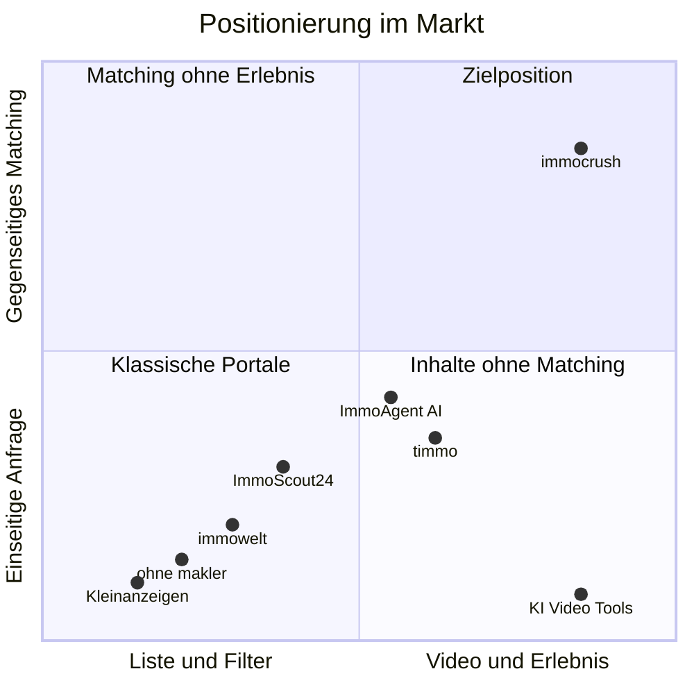

# 02 · Markt & Wettbewerb

> Recherche-Stand: Oktober 2026. Zahlen mit Quelle (siehe unten). Eigene Schätzungen sind als solche markiert.

## 1. Marktgröße

| Kennzahl | Wert | Quelle |
|---|---|---|
| Immobilien-Kaufverträge 2024 (alle Arten) | 805.000, Geldumsatz 247 Mrd. € | AK OGA / BBSR |
| davon Wohnimmobilien | 73 % | AK OGA / BBSR |
| Eigenheime (Ein-/Zweifamilienhäuser, Reihenhäuser, Doppelhaushälften) 2024 | ca. 253.000 (+13 %) | AK OGA |
| Eigentumswohnungen 2024 | ca. 255.600 (+17 %) | AK OGA |
| Kaufverträge 2025 | ca. 872.000 (+8 %), Geldumsatz 278 Mrd. € (+13 %) | BBSR, Juni 2026 |
| davon in Wohnimmobilien investiert 2025 | ca. 198 Mrd. € | BBSR, Juni 2026 |
| Anteil privater Verkaufsangebote, Q1 2026 | 21,1 % (Vorjahr 22,4 %) | Anzeigenanalyse, berichtet September 2026 |
| Anteil privater Verkaufsinserate laut ohne-makler.net | 14–15 % (vor 2,5 Jahren 12–13 %) | ImmoKaiser-Podcast via propgen |
| Maklerquote bei Eigentumswohnungen auf ImmoScout24 | rund zwei Drittel; Köln 54 %, Berlin und Hamburg 69 %, Leipzig 73 % | Sprengnetter, Q1 2026 |

### Einordnung

- Rund **510.000 Wohnungen und Häuser** wechselten 2024 per Kaufvertrag den Besitzer, 2025 waren es mehr. Das ist unser Kernmarkt.
- Grob geschätzt gibt es **80.000–120.000 Privatverkäufe pro Jahr** (eigene Schätzung; Annahme: 15–25 % Privatanteil, der Anteil an Angeboten entspricht ungefähr dem Anteil an Verkäufen). Relevant, aber kein Massenmarkt, der allein trägt.
- Makler bringen 65–80 % der Angebote. **Ohne Makler-Inventar wird kein Feed voll.**
- Der Markt hat sich nach dem Zinsschock erholt (2025: +8 % Kaufverträge, steigende Preise). Gleichzeitig können Eigentümer Wunschpreise vielerorts nicht mehr ohne Weiteres durchsetzen. Der „extreme Käufermarkt“ aus dem Ausgangstext gilt nicht mehr überall, aber Käufer bleiben die umworbene Seite. Die Strategie muss in beiden Marktphasen funktionieren.
- Der Privatanteil schwankt regional stark: Bremen 25,8 %, Niedersachsen 24,3 %, Thüringen 24,1 % gegenüber Brandenburg 13,1 % und Sachsen 14,5 %. Unter den Metropolen hat Köln die niedrigste Maklerquote. Das ist wichtig für die Wahl der Startregion.

## 2. Trends

1. **Video und Social first.** Makler und Creator zeigen Immobilien als Kurzvideos. Reichweite entsteht dort über Follower oder bezahlte Werbung, nicht über Suchkriterien.
2. **KI wird Standard – auch bei den Großen.**
   - **ImmoScout24:** KI-Objektvideos in den Makler-Mitgliedschaften; Gold-Kunden erhalten seit März 2026 in einer Testphase automatisch KI-Videos für neue Kaufinserate. Dazu kommen eine KI-Suche, die Merkmale auf Fotos erkennt (etwa „Holzdielen“), eine App in ChatGPT, der Assistent HeyImmo, eine automatische Vorqualifizierung von Anfragen und „Next Gen Leads“ mit mehr Daten über Interessenten.
   - **immowelt:** Seit Januar 2026 Ein-Marken-Strategie (immonet geht in immowelt auf). Ressourcen fließen in KI-Produkte und regionale Kampagnen in Bayern, Hamburg, Baden-Württemberg und NRW; das Marketingbudget wurde von Performance zu Marke umgeschichtet.
   - **Kleinanzeigen:** Plus-Paket für private Immobilienanzeigen mit KI-Einrichtung.
   - **Spezialwerkzeuge für Makler:** Pedra (ab 29 €/Monat, nach eigenen Angaben 30.000+ Makler), marton.ai, StagingVision, IACrea (ab 20 €/Monat netto), BetterSpace, Momenzo, Nodalview.
3. **Swipe und Matching kommen an.** timmo (seit April 2026, Kapitalanlage-Immobilien per Swipe, mit Berater bis zum Notar), ImmoAgent.AI (KI-Swipe mit Match-Score über Inserate aus 50+ Quellen), ImmoCrush aus Frankreich (Swipe für Neubauprojekte, „Das Tinder für Neubauimmobilien“).
4. **Privatverkauf professionalisiert sich.** ohne-makler.net vermarktet rund 8.500 Objekte, hat sein Team auf 14 Personen verdoppelt und expandiert nach Österreich, Tschechien und in die Slowakei. Evorimo bietet ein Monatsmodell mit Besichtigungsbuchung, Interessenten-Qualifizierung, Dokumentenfreigabe und KI-Assistent.
5. **Regulierung zieht an.** KI-Verordnung (Kennzeichnung von KI-Inhalten seit 2. August 2026), Gebäudeenergiegesetz (Pflichtangaben in Anzeigen), DSGVO, Digital Services Act. Wer das sauber löst, gewinnt Vertrauen.
6. **Generationenwechsel.** Viele Immobilien werden in den kommenden Jahren vererbt. Erben wohnen oft weit entfernt und brauchen einfache, digitale Wege zum Verkauf.

## 3. Wettbewerber im Detail

| Anbieter | Modell | Für Privatverkäufer | KI & Video | Matching | Was wir daraus lernen |
|---|---|---|---|---|---|
| **ImmoScout24** (Scout24, seit 1998) | Marktführer, Erlöse vor allem aus Makler-Mitgliedschaften | kostenpflichtig (Ausnahme: Nachmietersuche mit Basisanzeige) | KI-Videos für Makler, KI- und Bildsuche, ChatGPT-App, HeyImmo | einseitig (Suchauftrag + Anfrage), Vorqualifizierung von Anfragen | Bewegt sich bei KI schnell. Gehört seit 2023 auch Sprengnetter (Bewertungsdaten). Nicht über Funktionen angreifen, sondern über Erlebnis und Käuferseite. |
| **immowelt** (AVIV Group: KKR & CPP, Minderheit Axel Springer; seit 1996) | Nr. 2, seit 2026 eine Marke | kostenpflichtig | KI-Fokus angekündigt | einseitig | Investiert in Marke, will das „verstaubte“ Image loswerden. |
| **Kleinanzeigen** (seit 2009) | Kleinanzeigenmarkt, Immobilien wachsen | bis 2 Inserate gleichzeitig kostenlos; Plus ab 12,99 € für 14 Tage | KI-Einrichtung im Plus-Paket | keins | „Kostenlos“ ist kein Alleinstellungsmerkmal. Schwächen: kaum Qualifizierung, Betrugsrisiko. |
| **ohne-makler.net** (seit 2007) | Sammelbuchung auf Portale | 129–399 € pro Verkaufsinserat; Full-Service „OM-Premium“ 3.999 € | Wertermittlung, Statistiken | keins | Zahlungsbereitschaft ist da – für Reichweite. Unser Angebot: Reichweite plus passende Käufer, in der Basis kostenlos. |
| **Evorimo** | Monatsabo, volle Reichweite ab 169 €/Monat | kostenpflichtig | KI-Assistent | Interessenten-Qualifizierung | Qualifizierung und Besichtigungsbuchung sind gefragt. |
| **timmo** | Swipe-App nur für Kapitalanlagen, kuratiert, mit § 34c-Erlaubnis | – | – | Swipe, Like-Liste, persönlicher Berater | Swipe funktioniert als Entdeckungsform. Kapitalanleger sind besetzt, für uns ein Zweitsegment. |
| **ImmoAgent.AI** | KI-Swipe über Inserate aus 50+ Quellen | – | KI-Match-Score mit Begründung | einseitig, lernt aus Swipes und Absagegründen | Eine reine Käuferseite ist leicht kopierbar. Fremde Inserate sind rechtlich heikel und nicht exklusiv. |
| **ImmoCrush** (Frankreich, VefaDirect) | App für Neubauprojekte in Frankreich und international | – | KI-Kompatibilitäts-Score | Swipe | **Gleicher Name, ähnliches Prinzip.** Noch winzig (10+ Downloads), aber Markenfrage klären. |
| **KI-Werkzeuge** (Pedra, marton.ai, StagingVision, IACrea u. a.) | Software-Abo für Makler | teilweise | Kernprodukt | – | Das KI-Studio ist für uns Mittel zum Zweck. Spezialfunktionen (z. B. Home Staging) können wir per API zukaufen. |
| **Social Media** | Aufmerksamkeit | – | – | – | Konkurrent um Zeit und zugleich wichtigster Verbreitungskanal für unsere Videos. |

## 4. Positionierung

**Unsere Lücke:** Kein Anbieter verbindet

1. **eigenes Inventar** von Privatverkäufern und Maklern, statt fremde Inserate einzusammeln,
2. **gegenseitiges Matching** mit Käufer-Steckbriefen,
3. ein **Video-first-Erlebnis** mit Lebensgefühl-Daten und
4. ein **kostenloses KI-Studio** für Privatverkäufer.

## 5. Was uns schwer kopierbar macht

Funktionen lassen sich kopieren. Schwer kopierbar sind:

1. **Der Käufer-Graph:** tiefe, freiwillig gegebene und teils verifizierte Profile plus Swipe-Verhalten. Er beantwortet die Frage: Was wollen Menschen wirklich, und was können sie bezahlen? Je länger wir laufen, desto größer wird der Vorsprung.
2. **Gegenseitiges Matching als Geschäftslogik:** Die großen Portale verdienen an Anfragen und an Sichtbarkeit für Makler. Ein Modell, in dem Verkäufer bewusst weniger, aber bessere Kontakte bekommen, passt schlecht zu ihrem Erlösmodell – das klassische Innovator's Dilemma.
3. **Lokale Netzwerkeffekte:** Wer in einer Region die meisten aktiven, qualifizierten Käufer hat, zieht die Angebote an – und umgekehrt.
4. **Marke und Community:** eine Marke, die sich nach Verlieben anfühlt statt nach Behörde, und Creator, die mit uns Inhalte machen.
5. **Makler-Integrationen:** Wer in der Makler-Software als Portal angebunden ist, bekommt Inventar automatisch.

## 6. SWOT

| Stärken | Schwächen |
|---|---|
| Maklerwissen im Gründerteam | noch keine Reichweite und keine Marke |
| klares, emotionales Konzept | Henne-Ei-Problem eines Marktplatzes |
| gegenseitiges Matching als echter Unterschied | begrenztes Budget gegenüber Konzernen |
| schlanke, moderne Technik ohne Altlasten | Name rechtlich ungeklärt |

| Chancen | Risiken |
|---|---|
| Käufer sind umworben – wer sie hat, gewinnt | ImmoScout24 oder immowelt kopieren Swipe und Video |
| KI senkt Produktionskosten drastisch | Datenschutz- oder Diskriminierungsvorwürfe |
| Erben und Privatverkäufer brauchen einfache Werkzeuge | hohe Kosten für Nutzergewinnung |
| Markt-Insights als zweites Standbein | Rechtsrisiken bei KI-Bildern (Irreführung) |
| Exit-Optionen: Portale, Banken, internationale Gruppen | Betrug und Fake-Inserate schaden dem Vertrauen |

## 7. Wie reagieren die Großen – und was dann?

- **Wahrscheinlich:** ImmoScout24 baut einen Swipe-Modus in die App, immowelt zieht nach. Das bestätigt den Trend, bringt aber noch kein gegenseitiges Matching und keine Käufer-Steckbriefe.
- **Unsere Antwort:** Tempo, Fokus auf die Käuferseite, Dichte Region für Region, eine Marke für eine jüngere Zielgruppe. Wir konkurrieren nicht über die Menge an Inseraten, sondern über Passung.
- **Exit-Perspektive:** Plausible Käufer wären Scout24, AVIV/immowelt, Kleinanzeigen bzw. Adevinta, internationale Portalgruppen (CoStar wird Interesse am deutschen Markt nachgesagt), Banken oder Baufinanzierer. Wertbestimmend ist der Käufer-Graph.

## Quellen

- AK OGA: [Immobilienmarktbericht Deutschland 2025](https://redaktion-akoga.niedersachsen.de/download/224020/Immobilienmarktbericht_Deutschland_2025.pdf) (Berichtsjahr 2024)
- BBSR: [Immobilienumsätze 2024 steigen leicht](https://www.bbsr.bund.de/BBSR/DE/presse/presseinformationen/2025/immobilienmarktanalyse-gutachterausschuss-2024.html) (August 2025)
- BBSR: [198 Milliarden Euro flossen 2025 in den Kauf von Wohnimmobilien](https://www.bbsr.bund.de/BBSR/DE/presse/presseinformationen/2026/immobilienmarktanalyse-gutachterausschuesse.html) (Juni 2026)
- Wohnträume: [Immobilienverkäufer setzen vermehrt auf Makler](https://www.wohn-traeume.com/news/immobilienverkaeufer-setzen-vermehrt-auf-makler) (September 2026)
- propgen: [Was der Privatverkäufermarkt Maklern verrät](https://propgen.de/perspektiven/privatverkaeufermarkt-2026) (2026)
- Sprengnetter: Maklerquote Q1 2026 (Pressemitteilung, Mai 2026)
- ohne-makler.net: [Preise](https://www.ohne-makler.net/preise/), [Welches Immobilienportal?](https://www.ohne-makler.net/haeufige-fragen/welches-immobilienportal/)
- Evorimo: [Vergleich mit ohne-makler.net](https://www.evorimo.de/vergleich/ohne-makler-net/) (Oktober 2026)
- Kleinanzeigen: [Gebühren](https://hilfe.kleinanzeigen.de/hc/de/articles/17087642921628-Geb%C3%BChren-bei-Kleinanzeigen), [Pakete für private Immobilienanzeigen](https://hilfe.kleinanzeigen.de/hc/de/articles/28175620811804-Pakete-f%C3%BCr-private-Immobilienanzeigen)
- ImmoScout24: [Mitgliedschaften 2026](https://www.immobilienscout24.de/anbieten/gewerbliche-anbieter/lp/mitgliedschaften-2026.html), [KI-Videos für Gold-Kunden](https://www.linkedin.com/posts/isabelle-baumann-berlin_excited-to-share-that-we-have-launched-exclusive-activity-7442253915833925632-3Nq9), [ImmoScout24 in ChatGPT](https://www.scout24.com/news-medien/news/detail/deutschlands-fuehrende-immobilienplattform-kommt-zu-chatgpt)
- immowelt: [Ein-Marken-Strategie](https://www.immowelt.de/ueberuns/presse/pressemitteilungenkontakt/aviv-germany-gmbh/2026/fokus-auf-wachstum-immowelt-buendelt-kraefte-unter-neuem-management-powerhouse/) (Januar 2026), [Meedia-Interview zur Kampagne](https://meedia.de/news/beitrag/21744-das-tut-immowelt-gegen-den-als-muehsam-und-verstaubt-empfundenen-immobilienmarkt.html)
- timmo: [timmoapp.de](https://timmoapp.de/), [Pressemitteilung](https://www.openpr.de/news/1311695/Swipe-Like-Eigentuemer-timmo-bringt-Kapitalanlage-Immobilien-aufs-Smartphone.html)
- ImmoAgent.AI: [Objekt-Swipe & KI-Matching](https://immoagent.ai/features/swipe-matching)
- ImmoCrush (FR): [Google Play](https://play.google.com/store/apps/details?id=com.immocrush.app&hl=de)
- KI-Werkzeuge: [Pedra](https://pedra.ai/de), [Pedra-Vergleich KI-Video-Tools](https://pedra.ai/de/blog/beste-ki-video-tools-immobilien), [marton.ai](https://www.marton.ai/), [IACrea](https://www.iacrea.com/de/funktion/immobilien-videobearbeitung)
- CoStar und Europa: [Joreca-Analyse](https://www.joreca.com/post/what-path-forward-for-costar-in-europe)
