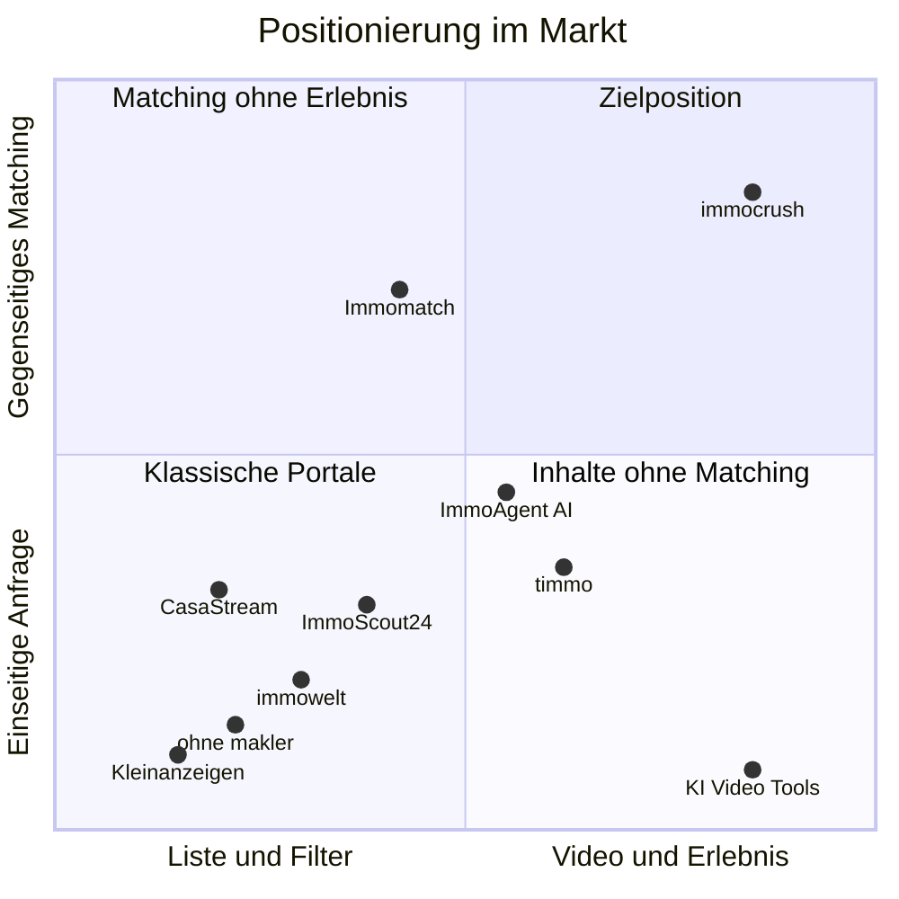

# 02 · Markt & Wettbewerb

> Recherche-Stand: Oktober 2026, aktualisiert am 18.10.2026 um Miete, neue Wettbewerber und die Einschätzung der Gründer. Zahlen mit Quelle (siehe unten). Eigene Schätzungen sind als solche markiert.

## 1. Marktgröße

### Kauf

| Kennzahl | Wert | Quelle |
|---|---|---|
| Immobilien-Kaufverträge 2024 (alle Arten) | 805.000, Geldumsatz 247 Mrd. € | AK OGA / BBSR |
| davon Wohnimmobilien | 73 % | AK OGA / BBSR |
| Eigenheime (Ein-/Zweifamilienhäuser, Reihenhäuser, Doppelhaushälften) 2024 | ca. 253.000 (+13 %) | AK OGA |
| Eigentumswohnungen 2024 | ca. 255.600 (+17 %) | AK OGA |
| Kaufverträge 2025 | ca. 872.000 (+8 %), Geldumsatz 278 Mrd. € (+13 %) | BBSR, Juni 2026 |
| davon in Wohnimmobilien investiert 2025 | ca. 198 Mrd. € | BBSR, Juni 2026 |
| Anteil privater Verkaufsangebote, Q1 2026 | 21,1 % (Vorjahr 22,4 %) | Anzeigenanalyse, berichtet September 2026 |
| Anteil privater Verkaufsinserate laut ohne-makler.net | 14–15 % (vor 2,5 Jahren 12–13 %) | ImmoKaiser-Podcast via propgen |
| Maklerquote bei Eigentumswohnungen auf ImmoScout24 | rund zwei Drittel; Köln 54 %, Berlin und Hamburg 69 %, Leipzig 73 % | Sprengnetter, Q1 2026 |

### Miete

| Kennzahl | Wert | Quelle |
|---|---|---|
| Mietquote | 52,8 % der Bevölkerung wohnen zur Miete, rund 44,1 Mio. Menschen in mehr als 20 Mio. Haushalten – höchster Wert in der EU | Deutscher Mieterbund, Mietenreport 2026; Destatis/Eurostat |
| Umzüge | 7,5–9 Mio. Menschen ziehen jedes Jahr innerhalb Deutschlands um (Faustregel: 10 % der Bevölkerung) | Deutsche Post Adress, Umzugsstudie 2024 |
| Nachfrage nach Mietwohnungen | Auf die meistgesuchten Mietwohnungen bewerben sich im Schnitt pro Tag: Berlin 373, Hamburg 277, München 237, Köln 193, Karlsruhe 130 Mietsuchende; bundesweit 22 | ImmoScout24, Auswertung Q1 2024 |
| Neubau | 2025 wurden 206.600 Wohnungen fertiggestellt (−18 %); für 2026 erwartet der GdW rund 200.000 bei einem Bedarf von rund 320.000 pro Jahr | Destatis via ZDB; GdW, 2026 |
| Fehlende Wohnungen | rund 1,4 Mio. | Deutscher Mieterbund, Mietenreport 2026 |

### Einordnung

- **Kauf ist der Werte-Markt:** Rund 510.000 Wohnungen und Häuser wechselten 2024 per Kaufvertrag den Besitzer, 2025 waren es mehr. Hier entstehen die wertvollsten Extras und Partner-Umsätze (Finanzierung, Versicherung, Einrichtung).
- **Miete ist der Massenmarkt:** Mehr als 20 Mio. Mieterhaushalte, Millionen Umzüge pro Jahr. Eigene grobe Schätzung: **1–2 Mio. neue Mietverträge pro Jahr** (Annahme: 5–10 % der Mieterhaushalte wechseln jährlich). Miete bringt Reichweite, und Reichweite bringt Werbeeinnahmen.
- **Der Mietmarkt bleibt angespannt:** Zu wenig Neubau, Hunderte Bewerbungen auf begehrte Wohnungen. Das Problem, das wir lösen (Vorsortierung für Vermieter, faire Chancen für Mietsuchende), wird in den nächsten Jahren eher größer.
- **Private Anbieter:** Grob geschätzt gibt es **80.000–120.000 Privatverkäufe pro Jahr** (eigene Schätzung; Annahme: 15–25 % Privatanteil). Die Beobachtung der Gründer, dass es „mehr und mehr Angebote von Privat“ gibt, passt zu den Zahlen von ohne-makler.net (Anstieg von 12–13 % auf 14–15 %) und zum wachsenden Markt. Der Anteil an allen Angeboten ist laut Anzeigenanalysen aber eher stabil.
- **Makler bringen 65–80 % der Angebote.** Ohne Makler-Inventar wird kein Feed voll. Deshalb ist es richtig, dass das Basisangebot auch für Makler und Bauträger kostenlos ist.
- **Der Markt hat sich erholt** (2025: +8 % Kaufverträge, steigende Preise). Käufer bleiben vielerorts die umworbene Seite, Mieter in den Städten die bedrängte. Die Strategie muss in beiden Lagen funktionieren.
- **Regionale Unterschiede:** Der Privatanteil bei Verkäufen ist in Bremen (25,8 %), Niedersachsen (24,3 %) und Thüringen (24,1 %) am höchsten, in Brandenburg (13,1 %) und Sachsen (14,5 %) am niedrigsten. Unter den Metropolen hat Köln die niedrigste Maklerquote. Der Mietdruck ist in Berlin, Hamburg, München und Köln am größten. Beides zählt für die Wahl der Fokusstädte.

## 2. Trends

1. **Video und Social first.** Makler und Creator zeigen Immobilien als Kurzvideos. Reichweite entsteht dort über Follower oder bezahlte Werbung, nicht über Suchkriterien. Es gibt also viele fertige Immobilienfilme, die in den Portalen kaum Platz finden.
2. **KI wird Standard – auch bei den Großen.**
   - **ImmoScout24:** KI-Objektvideos in den Makler-Mitgliedschaften; Gold-Kunden erhalten seit März 2026 in einer Testphase automatisch KI-Videos für neue Kaufinserate. Dazu kommen eine KI-Suche, die Merkmale auf Fotos erkennt (etwa „Holzdielen“), eine App in ChatGPT, der Assistent HeyImmo, eine automatische Vorqualifizierung von Anfragen und „Next Gen Leads“ mit mehr Daten über Interessenten.
   - **immowelt:** Seit Januar 2026 Ein-Marken-Strategie (immonet geht in immowelt auf). Ressourcen fließen in KI-Produkte und regionale Kampagnen in Bayern, Hamburg, Baden-Württemberg und NRW; das Marketingbudget wurde von Performance zu Marke umgeschichtet.
   - **Kleinanzeigen:** Plus-Paket für private Immobilienanzeigen mit KI-Einrichtung.
   - **Spezialwerkzeuge für Makler:** Pedra (ab 29 €/Monat, nach eigenen Angaben 30.000+ Makler), marton.ai, StagingVision, IACrea (ab 20 €/Monat netto), BetterSpace, Momenzo, Nodalview.
3. **Suchende sollen zahlen.** ImmoScout24 verkauft Suchenden das Abo „Suchen+“: Für Miete kostet es je nach Stufe und Laufzeit 12,99–39,99 € im Monat, für Kauf 24,99–39,99 € im Monat. Wichtigster Vorteil laut ImmoScout24: Die Nachricht landet oben im Postfach der Anbieter, exklusive Anzeigen sieht man früher. Wer zahlt, wird also eher gelesen.
4. **Swipe und Matching tauchen auf, aber ohne Durchbruch.** Immomatch (Österreich, Mietwohnungen, inzwischen praktisch eingestellt), timmo (seit April 2026, Kapitalanlage-Immobilien per Swipe), ImmoAgent.AI (KI-Swipe über fremde Inserate), ImmoCrush aus Frankreich (Swipe für Neubauprojekte). Keiner hat nennenswerte Reichweite.
5. **Privatverkauf professionalisiert sich.** ohne-makler.net vermarktet rund 8.500 Objekte, hat sein Team auf 14 Personen verdoppelt und expandiert nach Österreich, Tschechien und in die Slowakei. Evorimo bietet ein Monatsmodell mit Besichtigungsbuchung, Interessenten-Qualifizierung, Dokumentenfreigabe und KI-Assistent.
6. **Regulierung zieht an.** KI-Verordnung (Kennzeichnung von KI-Inhalten seit 2. August 2026), Gebäudeenergiegesetz (Pflichtangaben in Anzeigen), DSGVO, Digital Services Act. Für die Vermietung haben die Datenschutzbehörden im Januar 2026 neu festgelegt, was Vermieter wann fragen dürfen. Wer das sauber löst, gewinnt Vertrauen.
7. **Generationenwechsel.** Viele Immobilien werden in den kommenden Jahren vererbt. Erben wohnen oft weit entfernt und brauchen einfache, digitale Wege zum Verkauf oder zur Vermietung.

## 3. Wettbewerber

> „Wir orientieren uns an Immoscout und Immowelt, ggf auch Kleinanzeigen. Es gibt kein anderes relevantes Portal darüber hinaus.“ – Gründer, 18.10.2026

Die Recherche bestätigt das: Relevant für Reichweite sind nur die großen drei. Alle anderen sind Dienstleister, Nischen oder Versuche ohne Reichweite.

### 3.1 Der Maßstab: ImmoScout24, immowelt, Kleinanzeigen

| Anbieter | Modell | Für private Anbieter | Für Suchende | KI & Video | Was wir übernehmen | Wo wir anders sind |
|---|---|---|---|---|---|---|
| **ImmoScout24** (Scout24, seit 1998) | Marktführer, Erlöse vor allem aus Makler-Mitgliedschaften | kostenpflichtig (Ausnahme: Nachmietersuche mit Basisanzeige) | kostenlos, dazu Bezahl-Abo „Suchen+“ (Nachricht oben im Postfach, früherer Zugang) | KI-Videos für Makler, KI- und Bildsuche, ChatGPT-App, HeyImmo | Exposé-Struktur, Filter, Suchaufträge, Makler-Schnittstellen, Bewerbermappe | niemand kauft sich nach vorn; Filme im Vollbild; kostenlos für Anbieter |
| **immowelt** (AVIV Group: KKR & CPP, Minderheit Axel Springer; seit 1996) | Nr. 2, seit 2026 eine Marke | kostenpflichtig | kostenlos, kein Bezahl-Abo | KI-Fokus angekündigt | Funktionsumfang, regionale Markenkampagnen | Erlebnis statt Liste, Steckbrief statt Kontaktformular |
| **Kleinanzeigen** (seit 2009) | Kleinanzeigenmarkt, Immobilien wachsen | bis 2 Inserate gleichzeitig kostenlos; Plus ab 12,99 € für 14 Tage | kostenlos | KI-Einrichtung im Plus-Paket | **das Erlösmodell:** kostenlos im Kern, bezahlte Extras, Werbung | Qualität, Video, Matching, Schutz vor Betrug |

**Was daraus folgt:** ImmoScout24 und immowelt sind das Vorbild für Struktur und Funktionsumfang, Kleinanzeigen für das Erlösmodell. Unser Unterschied liegt nicht in mehr Funktionen, sondern im Erlebnis (Filme, Unterhaltung), in der Fairness (Steckbrief, kein Vorrang gegen Geld) und im Preis für Anbieter (kostenlos, auch gewerblich).

### 3.2 Dienstleister für Privatanbieter

| Anbieter | Modell | Preise | Einschätzung |
|---|---|---|---|
| **ohne-makler.net** (seit 2007) | schaltet Inserate gesammelt auf ImmoScout24, immowelt, Kleinanzeigen und weiteren Portalen | Verkauf 129–399 €, Miete 49–229 € je nach Paket und Laufzeit; Full-Service „OM-Premium“ 3.999 € | Zahlungsbereitschaft privater Anbieter ist da – für Reichweite. Die Seite ist laut Gründer „echt boring“. Bei uns gibt es Reichweite kostenlos, dazu passende Interessenten. |
| **Evorimo** | Monatsabo | volle Reichweite ab 169 € im Monat | Qualifizierung und Besichtigungsbuchung sind gefragt. |

### 3.3 Neue Ansätze – bisher ohne Reichweite

| Anbieter | Was | Stand | Was wir daraus lernen |
|---|---|---|---|
| **Immomatch** (Wien) | Swipe-App für Mietwohnungen und WG-Zimmer in Wien und Salzburg; Mieter und Vermieter wischen gegenseitig, Vermieter erhalten Mieter-Steckbriefe; nur Private, Makler ausgeschlossen; kostenlos, finanziert über Werbung | Start Juni 2021 mit Platz 12 in den österreichischen App-Charts; Android-App seit Dezember 2024 nicht mehr bei Google Play (zuletzt rund 4.600 Downloads, letztes Update August 2022); eine ImmoMatch GmbH ist laut österreichischem Firmenbuch seit 2023 in Liquidation und wurde 2025 gelöscht. Laut Gründer-Recherche ist heute nur noch eine „langweilige“ Demo zu sehen. | Die Idee des gegenseitigen Matchings mit Steckbriefen funktioniert als Aufmerksamkeitsmagnet. **Kostenlos plus Werbung trägt aber nur mit großem Inventar und Reichweite** – ohne Makler, ohne Video und regional begrenzt reichte es nicht. |
| **CasaStream** (casastream.de) | Portal für Kauf und Miete mit KI-Marktanalyse, Bewertung, Finanzierungs- und Investitionsrechnern, Klima-Analyse; Basisnutzung kostenlos, Bezahlpläne für mehr Inserate und Werkzeuge | laut Gründer-Recherche wenige aktive Angebote, „nicht wirklich gut gemacht“, keine Filme | Daten-Werkzeuge allein ziehen keine Nutzer an. Trotz des Namens kein Video. |
| **timmo** | Swipe-App nur für Kapitalanlagen, kuratiert, mit § 34c-Erlaubnis und Berater bis zum Notar | seit April 2026 | Kapitalanleger sind besetzt, für uns ein Zweitsegment. |
| **ImmoAgent.AI** | KI-Swipe über Inserate aus 50+ Quellen, Match-Score mit Begründung | – | Eine reine Suchenden-Seite mit fremden Inseraten ist leicht kopierbar und rechtlich heikel. |
| **ImmoCrush** (Frankreich, VefaDirect) | App für Neubauprojekte | 10+ Downloads | **Gleicher Name, ähnliches Prinzip.** Noch winzig, aber Markenfrage klären (siehe [Marke](06-marke-name-und-domains.md)). |

### 3.4 Weitere Konkurrenz um Aufmerksamkeit

| Anbieter | Rolle | Was wir daraus lernen |
|---|---|---|
| **KI-Werkzeuge** (Pedra, marton.ai, StagingVision, IACrea u. a.) | Software-Abo für Makler | Der Producer-Bereich ist für uns Mittel zum Zweck. Spezialfunktionen wie Home Staging können wir per Schnittstelle zukaufen. |
| **Instagram, TikTok, YouTube** | Konkurrent um Zeit und Aufmerksamkeit | Zugleich wichtigster Verbreitungskanal: Dort entstehen die Filme, die Anbieter bei uns hochladen, und dorthin teilen wir zurück. Unser Vorteil: Suchkriterien, Fakten, Matching. |

## 4. Was wir von den Großen übernehmen – und was wir anders machen

| Bereich | Übernehmen wir | Machen wir anders |
|---|---|---|
| Inserat | alle Standardfelder, Pflichtangaben, vollständiges Exposé | Film im Vollbild als Herzstück; vorhandene Videos hochladen oder per KI erstellen |
| Suche | Filter, Liste, Karte, Merkliste | Swipe-Feed als Hauptansicht in der App; Lebensgefühl-Kriterien statt nur Hardfacts |
| Benachrichtigungen | Suchauftrag per E-Mail und Push | „Matches“ statt „neue Angebote“: nur, was wirklich passt, mit Begründung |
| Kontakt | Nachricht an den Anbieter | Steckbrief, gegenseitiges Matching, Reihenfolge nach Passung statt nach Tempo oder Abo |
| Vermietung | Bewerbermappe | Steckbrief in drei Stufen nach den Regeln der Datenschutzbehörden; Anfrage-Bremse statt Inserat offline nehmen |
| Makler | Import aus der Makler-Software, Statistiken | kostenlos; Videos sichtbar; Kanal mit Followern; Käufer-Radar |
| Erlöse | bezahlte Extras wie bei Kleinanzeigen | keine Abos für Suchende; Werbung rund ums Wohnen statt beliebiger Banner |
| Unterhaltung | – | Themen-Feeds, „Preis raten“, Duelle: ein Grund, auch ohne Suche vorbeizuschauen |

## 5. Positionierung

**Unsere Lücke:** Kein Anbieter verbindet

1. **kostenloses Inserieren für alle Anbieter**, auch für Makler und Bauträger,
2. **Filme im Vollbild und Unterhaltung**, die man sich auch ohne Suche ansieht,
3. **gegenseitiges Matching mit Steckbriefen** für Kauf und Miete,
4. einen **Producer-Bereich**, in dem man vorhandene Videos hochlädt oder mit KI neue erstellt, und
5. **eigenes Inventar** von privaten und gewerblichen Anbietern, statt fremde Inserate einzusammeln.

## 6. Was uns schwer kopierbar macht

Funktionen lassen sich kopieren. Schwer kopierbar sind:

1. **Der Suchenden-Graph:** tiefe, freiwillig gegebene Profile plus Swipe-Verhalten. Er beantwortet die Frage: Was wollen Menschen wirklich, und was können sie bezahlen? Je länger wir laufen, desto größer wird der Vorsprung.
2. **Ein Geschäftsmodell, das die Großen nicht kopieren wollen:** ImmoScout24 verdient an Maklern, die für Sichtbarkeit zahlen, und an Suchenden, die für Vorrang zahlen. Kostenloses Inserieren für Makler und „niemand kauft sich nach vorn“ würden beide Erlösquellen beschädigen – das klassische Innovator's Dilemma.
3. **Lokale Netzwerkeffekte:** Wer in einer Region die meisten aktiven Suchenden hat, zieht die Angebote an – und umgekehrt.
4. **Marke und Community:** eine Marke, die sich nach Verlieben anfühlt statt nach Behörde, Creator, die mit uns Inhalte machen, und Makler-Kanäle mit Followern.
5. **Makler-Integrationen:** Wer in der Makler-Software als Portal angebunden ist, bekommt Inventar automatisch.

## 7. SWOT

| Stärken | Schwächen |
|---|---|
| Maklerwissen im Gründerteam | noch keine Reichweite und keine Marke |
| klares, emotionales Konzept | Henne-Ei-Problem eines Marktplatzes |
| kostenlos für alle Anbieter, auch gewerbliche | Werbemodell braucht sehr viel Reichweite |
| gegenseitiges Matching und Fairness als echter Unterschied | begrenztes Budget ohne Investoren |
| Unterhaltung macht unabhängig vom Suchzeitpunkt | Name rechtlich ungeklärt |
| schlanke, moderne Technik ohne Altlasten | |

| Chancen | Risiken |
|---|---|
| Mietmarkt in Not: Vermieter und Mietsuchende brauchen eine bessere Lösung | ImmoScout24 oder immowelt kopieren Swipe und Video |
| Unmut über Bezahl-Abos für Suchende | Datenschutz- oder Diskriminierungsvorwürfe, besonders bei Vermietung |
| Umzug ist ein starker Kaufanlass: Werbekunden rund ums Wohnen zahlen für den richtigen Moment | hohe Kosten für Nutzergewinnung, Vollgas-Marketing ohne Investoren |
| KI senkt Produktionskosten drastisch | Werbeeinnahmen bleiben unter Plan |
| Erben und Privatanbieter brauchen einfache Werkzeuge | Rechtsrisiken bei KI-Bildern und hochgeladenen Videos (Irreführung, Musikrechte) |
| Markt-Insights als weiteres Standbein | Betrug und Fake-Inserate schaden dem Vertrauen |

## 8. Wie reagieren die Großen – und was dann?

- **Wahrscheinlich:** ImmoScout24 baut einen Swipe- oder Video-Modus in die App, immowelt zieht nach. Das bestätigt den Trend, bringt aber kein gegenseitiges Matching, keine Steckbriefe und kein kostenloses Inserieren für Makler.
- **Unsere Antwort:** Tempo, Fokus auf die Suchenden, Fairness als Marke, Unterhaltung, Dichte in den Fokusstädten. Wir konkurrieren nicht über die Menge an Inseraten, sondern über Passung und Erlebnis.
- **Exit-Perspektive:** Auch wenn die Gründer keine Investoren wollen, ist gut zu wissen, wer später kaufen könnte: Scout24, AVIV/immowelt, Kleinanzeigen bzw. Adevinta, internationale Portalgruppen (CoStar wird Interesse am deutschen Markt nachgesagt), Banken oder Baufinanzierer. Wertbestimmend sind der Suchenden-Graph und die Reichweite.

## Quellen

- AK OGA: [Immobilienmarktbericht Deutschland 2025](https://redaktion-akoga.niedersachsen.de/download/224020/Immobilienmarktbericht_Deutschland_2025.pdf) (Berichtsjahr 2024)
- BBSR: [Immobilienumsätze 2024 steigen leicht](https://www.bbsr.bund.de/BBSR/DE/presse/presseinformationen/2025/immobilienmarktanalyse-gutachterausschuss-2024.html) (August 2025)
- BBSR: [198 Milliarden Euro flossen 2025 in den Kauf von Wohnimmobilien](https://www.bbsr.bund.de/BBSR/DE/presse/presseinformationen/2026/immobilienmarktanalyse-gutachterausschuesse.html) (Juni 2026)
- Wohnträume: [Immobilienverkäufer setzen vermehrt auf Makler](https://www.wohn-traeume.com/news/immobilienverkaeufer-setzen-vermehrt-auf-makler) (September 2026)
- propgen: [Was der Privatverkäufermarkt Maklern verrät](https://propgen.de/perspektiven/privatverkaeufermarkt-2026) (2026)
- Sprengnetter: Maklerquote Q1 2026 (Pressemitteilung, Mai 2026)
- Deutscher Mieterbund: [Mietenreport 2026](https://mieterbund.de/aktuelles/meldungen/mietenreport-2026-wohnungskrise-wird-zur-sozialstaatskrise/) (September 2026); Destatis: [Deutschland ist Mieterland Nummer 1](https://www.destatis.de/Europa/DE/Thema/Bevoelkerung-Arbeit-Soziales/Soziales-Lebensbedingungen/Mieteranteil.html) (April 2026)
- Deutsche Post Adress: [Umzugsstudie 2024](https://postadress.de/umzugsstudie.pdf)
- ImmoScout24: [Die meistgesuchte Mietwohnung Deutschlands](https://www.immobilienscout24.de/unternehmen/news-medien/news/default-title/die-meistgesuchte-mietwohnung-deutschlands-2024/) (Auswertung Q1 2024)
- ZDB: [Wohnungsneubau 2025 auf niedrigstem Stand seit über einem Jahrzehnt](https://www.zdb.de/meldungen/wohnungsneubau-2025-fertigstellungen-auf-niedrigstem-stand-seit-ueber-einem-jahrzehnt-baugewerbe-warnt-vor-weiterem-einbruch-2026); GdW: [Wohnungswirtschaft warnt vor Neubau-Kollaps](https://www.gdw.de/pressecenter/pressemeldungen/wohnungswirtschaft-warnt-vor-neubau-kollaps-wohn-investitionen-wandern-immer-staerker-in-den-bestand-statt-in-den-neubau/) (2026)
- ImmoScout24 Suchen+: [für Miete](https://www.immobilienscout24.de/suchende/suchenplus-mitgliedschaft-mieten.html), [für Kauf](https://www.immobilienscout24.de/premium-mitgliedschaft-kauf/leistungen.html); Preisübersicht: [Wohnticker](https://wohnticker.de/ratgeber/immoscout-mieterplus-kosten) (Stand September 2026)
- ohne-makler.net: [Preise](https://www.ohne-makler.net/preise/), [Welches Immobilienportal?](https://www.ohne-makler.net/haeufige-fragen/welches-immobilienportal/)
- Evorimo: [Vergleich mit ohne-makler.net](https://www.evorimo.de/vergleich/ohne-makler-net/) (Oktober 2026)
- Kleinanzeigen: [Gebühren](https://hilfe.kleinanzeigen.de/hc/de/articles/17087642921628-Geb%C3%BChren-bei-Kleinanzeigen), [Pakete für private Immobilienanzeigen](https://hilfe.kleinanzeigen.de/hc/de/articles/28175620811804-Pakete-f%C3%BCr-private-Immobilienanzeigen)
- ImmoScout24: [Mitgliedschaften 2026](https://www.immobilienscout24.de/anbieten/gewerbliche-anbieter/lp/mitgliedschaften-2026.html), [KI-Videos für Gold-Kunden](https://www.linkedin.com/posts/isabelle-baumann-berlin_excited-to-share-that-we-have-launched-exclusive-activity-7442253915833925632-3Nq9), [ImmoScout24 in ChatGPT](https://www.scout24.com/news-medien/news/detail/deutschlands-fuehrende-immobilienplattform-kommt-zu-chatgpt)
- immowelt: [Ein-Marken-Strategie](https://www.immowelt.de/ueberuns/presse/pressemitteilungenkontakt/aviv-germany-gmbh/2026/fokus-auf-wachstum-immowelt-buendelt-kraefte-unter-neuem-management-powerhouse/) (Januar 2026), [Meedia-Interview zur Kampagne](https://meedia.de/news/beitrag/21744-das-tut-immowelt-gegen-den-als-muehsam-und-verstaubt-empfundenen-immobilienmarkt.html)
- Immomatch: [Heute.at zum Start](https://www.heute.at/s/mit-dieser-app-wischt-man-sich-zur-traumwohnung-100148888) (Juni 2021), [Leadersnet-Interview](https://www.leadersnet.at/news/57225,wir-wollen-die-wohnungsvermittlung-revolutionieren.html), [App-Statistik](https://chrome-stats.com/d/com.ruma.immomatch), [Firmenbuch-Eintrag](https://www.wirtschaft.at/u/545978i)
- CasaStream: [Über uns](https://www.casastream.de/ueber-uns), [FAQ](https://www.casastream.de/faq)
- timmo: [timmoapp.de](https://timmoapp.de/), [Pressemitteilung](https://www.openpr.de/news/1311695/Swipe-Like-Eigentuemer-timmo-bringt-Kapitalanlage-Immobilien-aufs-Smartphone.html)
- ImmoAgent.AI: [Objekt-Swipe & KI-Matching](https://immoagent.ai/features/swipe-matching)
- ImmoCrush (FR): [Google Play](https://play.google.com/store/apps/details?id=com.immocrush.app&hl=de)
- KI-Werkzeuge: [Pedra](https://pedra.ai/de), [Pedra-Vergleich KI-Video-Tools](https://pedra.ai/de/blog/beste-ki-video-tools-immobilien), [marton.ai](https://www.marton.ai/), [IACrea](https://www.iacrea.com/de/funktion/immobilien-videobearbeitung)
- CoStar und Europa: [Joreca-Analyse](https://www.joreca.com/post/what-path-forward-for-costar-in-europe)
