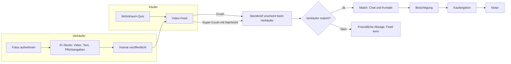

# 03 · Produktkonzept

## 1. Rollen

| Rolle | Plattform (Schwerpunkt) | Hauptaufgaben |
|---|---|---|
| Käufer – Selbstnutzer | App (iOS/Android), Web für Quiz und Steckbrief | Quiz, Swipen, Steckbrief, Matches, Chat, Besichtigung |
| Käufer – Kapitalanleger | App und Web | wie oben, zusätzlich Rendite- und Mietdaten |
| Privatverkäufer | App (Fotos aufnehmen) und Web (bequem am Rechner) | Inserat mit KI-Studio, Interessenten matchen, Termine |
| Makler (Team) | Web-Dashboard und App | Inventar per Schnittstelle, Studio mit eigenem Branding, Käufer-Radar |
| Partner | Web (Partnerportal) | Kontakte mit Einwilligung empfangen, Kampagnen buchen |
| Moderation/Admin | Web-Backoffice | Prüfung, Betrugsabwehr, Support, Kennzahlen |
| Später: Mieter, Vermieter, Bauträger | – | eigene Bereiche |

## 2. Der Kernablauf

## 3. Käufer-Erlebnis

### 3.1 Onboarding: Wohntraum-Quiz (unter 90 Sekunden bis zum ersten Swipe)

Pflicht sind nur fünf Fragen. Alles Weitere kommt später, spielerisch und im Feed:

1. **Kaufen oder mieten?** Mieten führt vorerst auf eine Warteliste für den Mietbereich.
2. **Selbst einziehen oder Kapitalanlage?** Die einzige Unterscheidung im ersten Schritt, wie im Ausgangstext.
3. **Wo?** Gebiet auf der Karte zeichnen, Orte wählen – oder „Weiß ich noch nicht“: Arbeitsort eingeben, wir zeigen, was in 30, 45 oder 60 Minuten erreichbar ist.
4. **Budget?** Schieberegler; bei „Weiß ich nicht“ öffnet sich ein Budget-Rechner (Einkommen, Eigenkapital, Wunschrate).
5. **Wie viel Platz?** Visuell mit Personen-Icons und Zimmern statt Zahlenfeldern.

Danach startet sofort der Feed. Wer mag, macht direkt mit dem **Wohntyp-Test** weiter (This-or-That mit Bildern, etwa zwei Minuten) und bekommt seinen Wohntyp als teilbare Karte.

### 3.2 Der Feed

- **Karte:** vertikales Video (stumm mit Untertiteln, Ton auf Tipp) oder Foto-Karussell. Faktenleiste: Preis, m², Zimmer, Ort, „provisionsfrei“-Badge, Match-Wert in Prozent.
- **Gesten:**
  - nach rechts – **Crush:** gefällt mir. Ich erscheine beim Verkäufer als anonymer Steckbrief.
  - nach links – **Weiter:** nicht für mich. Optional ein Tipp auf den Grund (Preis, Lage, Größe, Zustand, Stil, Grundriss, Sonstiges).
  - nach oben – **Super-Crush:** aktive Bewerbung mit Steckbrief und persönlicher Nachricht. Sie erscheint beim Verkäufer ganz oben und ist begrenzt (z. B. 3 pro Woche kostenlos), damit sie etwas wert ist.
  - Tippen öffnet die **Details**, das Lesezeichen **merkt** ein Inserat vor.
- **Feed-Mischung:** überwiegend die besten Matches, dazu bewusst ein Anteil „Entdecken“ knapp außerhalb der Kriterien (um Geschmack zu lernen) und ein Startbonus für neue Inserate.
- **Mikrofragen im Feed:** etwa alle 10–15 Karten eine kurze Frage, abgeleitet aus dem Verhalten („Du hast 6 Häuser mit Garten gecrusht – ist ein Garten ein Muss?“).

### 3.3 Detailansicht

- Video und Fotos mit Schalter **„Original / KI-Version“**
- alle Fakten inklusive Energie-Pflichtangaben
- **„Warum passt das?“** – Match-Erklärung mit ✓ und ✗, z. B. „✓ Garten · ✓ 18 Min. zur Arbeit · ✓ Kita 400 m · ✗ Baujahr 1972, gewünscht ab 1990“
- **Lage-Profil:** Pendelzeit zu meinen Orten, Kitas, Schulen nach Schulform, Ärzte, Kliniken, Einkaufen, Sport, Grünflächen, Restaurants, ÖPNV-Takt, überregionale Anbindung
- **„Ein Tag in diesem Zuhause“:** eine KI-Geschichte aus Objekt- und Lagedaten
- **Kostenrechner:** Kaufnebenkosten, monatliche Rate, für Anleger die Rendite
- nach dem Match: Unterlagen, Besichtigungstermine, Chat

### 3.4 Käufer-Steckbrief

Der Steckbrief ist die Bewerbungsmappe des Käufers – und die wichtigste Motivation, viel von sich preiszugeben.

| Bereich | Inhalt | Für Verkäufer sichtbar |
|---|---|---|
| Kurzprofil | Wohntyp, Haushalt (z. B. „Paar, 1 Kind, Hund“), Zeitplan | vor dem Match (anonym) |
| Passung | Match-Wert und die wichtigsten Übereinstimmungen | vor dem Match |
| Qualifizierung | Budgetrahmen, Finanzierungsstatus, Eigenkapital-Nachweis | vor dem Match als Badge, Zahlen nur mit Freigabe |
| Motivation | KI-Motivationsschreiben oder persönliche Nachricht | bei Super-Crush oder nach dem Match |
| Persönliches | Name, Foto, Kontaktdaten | erst nach dem Match |

- **Badges:** Finanzierung bestätigt · Eigenkapital nachgewiesen · Identität verifiziert · Profil vollständig · schnell erreichbar
- **KI-Motivationsschreiben:** pro Immobilie individuell, erzeugt aus Steckbrief, Objekt und Lage („Die Kita ist 400 m entfernt – unsere Tochter kommt im Sommer in die Kita“). Immer editierbar.
- **Export:** Steckbrief als PDF oder Link mit QR-Code, auch für Angebote auf anderen Portalen. Jeder Export macht immocrush bei Verkäufern und Maklern bekannt.

### 3.5 Matches, Chat, Termine

- Match-Liste mit Status: gecrusht → Match → Besichtigung → Angebot → abgeschlossen
- Chat (Text, Bilder, Dokumente), Freigabe der Kontaktdaten per Klick
- Besichtigungsplaner (V1): Verkäufer legen Zeitfenster an, Käufer buchen
- Freundliche Absagen: „Die Verkäufer haben sich für andere Interessenten entschieden. Wir haben drei ähnliche Zuhause für dich.“

### 3.6 Gemeinsam suchen (V1)

Paare und Familien verknüpfen ihre Profile. Beide wischen getrennt, die App zeigt: **„Ihr habt beide gecrusht.“** Das macht Spaß, bildet die echte Entscheidung ab und bringt pro Haushalt einen zweiten Nutzer.

### 3.7 Persönlicher Marktreport & Kompromiss-Assistent

- „In deinem Gebiet gibt es 23 passende Angebote, im Schnitt 4.200 €/m².“
- „Mit 10 % mehr Budget wären es 41.“ – „Mit 15 Minuten mehr Pendelzeit gäbe es doppelt so viele Häuser mit Garten.“
- Wird mit jeder Angabe genauer und motiviert so zu weiteren Angaben.

### 3.8 Benachrichtigungen

- neue Top-Matches (nur oberhalb einer Schwelle, Häufigkeit einstellbar), neuer Match, neue Nachricht, Terminerinnerung, Preissenkung bei gemerkten Inseraten
- Leitlinie: lieber wenige, sehr gute Push-Nachrichten als viele mittelmäßige

## 4. Verkäufer-Erlebnis

### 4.1 Einstieg: Nachfrage-Check

Adresse und drei Eckdaten eingeben, sofort erscheint: „**38 aktive Käufer** suchen in deiner Gegend so eine Immobilie. Budgetspanne 380.000–460.000 €. 12 davon mit bestätigter Finanzierung.“ Darunter: „Jetzt in 10 Minuten inserieren.“

Der Check lockt Eigentümer an und macht den Nutzen des Netzwerks sofort greifbar.

### 4.2 Das KI-Studio (Producer-Bereich)

| Funktion | Beschreibung | Release |
|---|---|---|
| Geführte Fotoaufnahme | In-App-Kamera mit Anleitung pro Raum (aus der Ecke, Querformat, Licht an) und Qualitätscheck (zu dunkel, schief, unscharf) | MVP |
| Foto-Optimierung | Belichtung, Begradigung, Weißabgleich; automatisches Verpixeln von Gesichtern, Kennzeichen und persönlichen Fotos | MVP |
| Raum- und Ausstattungserkennung | KI erkennt Raumtyp und Merkmale (Einbauküche, Parkett, Kamin, Balkon) und füllt Felder vor | MVP |
| Video aus Fotos | 20–45 Sekunden, Hochformat 9:16 und Querformat 16:9, Kamerafahrten, Musik, Texteinblendungen, Abspann mit QR-Code | MVP |
| Exposé-Texte | Titel, Beschreibung, Ausstattung, Lage (aus Lagedaten); Tonalität wählbar: emotional, sachlich, für Anleger | MVP |
| Pflichtangaben-Check | Energieausweis-Angaben nach GEG, Plausibilitätsprüfung (Fläche zu Zimmern, Preis zu Markt) | MVP |
| Energieausweis-Scan | Foto vom Energieausweis, Pflichtangaben werden automatisch übernommen | MVP |
| Social-Media-Paket | Captions, Hashtags, direkter Export zu Instagram, TikTok und WhatsApp-Status | MVP |
| „Ein Tag in diesem Zuhause“ | Story-Text und Video-Variante aus Objekt- und Lagedaten | V1 |
| Virtuelles Home Staging | leere Räume einrichten, Räume entrümpeln (gekennzeichnet) | V1 |
| KI-Sprecher | deutschsprachige Stimme für das Video | V1 |
| Grundriss aus Foto oder Skizze | saubere 2D-Grundrisse, Flächenvorschlag | V1 |
| Exposé-PDF | klassisches Exposé zum Teilen und Drucken, mit QR-Code zum Video | V1 |
| Übersetzungen | Englisch, Polnisch, Türkisch, Ukrainisch u. a. | V2 |

### 4.3 Inserats-Stärke

Eine Fortschrittsanzeige mit konkreten Hinweisen, z. B. „Füge einen Grundriss hinzu – Inserate mit Grundriss bekommen bei uns X % mehr Crushes.“ Konkrete Prozentwerte zeigen wir erst, wenn eigene Daten vorliegen; bis dahin gibt es qualitative Hinweise. Vollständige Inserate werden im Feed bevorzugt, und das erklären wir offen.

### 4.4 Interessenten-Inbox

- Käufer-Steckbriefe als Karten, sortiert nach Match-Wert, Qualifizierung und Super-Crush
- Aktionen: **Match**, **Absagen** (freundliche Standardtexte, optional mit Grund), **Später**
- **Modus wählbar:** „Ich wähle aus“ (Matching) oder „Alle Interessenten direkt“ (klassisch, z. B. für Makler)
- **Käufer entdecken (V1):** Verkäufer sehen passende, anonyme Suchprofile in ihrer Region und können sie einladen (begrenzt bzw. als Extra)

### 4.5 Dashboard & Swipe-Insights

- Aufrufe, Crushes, Super-Crushes, Matches und Besichtigungen im Zeitverlauf
- **Swipe-Insights:** Warum haben Käufer weitergewischt? („41 % Preis, 22 % Lage, 15 % Zustand“) Dieses Feedback liefert kein Portal.
- Vergleich mit ähnlichen Inseraten in der Region

### 4.6 Preis-Radar (V1)

Eine Preisempfehlung aus Budgets, Swipe-Verhalten und Angebotslage: „Bei 449.000 € passen 2,1-mal so viele aktive Käufer wie bei 489.000 €.“

### 4.7 Verkaufsfahrplan

Checkliste mit Fortschritt: Unterlagen (Grundbuchauszug, Energieausweis, Flurkarte, bei Wohnungen Teilungserklärung und Protokolle der Eigentümerversammlungen usw.), Termine, Notarvorbereitung. Passende Dienstleister sind direkt buchbar (Energieausweis, Fotograf, Gutachter).

### 4.8 Verkäufer-Wünsche (für gegenseitiges Matching)

Optional: bevorzugter Übergabezeitpunkt, Selbstnutzer oder Anleger bevorzugt, Finanzierungsnachweis gewünscht, „Wem würde ich am liebsten verkaufen?“ als Freitext. Die KI wertet ihn sachlich aus und ignoriert geschützte Merkmale.

## 5. Makler-Erlebnis (Web-Dashboard)

- **Inventar per OpenImmo-Schnittstelle** aus der Makler-Software, kostenlos
- KI-Studio mit Büro-Branding (Logo, Farben, Abspann) für alle Objekte
- **Käufer-Radar:** Wie viele aktive, qualifizierte Käufer suchen in PLZ X welche Immobilie zu welchem Budget? Das stärkste Argument im Gespräch mit Eigentümern.
- Interessenten-Inbox für alle Objekte, Zuweisung im Team, Export ins CRM
- Statistiken pro Objekt und Büro
- später: Off-Market-Matching („Bald verfügbar“ nur an passende Käufer, ohne öffentliches Inserat)

## 6. Matching-Logik

### 6.1 Drei Ebenen

1. **Harte Kriterien (Ausschluss):** Kauf oder Miete, Gebiet bzw. Pendelzeit, Objektart, Budget-Obergrenze (mit Toleranz, z. B. +10 %), Mindestgröße.
2. **Weiche Kriterien (gewichteter Wert):** Garten, Balkon, Zustand, Baujahr, Energieeffizienz, Stellplatz, Barrierefreiheit und Lagefaktoren wie Kita, Schule, Ärzte, Grün, ÖPNV. Der Käufer gewichtet mit **Muss · Wichtig · Schön · Egal · Lieber nicht**.
3. **Gelernter Geschmack:** Aus Crushes und Weiter-Swipes lernt das System Stil und Vorlieben (Bildmerkmale wie Altbau, hell, modern, Holz), die niemand in einen Filter schreiben würde.

### 6.2 Gegenseitigkeit

Der Gesamtwert berücksichtigt beide Richtungen:

- **Käufer → Objekt:** Wie gut passt das Zuhause zum Käufer?
- **Objekt → Käufer:** Wie gut passt der Käufer zu den Wünschen des Verkäufers (Zeitpunkt, Finanzierung, Selbstnutzer oder Anleger)?

In der Inbox des Verkäufers zählt beides, im Feed des Käufers vor allem die erste Richtung.

### 6.3 Beispiel (vereinfacht)

| Kriterium | Gewicht | Erfüllung | Beitrag |
|---|---|---|---|
| Garten (Muss) | – | ja | Ausschluss bestanden |
| Pendelzeit bis 30 Min. (Wichtig) | 3 | 18 Min. → 1,0 | 3,0 |
| Kita im Umkreis von 1 km (Wichtig) | 3 | 400 m → 1,0 | 3,0 |
| Baujahr ab 1990 (Schön) | 1 | 1972 → 0,2 | 0,2 |
| Stil-Ähnlichkeit (gelernt) | 2 | 0,8 | 1,6 |
| **Summe** | **9** | | **7,8 von 9 → Match-Wert 87 %** |

### 6.4 Erklärbarkeit

Jeder Match-Wert wird erklärt („Warum passt das?“). Das schafft Vertrauen und zeigt Käufern, welche Angaben das Ergebnis verbessern würden.

### 6.5 Ausbaustufen

- **MVP:** Regeln, Gewichte und eine einfache Stil-Ähnlichkeit über Bild-Embeddings
- **V1:** Gewichte werden aus Swipes gelernt (je Nutzer und Region), Absagegründe fließen ein
- **V2:** lernendes Ranking über alle Nutzer, gegenseitige Empfehlungen wie bei Dating-Apps, Prognose der Match-Wahrscheinlichkeit

## 7. Fragenkatalog: vom Ausgangstext zur spielerischen Abfrage

| Bereich | Frage (Ausgangstext) | Spielerische Umsetzung | Wann | Nutzen | Hinweis |
|---|---|---|---|---|---|
| Objekt | Art der Immobilie | Bilderkarten: Wohnung, Haus, Reihenhaus, Bauernhaus, Loft | Onboarding | Ausschluss | – |
| Objekt | Baujahr | This-or-That: Altbau oder Neubau, Epochen als Bilder | Wohntyp-Test | weich, Stil | – |
| Objekt | Größe | Personen- und Zimmer-Icons statt Zahlen | Onboarding | Ausschluss | – |
| Objekt | Sanierung, Modernisierung, Neubau | „Wie viel Lust auf Baustelle hast du?“ Regler von bezugsfertig bis Projekt | Wohntyp-Test | weich | – |
| Haushalt | Anzahl der Personen | Avatare zusammenstellen (Erwachsene, Kinder, Haustiere) | Level 2 | Größe, Lage | – |
| Haushalt | Geschlecht | **nicht abfragen** – kein Nutzen fürs Matching | – | – | Diskriminierungsrisiko |
| Haushalt | Alter | optional als Altersgruppe, z. B. für altersgerechtes Wohnen oder die Finanzierungslaufzeit | Level 3 | Bedarf | für Verkäufer nie sichtbar oder filterbar |
| Haushalt | Beruf | stattdessen Arbeitsort(e) für die Pendelzeit und Homeoffice-Tage für ein Arbeitszimmer | Level 2 | Lage, Raum | Beruf selbst nur optional |
| Lage | Lage, Anbindung mit Öffis | Karte, Pendelziele, Verkehrsmittel-Icons | Onboarding, Level 2 | Ausschluss, weich | – |
| Lage | Ansprüche an Infrastruktur | Wichtigkeit per Wischen: Kita, Schule, Ärzte, Kliniken, Einkaufen, Restaurants, Sport | Level 2 | weich | – |
| Lage | Schulformen | Grundschule, Gymnasium, Gesamtschule, international | Level 2 (bei Kindern) | weich | – |
| Lage | Überregionale Anbindung | Autobahn, ICE-Bahnhof, Flughafen, jeweils nach Wichtigkeit | Level 3 | weich | – |
| Lage | Nachbarschaft | This-or-That: ruhig oder lebendig, Stadt oder Land, Familienviertel oder gemischt | Wohntyp-Test | weich | keine Fragen zu Herkunft oder Religion von Nachbarn |
| Leben | Hobbys | Icon-Wand: Laufen, Rad, Reiten, Wassersport, Golf, Garten, Musik, Kultur … – daraus werden passende Orte in der Nähe | Level 2 | Lage-Score | – |
| Leben | Stil der Immobilie | Bilder-Swipes: Landhaus, modern, Altbau, skandinavisch, Industrial | Wohntyp-Test, Feed | gelernter Geschmack | – |
| Leben | Wie lange dort leben? | „Wo siehst du dich in 10 Jahren?“ mit Kurzantworten | Level 3 | Zustand, Selbstnutzer oder Anleger | – |
| Leben | Altersgerechtes Wohnen | Barrierearm wichtig? Ebenerdig, Aufzug, bodengleiche Dusche | Level 3 | weich | als Wohnbedarf fragen, nicht als Gesundheitsangabe |
| Grundstück | Beschaffenheit | Bilder: pflegeleichter oder großer Garten, Hanglage, Ausrichtung | Level 2 | weich | – |
| Finanzen | Budget | Regler, Budget-Rechner, optionaler Finanzierungs-Check | Onboarding, Level 4 | Ausschluss, Badge | Zahlen nur mit Freigabe sichtbar |
| Person | Fotos von sich | optional, **erst nach dem Match** sichtbar | Steckbrief | Vertrauen | nie für das Ranking verwendet |
| Person | Motivationsschreiben | KI-Entwurf pro Objekt, editierbar | Steckbrief, Super-Crush | überzeugen | – |

## 8. KI-Leitplanken: Verschönern ja, verfälschen nein

| Erlaubt | Nicht erlaubt |
|---|---|
| Belichtung, Farben, Begradigung, Schärfe | Mängel entfernen (Risse, Feuchtigkeit, Schäden) |
| virtuelle Möbel in leeren Räumen (gekennzeichnet) | Räume größer wirken lassen, Wände verschieben |
| persönliche Gegenstände entfernen (gekennzeichnet) | Ausblick, Garten, Pool oder Himmel erfinden, die es so nicht gibt |
| Kamerafahrten über echte Fotos | generierte Szenen, die bauliche Details verändern |
| Texte aus echten Daten | erfundene Ausstattung oder Lagevorteile |

- KI-bearbeitete und KI-erzeugte Medien werden **sichtbar gekennzeichnet** („KI-visualisiert“, „virtuell eingerichtet“) und **maschinenlesbar markiert** (z. B. mit C2PA-Metadaten). Das verlangt die KI-Verordnung seit dem 2. August 2026.
- **Originale bleiben immer abrufbar** (Schalter „Original / KI-Version“).
- Generative Videomodelle neigen dazu, Architektur zu erfinden. Standard sind deshalb kontrollierte Kamerafahrten über die echten Fotos; generative Clips gibt es nur mit Qualitätsprüfung.
- Nutzer können Darstellungen als „irreführend“ melden.

## 9. Vertrauen & Sicherheit

- Telefon- und E-Mail-Verifizierung für alle Inserenten, Ausweis-Verifizierung als Badge (V1)
- Kontaktdaten bleiben bis zum Match privat. Kleinanzeigen verkauft eine verschlüsselte Telefonnummer als Extra – bei uns ist Privatsphäre Standard.
- Betrugsprävention: Erkennung doppelter Bilder, Preis-Plausibilität, Warnhinweise bei Vorkasse-Forderungen, manuelle Prüfung der ersten Inserate eines Accounts
- Melden und Blockieren in jedem Chat und Inserat, klarer Moderationsprozess

## 10. Screen-Liste für das MVP (Grundlage fürs Design)

**Käufer-App**

1. Start und Login (E-Mail-Code, Apple, Google)
2. Wohntraum-Quiz (5 Schritte)
3. Wohntyp-Test und Ergebniskarte
4. Feed
5. Detailansicht mit Lage-Profil und „Warum passt das?“
6. Crushes und Merkliste
7. Matches und Chat
8. Käufer-Steckbrief (Ansicht, Bearbeiten, Profil-Stärke, Level)
9. Editor für das Motivationsschreiben
10. Einstellungen, Datenschutz-Cockpit, Benachrichtigungen, Konto löschen

**Verkäufer (App und Web)**

11. Nachfrage-Check
12. Inserat-Assistent (Fotos, Eckdaten, Energieausweis)
13. KI-Studio (Video, Texte, Vorschau, Kennzeichnung)
14. Vorschau und Veröffentlichung
15. Interessenten-Inbox
16. Dashboard mit Swipe-Insights

**Web (öffentlich)**

17. Startseite, Seiten für Verkäufer und Makler
18. Öffentliche Inseratsseite (teilbar, für Suchmaschinen, mit „In der App öffnen“)
19. Web-Quiz
20. Rechtliches (Impressum, Datenschutz, AGB, Transparenz zu Empfehlungen)

**Backoffice**

21. Moderations-Warteschlange, Nutzer- und Inseratsverwaltung, Meldungen, Kennzahlen
