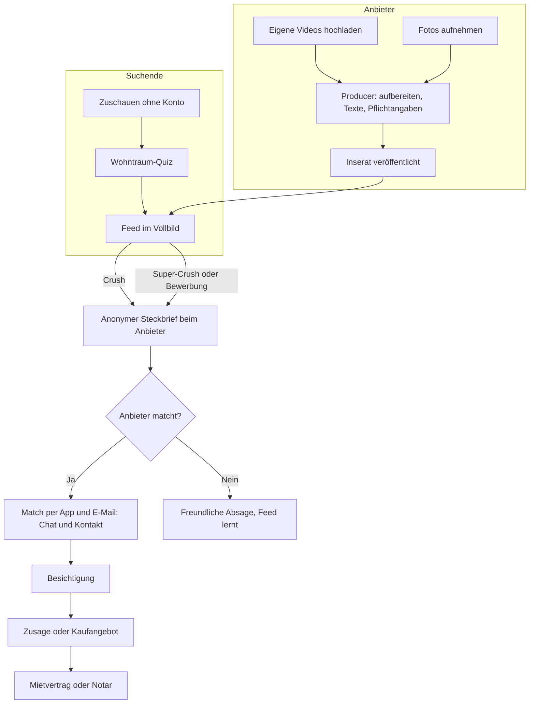

# 03 · Produktkonzept

## 1. Rollen

| Rolle | Plattform (Schwerpunkt) | Hauptaufgaben |
|---|---|---|
| Zuschauer (ohne Konto) | App und Website | Entdecken, Themen-Feeds, „Preis raten“, Teilen |
| Käufer – Selbstnutzer | App, Website für Quiz, Suche und Steckbrief | Quiz, Swipen, Steckbrief, Matches, Chat, Besichtigung |
| Käufer – Kapitalanleger | App und Website | wie oben, zusätzlich Rendite- und Mietdaten |
| Mietsuchende | App und Website | Quiz, Swipen, Bewerbung in Stufen, Matches, Besichtigung |
| Privatverkäufer und Privatvermieter | App (Fotos und Videos vom Handy) und Website (bequem am Rechner) | Inserat im Producer-Bereich, Interessenten auswählen, Termine |
| Makler, Bauträger, Hausverwaltungen (Teams) | Web-Dashboard und App | Inventar per Schnittstelle, Producer mit eigenem Branding, Inbox im Team, Kanal mit Followern |
| Werbekunden und Partner | Web (Partnerportal) | Werbung buchen, Einträge im Dienstleister-Verzeichnis, Kontakte mit Einwilligung empfangen |
| Moderation und Admin | Web-Backoffice | Prüfung, Betrugsabwehr, Support, Kennzahlen |

## 2. Der Kernablauf

## 3. Entdecken & Unterhaltung

> „Es soll so attraktiv gemacht sein, dass man sich das auch anschaut, wenn man gar keine Immobilie sucht. Als Entertainment.“ – Gründer, 18.10.2026

### 3.1 Der Feed: ein Angebot nach dem anderen

- **Vollbild:** Jede Immobilie füllt das ganze Display, als Film (stumm mit Untertiteln, Ton auf Tipp) oder als Foto-Karussell. Faktenleiste: Preis oder Warmmiete, m², Zimmer, Ort, „provisionsfrei“-Badge, Match-Wert in Prozent.
- **Gesten:**
  - nach rechts – **Crush:** gefällt mir. Ich erscheine beim Anbieter als anonymer Steckbrief.
  - nach links – **Weiter:** nicht für mich. Optional ein Tipp auf den Grund (Preis, Lage, Größe, Zustand, Stil, Grundriss, Sonstiges).
  - nach oben – **Super-Crush:** beim Kauf eine aktive Bewerbung mit Steckbrief und persönlicher Nachricht, bei Miete die **Bewerbung** („Ich möchte diese Wohnung mieten“). Super-Crushes sind begrenzt, damit sie etwas wert sind (Startwerte zum Testen: 3 pro Woche beim Kauf, 10 pro Woche bei Miete).
  - Tippen öffnet die **Details**, das Lesezeichen **merkt** ein Inserat vor.
- **Feed-Mischung:** überwiegend die besten Matches, dazu bewusst ein Anteil „Entdecken“ knapp außerhalb der Kriterien (um Geschmack zu lernen) und ein Startbonus für neue Inserate.
- **Mikrofragen im Feed:** etwa alle 10–15 Karten eine kurze Frage, abgeleitet aus dem Verhalten („Du hast 6 Wohnungen mit Balkon gecrusht – ist ein Balkon ein Muss?“).
- **Werbung:** höchstens jede 8.–12. Karte eine gekennzeichnete Partner-Karte (siehe Abschnitt 8).

### 3.2 Für alle, die nicht (gerade) suchen

| Funktion | Beschreibung | Release |
|---|---|---|
| Gastmodus | Feed ohne Konto ansehen; nach etwa 10–20 Karten freundlicher Hinweis, dass ein Konto Matches und Merkliste bringt | MVP |
| Themen-Feeds | „Altbau-Liebe“, „Häuser am See“, „Unter 300.000 €“, „Tiny Houses“, „Bauernhöfe“, „Wohnungen mit Dachterrasse“, „Neubau“ | MVP |
| Teilen | jedes Inserat als Link oder Video zu WhatsApp, Instagram, TikTok; Empfänger landen direkt im Film | MVP |
| Reaktionen | Herzen und Emojis statt Kommentaren (keine Moderationslast, kein Spott über Wohnungen) | MVP |
| „Preis raten“ | Film ansehen, Preis schätzen, Ergebnis vergleichen; Ranglisten unter Freunden. Nebenbei lernen wir, wie Menschen Preise wahrnehmen (nur anonymisiert ausgewertet) | V1 |
| Duelle | zwei Immobilien, eine Frage („Wo würdest du lieber wohnen?“), Abstimmung, teilbar | V1 |
| Kanäle folgen | Makler, Bauträger und Creator haben Kanäle, denen man folgen kann – wie bei Instagram | V1 |
| „Haus der Woche“ | die meistgecrushten Immobilien, als Feed und Newsletter | V1 |

### 3.3 Klassische Suche – wie bei den großen Portalen

Wer lieber filtert, bekommt, was er von ImmoScout24 und immowelt kennt: Filter, Ergebnisliste, Karte, Merkliste und gespeicherte Suchen. Auf der Website ist das die Hauptansicht und zugleich die Grundlage für Suchmaschinen (Seiten pro Stadt, Stadtteil und Objektart). In der App bleibt der Swipe-Feed die Hauptansicht, Liste und Karte sind einen Tipp entfernt.

## 4. Suchende: Kauf und Miete

### 4.1 Onboarding: Wohntraum-Quiz (unter 90 Sekunden bis zum ersten Swipe)

Pflicht sind nur fünf Fragen. Alles Weitere kommt später, spielerisch und im Feed:

1. **Kaufen oder mieten?**
2. **Beim Kauf: selbst einziehen oder Kapitalanlage?** Bei Miete: **ab wann?**
3. **Wo?** Gebiet auf der Karte zeichnen, Orte wählen – oder „Weiß ich noch nicht“: Arbeitsort eingeben, wir zeigen, was in 30, 45 oder 60 Minuten erreichbar ist.
4. **Budget?** Kaufpreis oder Warmmiete per Schieberegler; beim Kauf öffnet „Weiß ich nicht“ einen Budget-Rechner (Einkommen, Eigenkapital, Wunschrate).
5. **Wie viel Platz?** Visuell mit Personen-Icons und Zimmern statt Zahlenfeldern.

Danach startet sofort der Feed. Wer mag, macht direkt mit dem **Wohntyp-Test** weiter (This-or-That mit Bildern, etwa zwei Minuten) und bekommt seinen Wohntyp als teilbare Karte.

Zusätzliche Fragen bei Miete, später und freiwillig: möbliert oder unmöbliert, befristet oder unbefristet, WG geeignet, Haustiere, Wohnberechtigungsschein vorhanden.

### 4.2 Detailansicht

- Film und Fotos mit Schalter **„Original / KI-Version“**
- alle Fakten inklusive Energie-Pflichtangaben; bei Miete Kaltmiete, Nebenkosten, Heizkosten, Kaution, frei ab
- **„Warum passt das?“** – Match-Erklärung mit ✓ und ✗, z. B. „✓ Balkon · ✓ 18 Min. zur Arbeit · ✓ Kita 400 m · ✗ 3. OG ohne Aufzug“
- **Lage-Profil:** Pendelzeit zu meinen Orten, Kitas, Schulen nach Schulform, Ärzte, Kliniken, Einkaufen, Sport, Grünflächen, Restaurants, ÖPNV-Takt, überregionale Anbindung
- **„Ein Tag in diesem Zuhause“:** eine KI-Geschichte aus Objekt- und Lagedaten
- **Kostenrechner:** beim Kauf Kaufnebenkosten, monatliche Rate und für Anleger die Rendite; bei Miete die Gesamtkosten pro Monat
- **Profis in der Nähe:** passende Dienstleister (z. B. Energieberater bei älteren Häusern), gekennzeichnet als Anzeige
- nach dem Match: Unterlagen, Besichtigungstermine, Chat

### 4.3 Der Steckbrief beim Kauf

Der Steckbrief ist die Bewerbungsmappe – und die wichtigste Motivation, viel von sich preiszugeben.

| Bereich | Inhalt | Für Anbieter sichtbar |
|---|---|---|
| Kurzprofil | Wohntyp, Haushalt (z. B. „Paar, 1 Kind, Hund“), Zeitplan | vor dem Match (anonym) |
| Passung | Match-Wert und die wichtigsten Übereinstimmungen | vor dem Match |
| Qualifizierung | Budgetrahmen, Finanzierungsstatus, Eigenkapital-Nachweis | vor dem Match als Badge, Zahlen nur mit Freigabe |
| Motivation | KI-Motivationsschreiben oder persönliche Nachricht | bei Super-Crush oder nach dem Match |
| Persönliches | Name, Foto, Kontaktdaten | erst nach dem Match |

- **Badges:** Finanzierung bestätigt · Eigenkapital nachgewiesen · Identität verifiziert · Profil vollständig · schnell erreichbar
- **KI-Motivationsschreiben:** pro Immobilie individuell, erzeugt aus Steckbrief, Objekt und Lage („Die Kita ist 400 m entfernt – unsere Tochter kommt im Sommer in die Kita“). Immer editierbar.
- **Export:** Steckbrief als PDF oder Link mit QR-Code, auch für Angebote auf anderen Portalen. Jeder Export macht immocrush bei Anbietern und Maklern bekannt.

### 4.4 Der Steckbrief bei Miete: drei Stufen

Bei Vermietung legen die Datenschutzbehörden genau fest, welche Angaben Vermieter wann verlangen dürfen (Orientierungshilfe der Datenschutzkonferenz, Version 2.0, Januar 2026). Unser Steckbrief folgt diesen Stufen. Mietsuchende füllen ihr Profil einmal aus, freigegeben wird aber immer nur das, was in der jeweiligen Stufe erlaubt ist.

| Stufe | Wann | Was der Vermieter sieht |
|---|---|---|
| **1 · Interesse** | nach dem Crush | anonym: Match-Wert und Übereinstimmungen (Lage, Größe, Einzugstermin, Mietdauer, Budget passt zur Miete); bei Sozialwohnungen: Wohnberechtigungsschein vorhanden, genehmigte Fläche und Zimmerzahl |
| **2 · Bewerbung** | wenn der Mietsuchende erklärt, diese Wohnung mieten zu wollen (Super-Crush „Bewerben“) | weiterhin ohne Namen: Zahl der einziehenden Personen (Erwachsene, Kinder), Beruf und Arbeitgeber, ob für die Miete mindestens der nötige Betrag zur Verfügung steht (Ja/Nein statt Gehaltszahl), Haustiere, Selbstauskunft „kein laufendes Insolvenzverfahren, kein Räumungstitel in den letzten 5 Jahren“, Motivationsschreiben. Name und Kontakt kommen mit dem Match. |
| **3 · Zusage** | wenn sich der Vermieter für diese Person entschieden hat, unmittelbar vor dem Mietvertrag | aus dem Dokumenten-Tresor: Einkommensnachweis (nicht nötige Angaben geschwärzt), Bonitätsnachweis für Mietzwecke, ggf. Nachweis, dass eine öffentliche Stelle die Miete übernimmt |

- **Nie abgefragt:** Religion, ethnische Herkunft, Staatsangehörigkeit, Vorstrafen, Heiratsabsichten, Schwangerschaft, Kinderwunsch, Mitgliedschaft in Parteien oder Mietervereinen, Dauer des Arbeitsverhältnisses, Gründe für monatliche Belastungen, Kontaktdaten früherer Vermieter. Eine Mietschuldenfreiheitsbescheinigung dürfen Vermieter nicht verlangen.
- **Keine Unterlagen zu früh:** Der Dokumenten-Tresor gibt Unterlagen technisch erst in Stufe 3 frei. Mietsuchende können sie also gar nicht unaufgefordert verschicken, und Vermieter können sie nicht früher anfordern.
- **Löschen nach der Entscheidung:** Hat ein Vermieter einen Mietvertrag mit jemand anderem geschlossen, verliert er den Zugriff auf die übrigen Bewerbungen automatisch, spätestens nach 6 Monaten.
- **Gute Nachricht für Mietsuchende:** Weil Film und Rundgang viel zeigen, können sie sich oft schon vor der Besichtigung ernsthaft entscheiden – und sich dann sofort mit Stufe 2 bewerben.

> Die genaue Umsetzung (z. B. ob eine Bewerbung vor der Besichtigung schon als „Erklärung, mieten zu wollen“ gilt) stimmen wir mit einer Datenschutzberatung ab (siehe [Recht](09-recht-datenschutz-compliance.md)).

### 4.5 Matches per E-Mail und App

> „Die Matches (die anderen nennen es ‚neue Angebote‘) bekommt man per mail oder über die App angezeigt.“ – Gründer, 18.10.2026

- **Neue Top-Matches:** per Push oder E-Mail, nur oberhalb einer Schwelle, Häufigkeit wählbar (sofort, täglich, wöchentlich). Jede E-Mail zeigt Film-Vorschau, Match-Wert und „Warum passt das?“.
- **Gegenseitiger Match:** Wenn ein Anbieter zurückmatcht, kommt die Nachricht sofort – in der App und per E-Mail.
- **Match-Liste mit Status:** gecrusht → beworben → Match → Besichtigung → Zusage oder Angebot → abgeschlossen
- **Chat** (Text, Bilder, Dokumente in Stufe 3), Freigabe der Kontaktdaten per Klick
- **Besichtigungsplaner** (V1): Anbieter legen Zeitfenster an, Suchende buchen
- **Freundliche Absagen:** „Die Vermieter haben sich für andere Interessenten entschieden. Wir haben drei ähnliche Wohnungen für dich.“
- Leitlinie: lieber wenige, sehr gute Nachrichten als viele mittelmäßige.

### 4.6 Gemeinsam suchen (V1)

Paare, Familien und WGs verknüpfen ihre Profile. Alle wischen getrennt, die App zeigt: **„Ihr habt beide gecrusht.“** Das macht Spaß, bildet die echte Entscheidung ab und bringt pro Haushalt einen zweiten Nutzer.

### 4.7 Persönlicher Marktreport & Kompromiss-Assistent

- „In deinem Gebiet gibt es 23 passende Angebote, im Schnitt 4.200 €/m².“ bzw. „… im Schnitt 14,80 € kalt pro m².“
- „Mit 10 % mehr Budget wären es 41.“ – „Mit 15 Minuten mehr Pendelzeit gäbe es doppelt so viele Wohnungen mit Balkon.“
- Wird mit jeder Angabe genauer und motiviert so zu weiteren Angaben.

## 5. Anbieter: der Producer-Bereich

> „Bereits für social media produzierte Filme und Beiträge zu aktuellen Immobilienangeboten können hochgeladen werden. Wer diese Möglichkeit nicht hat, bekommt bei uns Unterstützung mit KI […]. Es muss natürlich kinderleicht sein.“ – Gründer, 18.10.2026

### 5.1 Kinderleicht in drei Schritten

1. **Hochladen:** Videos und Fotos aus der Galerie, direkt vom Handy oder am Rechner. Eckdaten eintippen oder per Foto vom Energieausweis übernehmen.
2. **Vorschlag ansehen:** Die KI baut daraus ein fertiges Inserat: Film, Texte, Fakten, Pflichtangaben.
3. **Freigeben.** Fertig. Änderungen sind jederzeit möglich.

### 5.2 Weg A: vorhandene Videos hochladen

- Hochformat und Querformat, gängige Formate (MP4, MOV); Basis bis 90 Sekunden pro Video, längere Videos als Extra (siehe Abschnitt 7)
- automatische Aufbereitung: Untertitel, Vorschaubild, Fakten-Einblendungen, Abspann mit QR-Code
- **Rechte bestätigen:** Musik, abgebildete Personen, Videograf. Musik aus Instagram oder TikTok ist meist nur innerhalb dieser Plattformen lizenziert. Deshalb gibt es den Knopf **„Musik ersetzen“** mit lizenzfreier Musik oder Ton aus.
- Hinweis bei Wasserzeichen anderer Plattformen: Bitte das Original ohne Logo hochladen.
- Später (V1): Import per Link aus YouTube oder Vimeo, Übernahme von Instagram-Beiträgen über die offizielle Schnittstelle, soweit möglich

### 5.3 Weg B: mit KI erstellen

| Funktion | Beschreibung | Release |
|---|---|---|
| Geführte Fotoaufnahme | In-App-Kamera mit Anleitung pro Raum (aus der Ecke, Querformat, Licht an) und Qualitätscheck (zu dunkel, schief, unscharf) | MVP |
| Foto-Optimierung | Belichtung, Begradigung, Weißabgleich; automatisches Verpixeln von Gesichtern, Kennzeichen und persönlichen Fotos | MVP |
| Raum- und Ausstattungserkennung | KI erkennt Raumtyp und Merkmale (Einbauküche, Parkett, Kamin, Balkon) und füllt Felder vor | MVP |
| Film aus Fotos | 20–45 Sekunden, Hochformat 9:16 und Querformat 16:9, Kamerafahrten, Musik, Texteinblendungen, Abspann mit QR-Code | MVP |
| Exposé-Texte | Titel, Beschreibung, Ausstattung, Lage (aus Lagedaten); Tonalität wählbar: emotional, sachlich, für Anleger | MVP |
| Pflichtangaben-Check | Energieausweis-Angaben nach GEG, Plausibilitätsprüfung (Fläche zu Zimmern, Preis zu Markt) | MVP |
| Energieausweis-Scan | Foto vom Energieausweis, Pflichtangaben werden automatisch übernommen | V1 |
| Social-Media-Paket | Captions, Hashtags, direkter Export zu Instagram, TikTok und WhatsApp-Status | V1 |
| „Ein Tag in diesem Zuhause“ | Story-Text und Video-Variante aus Objekt- und Lagedaten | V1 |
| Virtuelles Home Staging | leere Räume einrichten, Räume entrümpeln (gekennzeichnet) | V1, als Extra |
| KI-Sprecher | deutschsprachige Stimme für den Film | V1, als Extra |
| Grundriss aus Foto oder Skizze | saubere 2D-Grundrisse, Flächenvorschlag | V1, als Extra |
| Exposé-PDF | klassisches Exposé zum Teilen und Drucken, mit QR-Code zum Film | V1, als Extra |
| Übersetzungen | Englisch, Polnisch, Türkisch, Ukrainisch u. a. | V2 |

Die Basis (Film aus Fotos mit Kamerafahrten, Texte, Pflichtangaben-Check) ist für alle kostenlos. Aufwendige KI-Funktionen sind Extras, weil sie spürbare Kosten verursachen.

### 5.4 Inserats-Stärke

Eine Fortschrittsanzeige mit konkreten Hinweisen, z. B. „Füge einen Grundriss hinzu – Inserate mit Grundriss bekommen bei uns X % mehr Crushes.“ Konkrete Prozentwerte zeigen wir erst, wenn eigene Daten vorliegen; bis dahin gibt es qualitative Hinweise. Vollständige Inserate werden im Feed bevorzugt, und das erklären wir offen.

### 5.5 Einstieg für Eigentümer: Nachfrage-Check

Adresse und drei Eckdaten eingeben, sofort erscheint: „**38 aktive Käufer** suchen in deiner Gegend so eine Immobilie. Budgetspanne 380.000–460.000 €. 12 davon mit bestätigter Finanzierung.“ bzw. „**64 Mietsuchende** suchen hier eine 3-Zimmer-Wohnung bis 1.200 € warm.“ Darunter: „Jetzt kostenlos in 10 Minuten inserieren.“

## 6. Die Inbox der Anbieter: Verkauf und Vermietung

> „Anbieter – besonders von Mietwohnungen – können so gezielter filtern und müssen nicht nach 5 Minuten die Angebote rausnehmen, um nicht komplett den Überblick zu verlieren. Man muss sicher viele Regeln im Hinblick auf Fairness beachten.“ – Gründer, 18.10.2026

### 6.1 Grundfunktionen

- Steckbriefe als Karten, sortiert nach Match-Wert und Vollständigkeit; Super-Crushes und Bewerbungen hervorgehoben
- Aktionen: **Match**, **Absagen** (freundliche Standardtexte, automatisch an alle Übrigen, wenn die Wohnung vergeben ist), **Später**
- **Modus wählbar:** „Ich wähle aus“ (Matching) oder „Alle Interessenten direkt“ (klassisch, z. B. für Makler)
- **Weiterleitung in die Makler-Software:** Anfragen gehen auf Wunsch per E-Mail in einem Format, das Makler-Software automatisch einliest

### 6.2 Faire Filter

Anbieter können nur nach sachlichen Kriterien filtern. Alles, was zu Diskriminierung führen kann, gibt es als Filter nicht – auch nicht versteckt.

| Erlaubte Filter | Gibt es nicht |
|---|---|
| Match-Wert (z. B. ab 70 %) | Alter, Geschlecht |
| Einzugstermin, Mietdauer | Herkunft, Staatsangehörigkeit, Sprache |
| maximale Zahl der Personen | Familienstand, Kinder ja oder nein |
| Haustiere (wenn zustimmungspflichtig) | Religion, Weltanschauung |
| Wohnberechtigungsschein (bei Sozialwohnungen) | Beruf oder Arbeitgeber als Ausschlusskriterium |
| „Miete ist tragbar“ (Selbstauskunft, ab Stufe 2) | Fotos, Namen |
| beim Kauf: Finanzierung bestätigt, Zeitplan, Selbstnutzer oder Anleger | |

### 6.3 Anfrage-Bremse statt Inserat offline nehmen

- **Höchstzahl:** Der Anbieter legt fest, wie viele Bewerbungen er bekommen möchte (z. B. 30). Danach steht im Inserat „Bewerbungen pausiert“, das Inserat bleibt sichtbar. Neue Interessenten können sich vormerken lassen und werden benachrichtigt, falls es wieder aufgeht.
- **Mindest-Passung:** Nur Steckbriefe ab einem Match-Wert, den der Anbieter wählt, kommen in die Inbox.
- **Bewerbungsfenster:** Alle Bewerbungen, die in den ersten 24, 48 oder 72 Stunden eingehen, werden gleich behandelt und gemeinsam angezeigt, sortiert nach Passung. Wer zuerst tippt, hat keinen Vorteil.
- **Gleiche Passung, faire Reihenfolge:** Bei ähnlichem Match-Wert entscheidet der Zufall über die Reihenfolge, nicht die Uhrzeit.
- **Niemand kauft sich nach vorn:** Es gibt keinen bezahlten Platz oben in der Inbox, für niemanden.

### 6.4 Dashboard & Swipe-Insights

- Aufrufe, Crushes, Super-Crushes, Matches und Besichtigungen im Zeitverlauf
- **Swipe-Insights:** Warum haben Suchende weitergewischt? („41 % Preis, 22 % Lage, 15 % Zustand“) Dieses Feedback liefert kein Portal.
- Vergleich mit ähnlichen Inseraten in der Region

### 6.5 Weitere Werkzeuge

- **Preis-Radar (V1):** eine Preisempfehlung aus Budgets, Swipe-Verhalten und Angebotslage: „Bei 449.000 € passen 2,1-mal so viele aktive Käufer wie bei 489.000 €.“
- **Verkaufsfahrplan:** Checkliste mit Fortschritt: Unterlagen (Grundbuchauszug, Energieausweis, Flurkarte, bei Wohnungen Teilungserklärung und Protokolle der Eigentümerversammlungen usw.), Termine, Notarvorbereitung. Passende Dienstleister im Verzeichnis „Profis in der Nähe“.
- **Vermietungsfahrplan:** Mietvertrag, Übergabeprotokoll, Kaution, Hinweise zu Mietpreisbremse und Energieausweis.
- **Wünsche der Anbieter (für gegenseitiges Matching):** bevorzugter Übergabe- oder Einzugszeitpunkt, beim Kauf Selbstnutzer oder Anleger, Finanzierungsnachweis gewünscht. Freitext wie „Wem würde ich am liebsten verkaufen?“ wertet die KI sachlich aus und ignoriert geschützte Merkmale.

## 7. Extras: mehr Sichtbarkeit für Anbieter

> „Man zahlt nichts, es sei denn man nimmt besondere Dienste in Anspruch. Wie zum Beispiel besondere Platzierungen, Hervorhebungen, besonders große Anzeigen bzw lange Videos.“ – Gründer, 18.10.2026

| Extra | Was es bringt | Gekennzeichnet als |
|---|---|---|
| Hervorhebung | farbiger Rahmen und Badge im Feed und in der Liste | „Highlight“ |
| Top-Platzierung | erscheint in der Region weiter vorn im Feed und in den Suchergebnissen | „Gesponsert“ |
| Große Anzeige | größere Karte in der Liste, Galerie auf den Regionalseiten der Website | „Gesponsert“ |
| Lange Videos | Videos bis 10 Minuten, z. B. ein kompletter Rundgang (Basis: 90 Sekunden) | – |
| Hochschieben | Inserat erscheint noch einmal als neu | „Gesponsert“ |
| KI-Extras | Home Staging, KI-Sprecher, Grundriss, Exposé-PDF | KI-Kennzeichnung wie immer |
| Pakete | Bündel aus Extras; Premium-Paket mit Fotograf oder Videograf vor Ort | – |
| Für Gewerbliche | Monatspakete mit Kontingent, Kanal-Branding, Käufer-Radar, Team-Funktionen | – |

**Regeln:**

- Bezahlte Sichtbarkeit wirkt nur im Feed und in den Suchergebnissen – **nie in der Inbox der Anbieter** und nie auf die Reihenfolge von Bewerbungen.
- Bezahlte Platzierungen sind immer sichtbar gekennzeichnet.
- Auch mit Extras zählt die Passung: Ein gesponsertes Inserat erscheint nur bei Suchenden, zu denen es grundsätzlich passt.
- Gekauft wird auf der Website (Stripe). In der App nur, wenn die Store-Regeln es verlangen, dann per In-App-Kauf.

Preise und Rechenbeispiele stehen im [Geschäftsmodell](05-geschaeftsmodell.md).

## 8. Werbung im Produkt

Werbung ist neben den Extras unsere zweite Einnahmequelle. Sie soll zum Lebensgefühl passen und nicht stören.

| Platz | Format | Release |
|---|---|---|
| Feed | Partner-Karte im Vollbild (Bild oder Video), höchstens jede 8.–12. Karte | MVP (wenige Gründungs-Werbepartner) |
| Detailansicht | „Profis in der Nähe“: passende Dienstleister je nach Objekt (Energieberater, Handwerker, Finanzierer) | V1 |
| Website | Werbeflächen in Suchergebnissen, auf Inserats- und Ratgeberseiten | V1 |
| Themen-Feeds und Rechner | Sponsoring („Gartenträume, präsentiert von …“, Finanzierungsrechner einer Bank) | V1 |
| Umzugsplaner nach der Zusage | Partner-Angebote für Umzug, Strom, Internet, Versicherung, Einrichtung; Daten gehen nur mit ausdrücklicher Einwilligung an Partner | V1 |
| Newsletter „Haus der Woche“ | Sponsor-Platz, nur für Abonnenten mit Einwilligung | V1 |

**Regeln:**

- Werbung ist immer als **„Anzeige“** gekennzeichnet.
- **Nie** im Steckbrief, in der Inbox, im Chat oder in Match-Benachrichtigungen.
- Standard ist **kontextbezogene Werbung** (Region, Kauf oder Miete, Objektart, Thema). Personalisierte Werbung auf Basis des Nutzerverhaltens gibt es nur mit Einwilligung, sensible Daten nie.
- Nur Werbung rund ums Wohnen und Leben. Keine Glücksspiel-, Krypto- oder Kreditvermittlungs-Schleudern.

## 9. Makler, Bauträger, Hausverwaltungen (Web-Dashboard)

- **Kostenlos inserieren**, Inventar per OpenImmo-Schnittstelle aus der Makler-Software, auch für viele Objekte
- vorhandene Objektvideos hochladen; Producer mit Büro-Branding (Logo, Farben, Abspann) für alle Objekte
- **Kanal mit Followern (V1):** Suchende und Zuschauer folgen einem Büro oder Bauträger und sehen dessen neue Objekte zuerst
- **Käufer-Radar (Extra):** Wie viele aktive, qualifizierte Suchende suchen in PLZ X welche Immobilie zu welchem Budget? Das stärkste Argument im Gespräch mit Eigentümern.
- Inbox für alle Objekte, Zuweisung im Team, Weiterleitung ins CRM
- Statistiken pro Objekt und Büro
- **Bauträger:** Projektseiten mit mehreren Einheiten, Baufortschritt als Video-Serie
- **Hausverwaltungen:** viele Wohnungen gleichzeitig, Anfrage-Bremse und Bewerbungsfenster pro Objekt, automatische Absagen
- später: Off-Market-Matching („Bald verfügbar“ nur an passende Suchende, ohne öffentliches Inserat)

## 10. Matching-Logik

### 10.1 Drei Ebenen

1. **Harte Kriterien (Ausschluss):** Kauf oder Miete, Gebiet bzw. Pendelzeit, Objektart, Budget-Obergrenze (mit Toleranz, z. B. +10 %), Mindestgröße, bei Miete der Einzugstermin.
2. **Weiche Kriterien (gewichteter Wert):** Garten, Balkon, Zustand, Baujahr, Energieeffizienz, Stellplatz, Barrierefreiheit und Lagefaktoren wie Kita, Schule, Ärzte, Grün, ÖPNV. Suchende gewichten mit **Muss · Wichtig · Schön · Egal · Lieber nicht**.
3. **Gelernter Geschmack:** Aus Crushes und Weiter-Swipes lernt das System Stil und Vorlieben (Bildmerkmale wie Altbau, hell, modern, Holz), die niemand in einen Filter schreiben würde.

### 10.2 Gegenseitigkeit

Der Gesamtwert berücksichtigt beide Richtungen:

- **Suchende → Objekt:** Wie gut passt das Zuhause zu den Suchenden?
- **Objekt → Suchende:** Wie gut passen die Suchenden zu den sachlichen Wünschen des Anbieters (Zeitpunkt, beim Kauf Finanzierung und Selbstnutzer oder Anleger, bei Miete Personenzahl und Haustiere)?

In der Inbox der Anbieter zählt beides, im Feed der Suchenden vor allem die erste Richtung.

### 10.3 Beispiel (vereinfacht)

| Kriterium | Gewicht | Erfüllung | Beitrag |
|---|---|---|---|
| Garten (Muss) | – | ja | Ausschluss bestanden |
| Pendelzeit bis 30 Min. (Wichtig) | 3 | 18 Min. → 1,0 | 3,0 |
| Kita im Umkreis von 1 km (Wichtig) | 3 | 400 m → 1,0 | 3,0 |
| Baujahr ab 1990 (Schön) | 1 | 1972 → 0,2 | 0,2 |
| Stil-Ähnlichkeit (gelernt) | 2 | 0,8 | 1,6 |
| **Summe** | **9** | | **7,8 von 9 → Match-Wert 87 %** |

### 10.4 Erklärbarkeit

Jeder Match-Wert wird erklärt („Warum passt das?“). Das schafft Vertrauen und zeigt Suchenden, welche Angaben das Ergebnis verbessern würden.

### 10.5 Ausbaustufen

- **MVP:** Regeln, Gewichte und eine einfache Stil-Ähnlichkeit über Bild-Embeddings
- **V1:** Gewichte werden aus Swipes gelernt (je Nutzer und Region), Absagegründe fließen ein
- **V2:** lernendes Ranking über alle Nutzer, gegenseitige Empfehlungen wie bei Dating-Apps, Prognose der Match-Wahrscheinlichkeit

## 11. Fragenkatalog: vom Ausgangstext zur spielerischen Abfrage

| Bereich | Frage (Ausgangstext) | Spielerische Umsetzung | Wann | Nutzen | Hinweis |
|---|---|---|---|---|---|
| Objekt | Art der Immobilie | Bilderkarten: Wohnung, Haus, Reihenhaus, Bauernhaus, Loft | Onboarding | Ausschluss | – |
| Objekt | Baujahr | This-or-That: Altbau oder Neubau, Epochen als Bilder | Wohntyp-Test | weich, Stil | – |
| Objekt | Größe | Personen- und Zimmer-Icons statt Zahlen | Onboarding | Ausschluss | – |
| Objekt | Sanierung, Modernisierung, Neubau | „Wie viel Lust auf Baustelle hast du?“ Regler von bezugsfertig bis Projekt | Wohntyp-Test | weich | beim Kauf |
| Miete | Mietdauer, möbliert, WG | Kurzantworten mit Icons | Level 2 | Ausschluss, weich | – |
| Haushalt | Anzahl der Personen | Avatare zusammenstellen (Erwachsene, Kinder, Haustiere) | Level 2 | Größe, Lage | bei Miete erst in Stufe 2 für Vermieter sichtbar |
| Haushalt | Geschlecht | **nicht abfragen** – kein Nutzen fürs Matching | – | – | Diskriminierungsrisiko |
| Haushalt | Alter | optional als Altersgruppe, z. B. für altersgerechtes Wohnen oder die Finanzierungslaufzeit | Level 3 | Bedarf | für Anbieter nie sichtbar oder filterbar |
| Haushalt | Beruf | Arbeitsort(e) für die Pendelzeit und Homeoffice-Tage für ein Arbeitszimmer; Beruf selbst nur bei Miete in Stufe 2 | Level 2 | Lage, Raum | nie als Filter |
| Lage | Lage, Anbindung mit Öffis | Karte, Pendelziele, Verkehrsmittel-Icons | Onboarding, Level 2 | Ausschluss, weich | – |
| Lage | Ansprüche an Infrastruktur | Wichtigkeit per Wischen: Kita, Schule, Ärzte, Kliniken, Einkaufen, Restaurants, Sport | Level 2 | weich | – |
| Lage | Schulformen | Grundschule, Gymnasium, Gesamtschule, international | Level 2 (bei Kindern) | weich | – |
| Lage | Überregionale Anbindung | Autobahn, ICE-Bahnhof, Flughafen, jeweils nach Wichtigkeit | Level 3 | weich | – |
| Lage | Nachbarschaft | This-or-That: ruhig oder lebendig, Stadt oder Land, Familienviertel oder gemischt | Wohntyp-Test | weich | keine Fragen zu Herkunft oder Religion von Nachbarn |
| Leben | Hobbys | Icon-Wand: Laufen, Rad, Reiten, Wassersport, Golf, Garten, Musik, Kultur … – daraus werden passende Orte in der Nähe | Level 2 | Lage-Score | – |
| Leben | Stil der Immobilie | Bilder-Swipes: Landhaus, modern, Altbau, skandinavisch, Industrial | Wohntyp-Test, Feed | gelernter Geschmack | – |
| Leben | Wie lange dort leben? | „Wo siehst du dich in 10 Jahren?“ mit Kurzantworten | Level 3 | Zustand, Selbstnutzer oder Anleger | – |
| Leben | Altersgerechtes Wohnen | Barrierearm wichtig? Ebenerdig, Aufzug, bodengleiche Dusche | Level 3 | weich | als Wohnbedarf fragen, nicht als Gesundheitsangabe |
| Grundstück | Beschaffenheit | Bilder: pflegeleichter oder großer Garten, Hanglage, Ausrichtung | Level 2 | weich | beim Kauf |
| Finanzen | Budget | Regler, Budget-Rechner, optionaler Finanzierungs-Check | Onboarding, Level 4 | Ausschluss, Badge | Zahlen nur mit Freigabe sichtbar |
| Person | Fotos von sich | optional, **erst nach dem Match** sichtbar | Steckbrief | Vertrauen | nie für das Ranking verwendet |
| Person | Motivationsschreiben | KI-Entwurf pro Objekt, editierbar | Steckbrief, Super-Crush | überzeugen | – |

## 12. KI-Leitplanken: Verschönern ja, verfälschen nein

| Erlaubt | Nicht erlaubt |
|---|---|
| Belichtung, Farben, Begradigung, Schärfe | Mängel entfernen (Risse, Feuchtigkeit, Schäden) |
| virtuelle Möbel in leeren Räumen (gekennzeichnet) | Räume größer wirken lassen, Wände verschieben |
| persönliche Gegenstände entfernen (gekennzeichnet) | Ausblick, Garten, Pool oder Himmel erfinden, die es so nicht gibt |
| Kamerafahrten über echte Fotos | generierte Szenen, die bauliche Details verändern |
| Texte aus echten Daten | erfundene Ausstattung oder Lagevorteile |

- KI-bearbeitete und KI-erzeugte Medien werden **sichtbar gekennzeichnet** („KI-visualisiert“, „virtuell eingerichtet“) und **maschinenlesbar markiert** (z. B. mit C2PA-Metadaten). Das verlangt die KI-Verordnung seit dem 2. August 2026.
- **Originale bleiben immer abrufbar** (Schalter „Original / KI-Version“).
- Generative Videomodelle neigen dazu, Architektur zu erfinden. Standard sind deshalb kontrollierte Kamerafahrten über die echten Fotos; generative Clips gibt es nur mit Qualitätsprüfung.
- Nutzer können Darstellungen als „irreführend“ melden. Das gilt auch für hochgeladene Videos.

## 13. Vertrauen & Sicherheit

- Telefon- und E-Mail-Verifizierung für alle Inserenten, Ausweis-Verifizierung als Badge (V1)
- Kontaktdaten bleiben bis zum Match privat. Kleinanzeigen verkauft eine verschlüsselte Telefonnummer als Extra – bei uns ist Privatsphäre Standard.
- **Genaue Adresse privater Anbieter erst nach dem Match:** Im Feed und auf der Karte erscheint nur die ungefähre Lage. Das schützt vor Einbrechern und Schaulustigen – gerade weil viele Zuschauer ohne Kaufabsicht zuschauen.
- **Bewohnte Wohnungen:** Wer eine vermietete Wohnung filmt, braucht die Zustimmung der aktuellen Mieter. Der Upload fragt das ab.
- Betrugsprävention: Erkennung doppelter Bilder und Videos, Preis-Plausibilität, Warnhinweise bei Vorkasse-Forderungen (typischer Mietbetrug), manuelle Prüfung der ersten Inserate eines Accounts
- Melden und Blockieren in jedem Chat und Inserat, klarer Moderationsprozess

## 14. Screen-Liste für das MVP (Grundlage fürs Design)

**App für Suchende und Zuschauer**

1. Start: Gastmodus oder Login (E-Mail-Code, Apple, Google)
2. Wohntraum-Quiz (5 Schritte, Kauf und Miete)
3. Wohntyp-Test und Ergebniskarte
4. Feed im Vollbild, Themen-Feeds
5. Detailansicht mit Lage-Profil und „Warum passt das?“
6. Liste und Karte, gespeicherte Suchen
7. Crushes und Merkliste
8. Matches und Chat
9. Steckbrief (Ansicht, Bearbeiten, Profil-Stärke, Level; bei Miete mit Stufen-Anzeige)
10. Bewerbung abschicken und Motivationsschreiben
11. Einstellungen, Benachrichtigungen (Push und E-Mail), Datenschutz-Cockpit, Konto löschen

**Anbieter (App und Web)**

12. Nachfrage-Check
13. Producer: Videos und Fotos hochladen, Eckdaten, Energieausweis
14. Producer: Vorschlag, Rechte bestätigen, Kennzeichnung, Freigabe
15. Inbox mit fairen Filtern, Anfrage-Bremse und Bewerbungsfenster
16. Dashboard mit Swipe-Insights
17. Extras buchen (Web)

**Web (öffentlich)**

18. Startseite, Seiten für Anbieter, Makler und Werbekunden
19. Suchergebnisse mit Filtern, Liste und Karte; Regionalseiten für Städte und Stadtteile
20. Öffentliche Inseratsseite (teilbar, für Suchmaschinen, mit „In der App öffnen“)
21. Web-Quiz
22. Rechtliches (Impressum, Datenschutz, AGB, Transparenz zu Empfehlungen und Werbung)

**Backoffice**

23. Moderations-Warteschlange (Inserate und Videos), Nutzer- und Inseratsverwaltung, Meldungen, Kennzahlen
24. Werbepartner-Karten und Extras verwalten
