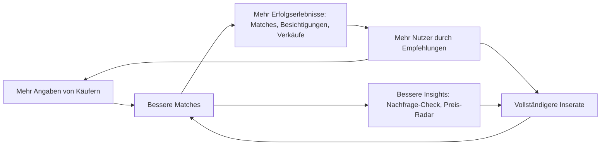

# 04 · Motivation & Datenstrategie: beide Seiten zum Mitmachen bringen

> Ziel: Käufer und Verkäufer geben freiwillig und gern so viele Informationen wie möglich, weil es ihnen sofort etwas bringt – nicht, weil wir sie drängen.

## 1. Warum das der Kern ist

Ein Matching ist nur so gut wie die Daten beider Seiten. Ein Käufer mit fünf Kriterien bekommt mittelmäßige Vorschläge, ein Inserat ohne Angaben findet keine passenden Käufer. Gleichzeitig ist die Tiefe unserer Daten der wichtigste Vorsprung gegenüber den Portalen.

## 2. Sieben Prinzipien

1. **Sofortiger Gegenwert.** Jede Antwort verändert sichtbar etwas: Der Feed wird besser, der Match-Wert genauer, eine neue Funktion wird freigeschaltet.
2. **Fortschritt sichtbar machen.** Profil-Stärke und Inserats-Stärke als Balken. Man startet nicht bei 0 %, sondern bei 20 % – das Gefühl, schon angefangen zu haben, motiviert zum Weitermachen.
3. **Selbsterkenntnis macht Spaß.** Ein Wohntyp-Ergebnis funktioniert wie ein Persönlichkeitstest: Man will es wissen und teilen.
4. **Vorteil im Wettbewerb.** Vollständige, verifizierte Profile stehen beim Verkäufer oben. Das versteht jeder sofort.
5. **Exklusivität.** Vollständige Profile sehen neue Angebote früher.
6. **Kontrolle schafft Offenheit.** Wer genau weiß, wer was sieht, gibt mehr preis. Anonym bis zum Match, Datenschutz-Cockpit, jederzeit löschbar.
7. **Weniger tippen.** Die KI liest Energieausweis, Grundriss und Fotos aus. Jede Angabe, die wir automatisch erkennen, muss niemand eintippen.

## 3. Käuferseite

### 3.1 Level-System

| Level | Was du angibst | Was du bekommst |
|---|---|---|
| 1 · Start | 5 Pflichtfragen (Kauf, Nutzung, Gebiet, Budget, Platz) | persönlicher Feed |
| 2 · Entdecker | Haushalt, Pendelziele, Wichtigkeit der Infrastruktur, Hobbys | Lage-Profil mit deinen Pendelzeiten in jedem Inserat, persönlicher Marktreport |
| 3 · Kenner | Wohntyp-Test, Zeitplan, Zukunftspläne, Stil | Käufer-Steckbrief, KI-Motivationsschreiben, Kompromiss-Assistent |
| 4 · Verifiziert | Finanzierungs-Check, Eigenkapital-Nachweis, Identität | Badges, Platz oben in der Verkäufer-Inbox, neue Angebote 24 Stunden früher, mehr Super-Crushes |

### 3.2 Mechaniken im Einzelnen

| Mechanik | So funktioniert es | Warum Nutzer mitmachen |
|---|---|---|
| Wohntraum-Quiz | 5 Fragen mit Bildern und Reglern, unter 90 Sekunden | schneller Start, macht Lust auf mehr |
| Wohntyp-Test | 15–20 This-or-That-Paare mit Fotos, Ergebnis z. B. „Stadtgärtner“, „Altbau-Romantiker“, „Landliebe“, „Rendite-Rechner“ | Neugier, teilbare Ergebniskarte |
| Mikrofragen im Feed | aus dem Verhalten abgeleitet: „Du crushst oft Häuser mit Garten – ist das ein Muss?“ | ein Tipp, und der Feed wird sofort besser |
| „Warum nicht?“ | nach dem Weiterwischen ein Tipp auf den Grund | der Feed lernt schneller, Verkäufer bekommen Feedback |
| Profil-Stärke | Balken mit nächstem Schritt und Belohnung | Fortschritt, Vollständigkeit |
| Käufer-Steckbrief | Bewerbungsmappe mit Badges | Vorteil gegenüber anderen Interessenten |
| Motivationsschreiben | KI schreibt pro Objekt einen persönlichen Entwurf – je vollständiger das Profil, desto besser | spart Zeit, wirkt persönlich |
| Marktreport & Kompromiss-Assistent | „Mit 15 Minuten mehr Pendelzeit doppelt so viele Häuser mit Garten“ | echter Erkenntnisgewinn |
| Gemeinsam suchen | Partner einladen, „Ihr habt beide gecrusht“ | Spaß, echte gemeinsame Entscheidung, zweiter Nutzer |
| Frühzugang | neue Inserate zuerst für passende, vollständige Profile | Exklusivität |
| Smarte Benachrichtigungen | nur Push-Nachrichten oberhalb einer Match-Schwelle | weniger Spam, mehr Vertrauen |

### 3.3 Beispieltexte (Tonalität)

- „Noch 2 Fragen, dann ist dein Steckbrief fertig. Verkäufer sehen vollständige Steckbriefe zuerst.“
- „Du hast 8 Altbauten gecrusht. Sollen wir dir mehr davon zeigen? [Ja] [Nein]“
- „Dein Match-Wert für dieses Haus ist von 72 % auf 86 % gestiegen, weil wir jetzt wissen, wo du arbeitest.“
- „Wofür wir das brauchen: Mit deinem Arbeitsort berechnen wir die Pendelzeit zu jedem Zuhause. Verkäufer sehen ihn nie.“

## 4. Verkäuferseite

| Mechanik | So funktioniert es | Warum Verkäufer mitmachen |
|---|---|---|
| Nachfrage-Check | Adresse und 3 Eckdaten, Ergebnis: Zahl und Budget passender, aktiver Käufer | Neugier, sofortiger Beweis, dass das Netzwerk lebt |
| KI-Studio | Fotos rein, Video, Texte und Posts raus | professionelles Ergebnis in Minuten, kostenlos |
| Automatisches Auslesen | Energieausweis, Grundriss und Fotos füllen Felder vor | weniger Arbeit, trotzdem mehr Daten |
| Inserats-Stärke | Balken mit konkreten Tipps und erwarteter Wirkung | mehr Crushes, bessere Platzierung |
| Qualifizierte Inbox | Steckbriefe sortiert nach Passung und Finanzierung | keine Anfragenflut, Zeitersparnis |
| Swipe-Insights | Gründe, warum Käufer weiterwischen | einzigartiges Feedback, hilft beim Preis |
| Preis-Radar | Preisempfehlung auf Basis echter Nachfrage | bessere Entscheidung, kürzere Vermarktungszeit |
| Verkaufsfahrplan | Checkliste mit Fortschritt (Unterlagen, Termine, Notar) | Sicherheit und Orientierung |
| Verkäufer-Wünsche | Zeitpunkt, Finanzierungsnachweis, Selbstnutzer oder Anleger | passendere Käufer stehen oben |

## 5. Makler: Geben und Nehmen

- Wer Inventar mit vollständigen Daten liefert, bekommt mehr Matches und genauere Käufer-Radar-Daten für seine Region.
- Die Tiefe des Käufer-Radars kann an den eigenen Datenbeitrag gekoppelt werden („Daten gegen Daten“).
- Das Branding im Studio macht jedes Video zur Werbung für das Maklerbüro – ein Anreiz, alle Objekte bei uns zu pflegen.

## 6. Werte-Tausch: Du gibst – du bekommst

| Du gibst … | … du bekommst | Wer sieht es? |
|---|---|---|
| Arbeitsort | Pendelzeit zu jedem Inserat | nur du |
| Kinder und Schulform | Kitas und Schulen im Lage-Profil, bessere Matches | Verkäufer sehen auf Wunsch nur die Haushaltsangabe („Familie mit Kind“) |
| Hobbys | passende Orte in der Nähe, Lage-Score | nur du (anonym in Auswertungen) |
| Finanzierungsstatus | Badge, Platz oben in der Inbox | Verkäufer sehen das Badge, keine Zahlen |
| Stil-Swipes | ein Feed, der deinen Geschmack trifft | niemand (nur das Modell) |
| Grundriss (Verkäufer) | mehr Crushes, Flächenprüfung | alle Käufer |
| Foto vom Energieausweis (Verkäufer) | Pflichtangaben automatisch, rechtssicheres Inserat | alle Käufer (nur die Pflichtangaben) |
| Gründe beim Weiterwischen (Käufer) | besserer Feed | Verkäufer nur zusammengefasst und anonym |

## 7. Grenzen: was wir bewusst nicht tun

- **Keine Dark Patterns.** Keine versteckten Opt-ins, keine künstliche Verknappung, kein „Du verpasst etwas“-Druck. DSGVO (freiwillige Einwilligung) und Digital Services Act verbieten das, und es zerstört Vertrauen.
- **Keine Kopplung.** Kernfunktionen funktionieren auch mit wenigen Angaben. Mehr Angaben bringen mehr Komfort, sind aber keine Zugangsvoraussetzung.
- **Nichts fragen, was wir nicht nutzen.** Jede Frage hat ein „Wofür?“.
- **Keine geschützten Merkmale im Matching.** Kein Geschlecht, keine Herkunft, keine Religion; Fotos erst nach dem Match; Alter nur optional und nie für Verkäufer filterbar.
- **Vorsicht bei sensiblen Daten.** Gesundheitsbezogene Bedürfnisse wie Barrierefreiheit erfassen wir als Wohnbedarf, nicht als Diagnose. Wünsche wie „Kirche oder Moschee in der Nähe“ verraten die Religion – also nur mit ausdrücklicher Einwilligung oder gar nicht.
- **Partnerkontakt nur auf Wunsch.** Ob sich ein Finanzierer oder Dienstleister meldet, entscheidet der Nutzer im Einzelfall.

## 8. Kennzahlen

| Kennzahl | Zielwert Beta (Hypothese) |
|---|---|
| Abschlussquote Wohntraum-Quiz (5 Pflichtfragen) | ≥ 80 % |
| Wohntyp-Test abgeschlossen | ≥ 50 % der Nutzer |
| beantwortete Fragen pro Käufer nach 14 Tagen (Durchschnitt) | ≥ 25 |
| Anteil Käufer auf Level 3 oder höher | ≥ 30 % |
| Antwortquote auf Mikrofragen | ≥ 40 % |
| Anteil der Weiter-Swipes mit Grund | ≥ 20 % |
| durchschnittliche Inserats-Stärke | ≥ 80 % |
| verifizierte Käufer (ab V1) | ≥ 15 % |
| Zusammenhang zwischen Profil-Stärke und Match-Quote | messbar positiv – der Beweis, dass sich Angaben lohnen |

## 9. Experimente für die Beta

1. Quiz vor dem Feed oder Feed sofort und Fragen später
2. Fortschrittsbalken ab 0 % oder ab 20 %
3. Badges sichtbar im Feed oder nur im Steckbrief
4. Frühzugang 24 Stunden, 12 Stunden oder gar nicht
5. Super-Crush-Limit 3 oder 5 pro Woche
6. „Warum nicht?“ nach jedem oder nach jedem dritten Weiter-Swipe
