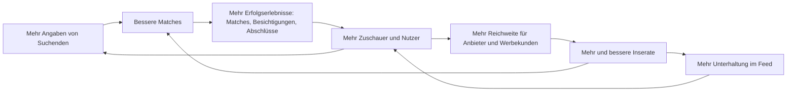

# 04 · Motivation & Datenstrategie: beide Seiten zum Mitmachen bringen

> Ziel: Suchende und Anbieter geben freiwillig und gern so viele Informationen wie möglich, weil es ihnen sofort etwas bringt – nicht, weil wir sie drängen. Und Zuschauer werden irgendwann zu Suchenden, weil ihr Profil dann schon fertig ist.

## 1. Warum das der Kern ist

Ein Matching ist nur so gut wie die Daten beider Seiten. Wer nur fünf Kriterien angibt, bekommt mittelmäßige Vorschläge, ein Inserat ohne Angaben findet keine passenden Interessenten. Gleichzeitig ist die Tiefe unserer Daten der wichtigste Vorsprung gegenüber den Portalen. Neu dazu kommt die Unterhaltung: Gute Filme bringen Zuschauer, Zuschauer bringen Reichweite für Anbieter und Werbekunden.

## 2. Sieben Prinzipien

1. **Sofortiger Gegenwert.** Jede Antwort verändert sichtbar etwas: Der Feed wird besser, der Match-Wert genauer, eine neue Funktion wird freigeschaltet.
2. **Fortschritt sichtbar machen.** Profil-Stärke und Inserats-Stärke als Balken. Man startet nicht bei 0 %, sondern bei 20 % – das Gefühl, schon angefangen zu haben, motiviert zum Weitermachen.
3. **Selbsterkenntnis und Spiel machen Spaß.** Ein Wohntyp-Ergebnis funktioniert wie ein Persönlichkeitstest, „Preis raten“ wie ein Quiz: Man will es wissen und teilen.
4. **Vorteil durch Passung, nie durch Geld.** Vollständige Profile passen besser und stehen deshalb weiter oben. Kaufen kann man diesen Platz nicht.
5. **Exklusivität.** Vollständige Profile sehen neue Angebote früher.
6. **Kontrolle schafft Offenheit.** Wer genau weiß, wer was sieht, gibt mehr preis. Anonym bis zum Match, bei Miete in Stufen, Datenschutz-Cockpit, jederzeit löschbar.
7. **Weniger tippen.** Die KI liest Energieausweis, Grundriss, Fotos und Videos aus. Jede Angabe, die wir automatisch erkennen, muss niemand eintippen.

## 3. Suchende: Kauf und Miete

### 3.1 Level-System

| Level | Was du angibst | Was du bekommst |
|---|---|---|
| 1 · Start | 5 Pflichtfragen (Kauf oder Miete, Nutzung bzw. Einzug, Gebiet, Budget, Platz) | persönlicher Feed, Matches per App und E-Mail |
| 2 · Entdecker | Haushalt, Pendelziele, Wichtigkeit der Infrastruktur, Hobbys | Lage-Profil mit deinen Pendelzeiten in jedem Inserat, persönlicher Marktreport |
| 3 · Kenner | Wohntyp-Test, Zeitplan, Zukunftspläne, Stil; bei Miete die Angaben für Stufe 2 | fertiger Steckbrief, KI-Motivationsschreiben, Kompromiss-Assistent, neue Angebote 24 Stunden früher |
| 4 · Bereit | beim Kauf Finanzierungs-Check und Eigenkapital-Nachweis; bei Miete Unterlagen im Dokumenten-Tresor; Identität | Badges „Finanzierung bestätigt“ bzw. „Unterlagen bereit“, mehr Super-Crushes |

**Badges dürfen niemanden ausschließen.** Wer zum Beispiel nach einem Zuzug noch keine Bonitätshistorie hat, kann andere Nachweise hinterlegen (Arbeitsvertrag, Bürgschaft, Übernahme durch eine öffentliche Stelle). Und bei Miete sieht der Vermieter die Unterlagen selbst ohnehin erst in Stufe 3 (siehe [Produktkonzept](03-produktkonzept.md)).

### 3.2 Mechaniken im Einzelnen

| Mechanik | So funktioniert es | Warum Nutzer mitmachen |
|---|---|---|
| Wohntraum-Quiz | 5 Fragen mit Bildern und Reglern, unter 90 Sekunden | schneller Start, macht Lust auf mehr |
| Wohntyp-Test | 15–20 This-or-That-Paare mit Fotos, Ergebnis z. B. „Stadtgärtner“, „Altbau-Romantiker“, „Landliebe“, „Rendite-Rechner“ | Neugier, teilbare Ergebniskarte |
| Mikrofragen im Feed | aus dem Verhalten abgeleitet: „Du crushst oft Wohnungen mit Balkon – ist das ein Muss?“ | ein Tipp, und der Feed wird sofort besser |
| „Warum nicht?“ | nach dem Weiterwischen ein Tipp auf den Grund | der Feed lernt schneller, Anbieter bekommen Feedback |
| Profil-Stärke | Balken mit nächstem Schritt und Belohnung | Fortschritt, Vollständigkeit |
| Steckbrief | Bewerbungsmappe mit Badges; bei Miete in drei Stufen | Vorteil durch Passung, einmal ausfüllen, überall bewerben |
| Motivationsschreiben | KI schreibt pro Objekt einen persönlichen Entwurf – je vollständiger das Profil, desto besser | spart Zeit, wirkt persönlich |
| Bewerbungsfenster | bei Miete werden alle Bewerbungen der ersten 24–72 Stunden gleich behandelt | kein Wettrennen um die schnellste Nachricht, weniger Stress |
| Matches per E-Mail | nur Angebote oberhalb einer Match-Schwelle, mit „Warum passt das?“ | weniger Spam, mehr Vertrauen |
| Marktreport & Kompromiss-Assistent | „Mit 15 Minuten mehr Pendelzeit doppelt so viele Wohnungen mit Balkon“ | echter Erkenntnisgewinn |
| Gemeinsam suchen | Partner oder Mitbewohner einladen, „Ihr habt beide gecrusht“ | Spaß, echte gemeinsame Entscheidung, zweiter Nutzer |
| Frühzugang | neue Inserate zuerst für passende, vollständige Profile | Exklusivität |

### 3.3 Beispieltexte (Tonalität)

- „Noch 2 Fragen, dann ist dein Steckbrief fertig. Vollständige Steckbriefe passen besser und stehen deshalb weiter oben.“
- „Du hast 8 Altbauten gecrusht. Sollen wir dir mehr davon zeigen? [Ja] [Nein]“
- „Dein Match-Wert für diese Wohnung ist von 72 % auf 86 % gestiegen, weil wir jetzt wissen, wo du arbeitest.“
- „Wofür wir das brauchen: Mit deinem Arbeitsort berechnen wir die Pendelzeit zu jedem Zuhause. Anbieter sehen ihn nie.“
- „Bei dieser Wohnung zählt nicht, wer zuerst schreibt. Alle Bewerbungen bis Donnerstag, 18 Uhr, werden gleich behandelt.“

## 4. Zuschauer: von der Unterhaltung zum Profil

Viele kommen nicht, weil sie suchen, sondern weil es Spaß macht. Das ist gewollt. Wir machen es leicht, nebenbei ein Profil aufzubauen – ohne Druck.

| Schritt | Mechanik | Was wir lernen | Was der Zuschauer davon hat |
|---|---|---|---|
| Zuschauen | Gastmodus, Themen-Feeds | welche Themen und Stile ankommen | Unterhaltung ohne Anmeldung |
| Mitspielen | „Preis raten“, Duelle | Preiswahrnehmung (nur anonymisiert ausgewertet) | Spaß, Ranglisten mit Freunden |
| Merken | Lesezeichen, „Traumhaus-Liste“ | Geschmack | eigene Sammlung, auf allen Geräten |
| Folgen | Kanäle von Maklern, Bauträgern, Creatorn | Vertrauen in Anbieter | neue Objekte der Lieblingskanäle zuerst |
| Wohntyp-Test | This-or-That mit Bildern | Stil und Lebensgefühl | teilbares Ergebnis |
| Profil | „Wenn du irgendwann suchst, ist dein Profil schon fertig.“ | Grundlage für Matches | Start ohne Aufwand, sobald es ernst wird |

Ein Konto braucht man erst zum Merken, Folgen und Mitspielen in Ranglisten. Wer nur schauen will, darf das.

## 5. Anbieter: privat und gewerblich

| Mechanik | So funktioniert es | Warum Anbieter mitmachen |
|---|---|---|
| Kostenlos inserieren | Basis für alle, auch für Makler, Bauträger und Hausverwaltungen | kein Risiko, kein Abo; bei ohne-makler.net zahlen Private ab 129 € für ein Verkaufsinserat |
| Nachfrage-Check | Adresse und 3 Eckdaten, Ergebnis: Zahl und Budget passender, aktiver Suchender | Neugier, sofortiger Beweis, dass das Netzwerk lebt |
| Vorhandene Videos hochladen | Social-Media-Filme rein, wir bereiten sie auf | die Arbeit ist schon gemacht – hier bekommt sie mehr Reichweite |
| Producer mit KI | Fotos rein, Film, Texte und Posts raus | professionelles Ergebnis in Minuten, kostenlos |
| Automatisches Auslesen | Energieausweis, Grundriss, Fotos und Videos füllen Felder vor | weniger Arbeit, trotzdem mehr Daten |
| Inserats-Stärke | Balken mit konkreten Tipps und erwarteter Wirkung | mehr Crushes, bessere Platzierung |
| Inbox mit fairen Filtern | Steckbriefe sortiert nach Passung, Anfrage-Bremse, Bewerbungsfenster | keine Anfragenflut, kein Inserat muss nach Minuten offline |
| Swipe-Insights | Gründe, warum Suchende weiterwischen | einzigartiges Feedback, hilft beim Preis |
| Preis-Radar | Preisempfehlung auf Basis echter Nachfrage | bessere Entscheidung, kürzere Vermarktungszeit |
| Verkaufs- und Vermietungsfahrplan | Checkliste mit Fortschritt | Sicherheit und Orientierung |
| Wünsche der Anbieter | Zeitpunkt, Finanzierungsnachweis, Personenzahl, Haustiere | passendere Interessenten stehen oben |
| Kanal mit Followern | Makler und Bauträger bauen ein Publikum auf | Reichweite, die bleibt – auch für das nächste Objekt |
| Extras | mehr Sichtbarkeit, wenn man will | volle Kontrolle: zahlen nur, wenn es sich lohnt |

## 6. Makler: Geben und Nehmen

- Kostenloser Import per OpenImmo: Für Makler ist immocrush nur ein weiterer Haken in ihrer Software.
- Wer Inventar mit vollständigen Daten liefert, bekommt mehr Matches und genauere Käufer-Radar-Daten für seine Region.
- Die Tiefe des Käufer-Radars kann an den eigenen Datenbeitrag gekoppelt werden („Daten gegen Daten“).
- Das Branding im Producer macht jedes Video zur Werbung für das Maklerbüro, der Kanal sammelt Follower – ein Anreiz, alle Objekte bei uns zu pflegen.

## 7. Werte-Tausch: Du gibst – du bekommst

| Du gibst … | … du bekommst | Wer sieht es? |
|---|---|---|
| Arbeitsort | Pendelzeit zu jedem Inserat | nur du |
| Kinder und Schulform | Kitas und Schulen im Lage-Profil, bessere Matches | beim Kauf auf Wunsch nur die Haushaltsangabe („Familie mit Kind“); bei Miete die Personenzahl erst in Stufe 2 |
| Hobbys | passende Orte in der Nähe, Lage-Score | nur du (anonym in Auswertungen) |
| Finanzierungsstatus (Kauf) | Badge, bessere Passung | Anbieter sehen das Badge, keine Zahlen |
| „Miete ist tragbar“ (Miete) | Bewerbung in Stufe 2 ohne Gehaltszahl | Vermieter sehen Ja oder Nein, erst nach deiner Bewerbung |
| Unterlagen im Tresor (Miete) | Badge „Unterlagen bereit“, schneller Vertrag | Vermieter erst in Stufe 3 |
| Stil-Swipes | ein Feed, der deinen Geschmack trifft | niemand (nur das Modell) |
| Preis-Tipps beim Spiel | Spaß, Ranglisten | niemand einzeln, nur anonymisierte Auswertung |
| Grundriss (Anbieter) | mehr Crushes, Flächenprüfung | alle Suchenden |
| Foto vom Energieausweis (Anbieter) | Pflichtangaben automatisch, rechtssicheres Inserat | alle Suchenden (nur die Pflichtangaben) |
| Gründe beim Weiterwischen (Suchende) | besserer Feed | Anbieter nur zusammengefasst und anonym |

## 8. Grenzen: was wir bewusst nicht tun

- **Keine Dark Patterns.** Keine versteckten Opt-ins, keine künstliche Verknappung, kein „Du verpasst etwas“-Druck. DSGVO (freiwillige Einwilligung) und Digital Services Act verbieten das, und es zerstört Vertrauen.
- **Keine Kopplung.** Kernfunktionen funktionieren auch mit wenigen Angaben. Mehr Angaben bringen mehr Komfort, sind aber keine Zugangsvoraussetzung.
- **Kein Vorrang gegen Geld.** Suchende zahlen nie, und niemand kann sich in der Inbox nach vorn kaufen.
- **Nichts fragen, was wir nicht nutzen.** Jede Frage hat ein „Wofür?“.
- **Keine geschützten Merkmale im Matching.** Kein Geschlecht, keine Herkunft, keine Staatsangehörigkeit, keine Religion; Fotos erst nach dem Match; Alter nur optional und nie für Anbieter filterbar.
- **Bei Miete nichts zu früh.** Angaben und Unterlagen werden nur in der Stufe freigegeben, in der Vermieter sie verlangen dürfen.
- **Vorsicht bei sensiblen Daten.** Gesundheitsbezogene Bedürfnisse wie Barrierefreiheit erfassen wir als Wohnbedarf, nicht als Diagnose. Wünsche wie „Kirche oder Moschee in der Nähe“ verraten die Religion – also nur mit ausdrücklicher Einwilligung oder gar nicht.
- **Werbung ohne Profil-Verkauf.** Werbung ist kontextbezogen; personalisiert nur mit Einwilligung, nie mit sensiblen Daten.
- **Partnerkontakt nur auf Wunsch.** Ob sich ein Finanzierer oder Dienstleister meldet, entscheidet der Nutzer im Einzelfall.

## 9. Kennzahlen

| Kennzahl | Zielwert Beta (Hypothese) |
|---|---|
| Abschlussquote Wohntraum-Quiz (5 Pflichtfragen) | ≥ 80 % |
| Wohntyp-Test abgeschlossen | ≥ 50 % der Nutzer |
| beantwortete Fragen pro Suchendem nach 14 Tagen (Durchschnitt) | ≥ 25 |
| Anteil Suchender auf Level 3 oder höher | ≥ 30 % |
| Antwortquote auf Mikrofragen | ≥ 40 % |
| Anteil der Weiter-Swipes mit Grund | ≥ 20 % |
| Anteil der Gäste, die ein Konto anlegen | ≥ 15 % |
| Wiederkehr der Zuschauer innerhalb von 7 Tagen | ≥ 30 % |
| durchschnittliche Inserats-Stärke | ≥ 80 % |
| Anteil der Inserate mit hochgeladenem Video | ≥ 30 % |
| Vermieter, die die Anfrage-Bremse nutzen | ≥ 50 % |
| verifizierte Suchende (ab V1) | ≥ 15 % |
| Zusammenhang zwischen Profil-Stärke und Match-Quote | messbar positiv – der Beweis, dass sich Angaben lohnen |

## 10. Experimente für die Beta

1. Quiz vor dem Feed oder Feed sofort und Fragen später
2. Gastmodus: Hinweis auf ein Konto nach 10 oder nach 20 Karten
3. Fortschrittsbalken ab 0 % oder ab 20 %
4. Badges sichtbar im Feed oder nur im Steckbrief
5. Frühzugang 24 Stunden, 12 Stunden oder gar nicht
6. Super-Crush-Limit beim Kauf 3 oder 5 pro Woche, Bewerbungen bei Miete 5 oder 10 pro Woche
7. Bewerbungsfenster 24 oder 48 Stunden
8. Werbung jede 8. oder jede 12. Karte
9. „Warum nicht?“ nach jedem oder nach jedem dritten Weiter-Swipe
