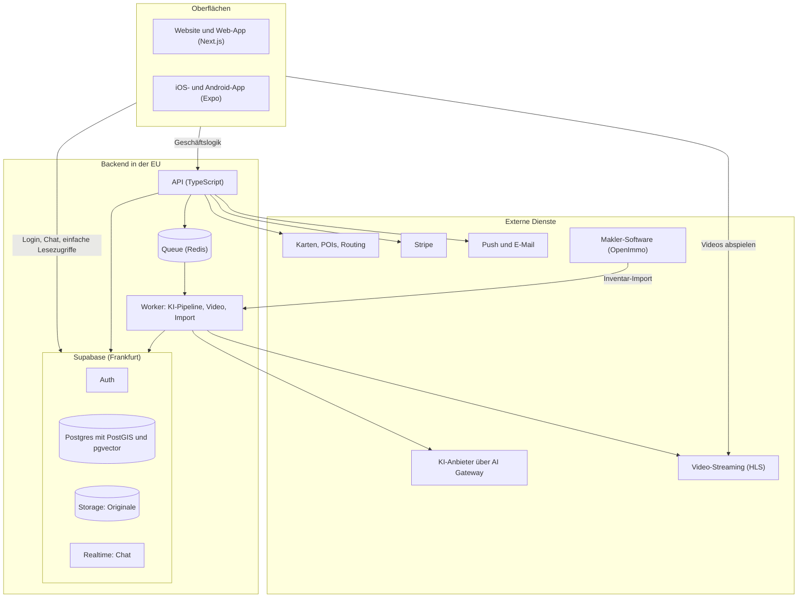
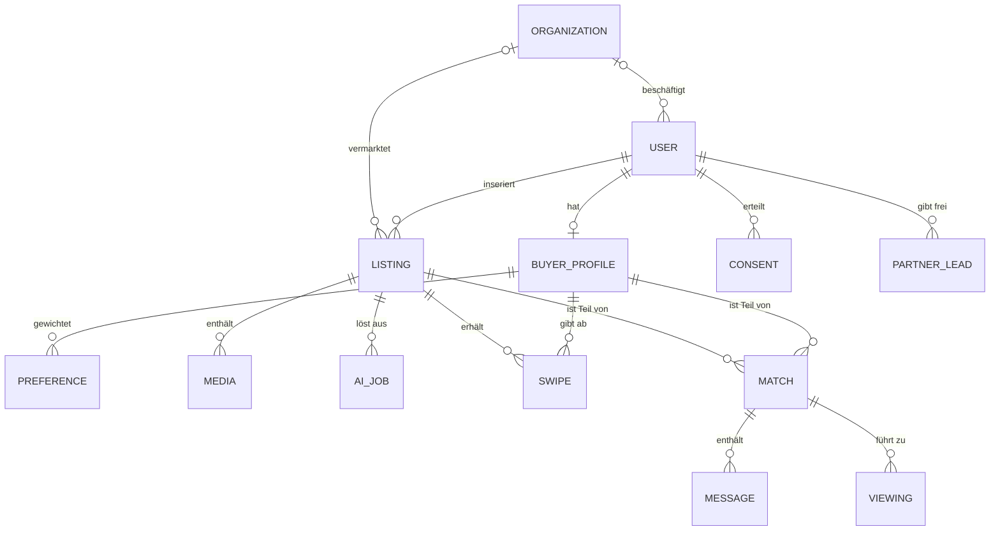
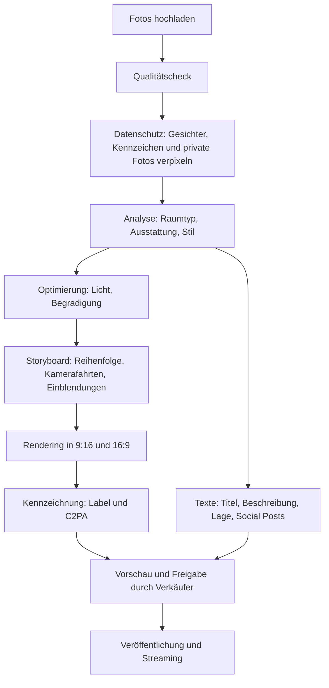
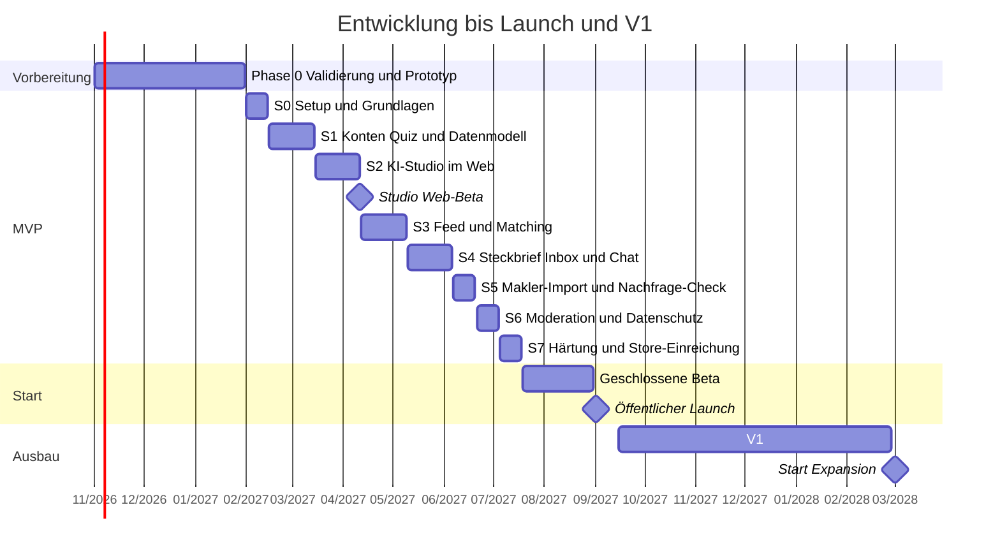

# 08 · Anwendungsentwicklungsplan

> Ziel: eine Website und Apps für iOS und Android, gebaut von einem kleinen Team in rund sechs Monaten bis zur Beta, öffentlicher Start im September 2027. Grundsatz: eine Sprache (TypeScript) für alles, bewährte Dienste einkaufen, selbst bauen nur, was uns unterscheidet: Matching, KI-Studio und Steckbrief.

## 1. Plattformen

| Plattform | Für wen | Umfang im MVP |
|---|---|---|
| **Website** (Next.js) | alle; Verkäufer und Makler am Rechner; Suchmaschinen | Startseite und Landingpages, Web-Quiz und Steckbrief, öffentliche Inseratsseiten, KI-Studio, Interessenten-Inbox, Verkäufer-Dashboard, Makler-Dashboard, Backoffice |
| **iOS-App** (Expo / React Native) | Käufer; Verkäufer unterwegs | Feed, Detailansicht, Matches und Chat, Steckbrief, Fotoaufnahme fürs Inserat, Inbox, Push-Nachrichten |
| **Android-App** (dieselbe Codebasis) | wie iOS | identisch |

Der Swipe-Feed ist zuerst ein App-Erlebnis (Video, Gesten, Push). Eine Browser-Version des Feeds folgt in V1.

## 2. Technologie-Stack

| Bereich | Wahl | Warum |
|---|---|---|
| Monorepo | pnpm und Turborepo | gemeinsame Typen, Schemas und Logik für Website, Apps und API |
| Website | Next.js (App Router), TypeScript | Suchmaschinen-tauglich (öffentliche Inserate), schnell entwickelt, passt zur vorhandenen Erfahrung |
| Apps | Expo (React Native) mit Expo Router; EAS Build, Submit und Update | eine Codebasis für iOS und Android, Updates ohne Store-Review für reine JavaScript-Änderungen |
| API | TypeScript mit Hono oder Fastify, Zod-Schemas, OpenAPI | Geschäftslogik, Matching, Partner-Schnittstellen |
| Datenbank | Postgres bei Supabase (Region Frankfurt) mit PostGIS und pgvector | Geodaten (Gebiete, Pendelzonen, Umkreise) und Bild-Embeddings für Stil-Ähnlichkeit in einer Datenbank |
| Login, Dateien, Echtzeit | Supabase Auth, Storage, Realtime, Row Level Security | Login per E-Mail-Code, Apple und Google; Chat in Echtzeit; Zugriffsrechte direkt in der Datenbank |
| Hintergrundjobs | Worker mit Queue (BullMQ und Redis oder Trigger.dev) | Video-Rendering, KI-Aufrufe, Inventar-Import, Benachrichtigungen |
| Video-Auslieferung | Mux oder Cloudflare Stream (HLS) | adaptive Qualität, schneller Start, Vorschaubilder |
| Inhalte | Payload oder Storyblok | Ratgeber, Landingpages, Seiten für Suchmaschinen |
| Hosting | Vercel (Website), Railway in der EU-Region (API, Worker, Redis) | bekannte Werkzeuge, Datenhaltung in der EU |
| Produkt-Analytics | PostHog (EU-Cloud) | Auswertungen, Feature-Flags, A/B-Tests |
| Fehlerüberwachung | Sentry | Website, Apps und API |
| Bezahlung | Stripe (Website); RevenueCat nur, falls In-App-Käufe nötig werden | Pakete und Abos |
| Push und E-Mail | Expo Push; Resend oder Postmark | Benachrichtigungen |
| Karten und Lage | MapLibre oder Mapbox; Points of Interest aus OpenStreetMap; Routing-API (TravelTime, Google Routes oder HERE); ÖPNV-Fahrpläne (GTFS) | Pendelzeiten, Erreichbarkeit, Lage-Profil |
| KI | eigene Abstraktionsschicht („AI Gateway“) über mehrere Anbieter für Text, Bildanalyse, Bildbearbeitung und Video | Anbieterwechsel ohne Umbau, Kosten- und Qualitätskontrolle |
| Herkunftsnachweis | C2PA-Metadaten | maschinenlesbare Kennzeichnung von KI-Inhalten |
| Makler-Schnittstelle | OpenImmo-Import (XML/ZIP per FTP aus der Makler-Software) | Standard im deutschen Markt |
| Tests | Vitest, Playwright (Website), Maestro (Apps) | automatisierte Qualitätssicherung |

**Aufgabenteilung:** Einfache Lesezugriffe und der Chat laufen direkt über Supabase, abgesichert durch Row Level Security. Alles mit Geschäftslogik – Matching, Inserate veröffentlichen, Kontaktfreigabe, Zahlungen, Partner – läuft über die eigene API.

**Verworfene Alternativen**

| Alternative | Warum nicht |
|---|---|
| Flutter | eigene Sprache (Dart), kein gemeinsamer Code mit Website und API |
| zwei native Apps (Swift und Kotlin) | doppelte Entwicklung und Kosten. Wo native Leistung nötig ist (Kamera, Video), erlaubt Expo eigene native Module. |
| eigene Server oder Kubernetes | Betriebsaufwand ohne Mehrwert in der Startphase |
| Firebase | schwächer bei relationalen Daten und Geo-Abfragen |
| Payload als App-Backend | stark als CMS, aber Matching, Echtzeit und Jobs passen besser in eine eigene API |

## 3. Architektur



## 4. Repository-Struktur

```text
immocrush/
├── apps/
│   ├── web/          # Next.js: Website, Web-Quiz, KI-Studio, Dashboards, Backoffice
│   ├── mobile/       # Expo: iOS- und Android-App
│   ├── api/          # TypeScript-API (Hono oder Fastify)
│   └── worker/       # Hintergrundjobs: KI-Pipeline, Video, OpenImmo-Import
├── packages/
│   ├── core/         # Domänenmodell, Zod-Schemas, Matching-Logik
│   ├── ui/           # Design-Tokens und gemeinsame Komponenten
│   ├── api-client/   # typisierter Client für Website und Apps
│   └── config/       # gemeinsame Konfiguration (TypeScript, Linting)
├── supabase/         # Migrationen, Row-Level-Security-Policies, Testdaten
├── docs/             # Konzeptdokumente und Architekturentscheidungen (ADR)
├── turbo.json
└── pnpm-workspace.yaml
```

Das Repository enthält derzeit nur die Konzeptdokumente. Der Code entsteht ab Sprint 0 in dieser Struktur.

## 5. Datenmodell



| Entität | Zweck | Wichtige Felder | Hinweise |
|---|---|---|---|
| USER | Konto | E-Mail, Telefon, Rollen, Verifizierungen | vollständige Löschung auf Wunsch |
| ORGANIZATION | Maklerbüro oder Partner | Name, Erlaubnis nach § 34c, Branding, Abo | |
| BUYER_PROFILE | Suchprofil | Nutzung, Budget, Suchgebiete (PostGIS), Haushalt, Level, Wohntyp, Geschmacksvektor (pgvector) | Sichtbarkeit pro Feld geregelt |
| PREFERENCE | gewichtetes Kriterium | Kriterium, Gewicht (Muss bis Lieber nicht), Quelle (Quiz, Mikrofrage, gelernt) | |
| LISTING | Inserat | Objektart, Preis, Fläche, Lage (PostGIS), Energie-Pflichtangaben, Käuferprovision, Status | |
| MEDIA | Fotos und Videos | Original, bearbeitete Fassung, KI-Kennzeichnung, C2PA, Bild-Embedding | Original bleibt immer erhalten |
| AI_JOB | KI-Verarbeitung | Typ, Status, Modell und Version, Kosten, Protokoll | Kostenkontrolle und Nachvollziehbarkeit |
| SWIPE | Crush, Weiter, Super-Crush | Richtung, Grund, Zeitpunkt, Position im Feed | Grundlage für Lernen und Swipe-Insights |
| MATCH | gegenseitiges Ja | Status (gecrusht, Match, Besichtigung, Angebot, abgeschlossen) | steuert die Freigabe der Kontaktdaten |
| MESSAGE | Chat | Text, Anhänge | Melden und Moderation |
| VIEWING | Besichtigung | Zeitfenster, Status | |
| CONSENT | Einwilligung | Zweck, Textversion, Zeitpunkt, Widerruf | Nachweispflicht nach DSGVO |
| PARTNER_LEAD | Kontaktweitergabe | Partner, Zweck, zugehörige Einwilligung | nur mit Einwilligung im Einzelfall |

**Datenschutz im Datenmodell**

- Felder haben Sichtbarkeitsstufen: nur ich, anonym vor dem Match, nach dem Match. Umgesetzt mit Datenbank-Views, Row Level Security und klar definierten API-Antworten.
- Sensible Angaben liegen in eigenen Tabellen mit strengeren Rechten.
- Auswertungen für Insights laufen in einem getrennten Bereich und nur über Gruppen mit mindestens 20 Profilen.
- Löschung entfernt alle personenbezogenen Daten. In Auswertungen bleiben nur anonyme Zählwerte.

## 6. Matching-Engine

**Ablauf pro Feed-Anfrage**

1. **Kandidaten** (Postgres, PostGIS): aktives Inserat, im Suchgebiet oder in der Pendelzone, Preis höchstens 10 % über dem Budget, passende Objektart und Mindestgröße, noch nicht gewischt. „Muss“-Kriterien wirken hier als Ausschluss.
2. **Bewertung** (TypeScript in `packages/core`): weiche Kriterien mit Gewichten, Lagewerte aus POI-Entfernungen und Pendelzeiten, Stil-Ähnlichkeit zwischen Geschmacksvektor und Bild-Embeddings (pgvector).
3. **Feed-Mischung:** etwa 70 % beste Matches, 20 % Entdecken knapp außerhalb der Kriterien, 10 % neue Inserate. Dazu Vielfalt (nicht fünfmal dasselbe Viertel hintereinander). Bezahlte Platzierungen sind gekennzeichnet und begrenzt.
4. **Erklärung:** die drei wichtigsten Übereinstimmungen und Abweichungen werden mit dem Wert gespeichert („Warum passt das?“).

```ts
type Weight = 0 | 1 | 2 | 3;
function matchScore(criteria: { weight: Weight; fulfillment: number }[]): number {
  const total = criteria.reduce((sum, c) => sum + c.weight, 0);
  if (total === 0) return 0;
  const achieved = criteria.reduce((sum, c) => sum + c.weight * c.fulfillment, 0);
  return Math.round((achieved / total) * 100);
}
```

„Egal“ hat das Gewicht 0, „Lieber nicht“ wird als umgekehrte Erfüllung gewertet. Das Beispiel aus dem [Produktkonzept](03-produktkonzept.md) ergibt so 87 %.

**Gegenseitigkeit:** Die Verkäufer-Inbox sortiert nach einer Kombination aus Passung Käufer → Objekt, Passung zu den Verkäufer-Wünschen, Qualifizierung (Badges) und Super-Crush.

**Fairness im Code:** Das Ranking darf nur Merkmale aus einer festen Liste erlaubter Merkmale nutzen. Geschlecht, Herkunft, Religion, Fotos und Namen sind technisch ausgeschlossen. Regelmäßige Prüfungen stellen sicher, dass das so bleibt.

**Vorberechnung:** Bei neuen Inseraten berechnet der Worker passende Käufer (für Benachrichtigungen und den Käufer-Radar). Ändert sich ein Profil, wird der Feed-Vorrat neu berechnet. Der Feed lädt in Seiten zu je 20 Karten.

**Ausbaustufen:** Im MVP Regeln, Gewichte und Stil-Ähnlichkeit. In V1 lernt das System Gewichte aus Swipes und Absagegründen (je Nutzer und Region). In V2 folgt ein lernendes Ranking über alle Nutzer – trainiert nur mit erlaubten Merkmalen.

**Lagedaten:** Points of Interest aus OpenStreetMap, monatlich aktualisiert in PostGIS. Schulformen werden mit amtlichen Schulverzeichnissen der Länder ergänzt, weil sie in OpenStreetMap lückenhaft sind. Pendelzeiten kommen aus einer Routing-API und werden zwischengespeichert. Der ÖPNV-Takt wird aus öffentlichen Fahrplandaten (GTFS) berechnet. Religiöse Einrichtungen fließen ohne ausdrückliche Einwilligung nicht ins Matching ein.

## 7. KI-Pipeline des Studios



- **Standard-Video:** kontrollierte Kamerafahrten über die echten Fotos, mit Tiefen- und Parallax-Effekt, Musik, Einblendungen und Abspann. Das ist günstig, schnell und erfindet keine Architektur.
- **Generative Videoclips** gibt es erst nach einem Benchmark mit 50 echten Inseraten (Qualität, Kosten, Dauer) und nur mit Qualitätsprüfung. Generative Modelle neigen dazu, Räume und Details zu verändern.
- **Texte** entstehen aus strukturierten Fakten und Lagedaten. Ein Prüfschritt vergleicht die Aussagen mit den Daten und markiert Erfundenes, etwa eine Ausstattung, die nicht angegeben wurde.
- **Energieausweis-Scan:** Texterkennung und Bildanalyse übertragen die Pflichtangaben in Felder. Der Verkäufer bestätigt sie.
- **Moderation:** automatische Prüfung von Bildern und Texten, Erkennung doppelter Bilder als Betrugssignal.
- **Steuerung:** Modelle und Prompts sind versioniert, Kosten werden pro Job protokolliert. Vertraglich ausgeschlossen ist, dass Anbieter unsere Daten zum Training nutzen. Anbieter mit Verarbeitung in der EU werden bevorzugt.
- **Ziel:** Video und Texte sind in unter 10 Minuten fertig, die KI-Kosten liegen bei 1–10 € pro Inserat.

## 8. Releases

| Bereich | MVP (Start September 2027) | V1 (bis Februar 2028) | V2 (2028) |
|---|---|---|---|
| Käufer | Wohntraum-Quiz, Wohntyp-Test, Video-Feed mit Crush, Weiter und Super-Crush, Detailansicht mit Lage-Profil und Match-Erklärung, Steckbrief mit Link und QR-Code, Motivationsschreiben, Matches, Chat, Push | Gemeinsam suchen, Marktreport und Kompromiss-Assistent, Steckbrief als PDF, Feed im Browser | Käufer-Plus, Übersetzungen |
| Verkäufer | Nachfrage-Check, Inserat-Assistent mit Inserats-Stärke, KI-Studio (Fotoaufnahme, Optimierung, Erkennung, Video, Texte, Pflichtangaben-Check, Energieausweis-Scan, Social-Paket), Inbox mit Moduswahl, Dashboard mit Swipe-Insights | Preis-Radar, Besichtigungsplaner, Home Staging, KI-Sprecher, Grundriss, Exposé-PDF, „Ein Tag in diesem Zuhause“, Käufer entdecken, Verkaufsfahrplan, Pakete über Stripe | – |
| Makler | OpenImmo-Import, Dashboard mit Inbox, Studio mit Branding | Käufer-Radar, Team-Funktionen, CRM-Export, Makler Pro | Off-Market-Matching |
| Matching | Regeln, Gewichte, Stil-Ähnlichkeit | Gewichte aus Swipes gelernt, Absagegründe | lernendes Ranking, Match-Wahrscheinlichkeit |
| Vertrauen | Telefon- und E-Mail-Verifizierung, Finanzierungsnachweis per Upload (manuell geprüft), Melden und Blockieren, Moderation | Ausweis-Verifizierung, Finanzierungs-Check mit Partner, automatische Betrugserkennung | – |
| Plattform | Website, iOS, Android, Backoffice, Analytics | Partnerportal | Mietbereich, Bauträger, Insights für Kunden |

**Bewusst nicht im MVP:** Mietbereich, Bauträger-Projekte, Bezahlfunktionen (folgen im vierten Quartal 2027), Live-Videobesichtigungen, Übersetzungen, weitere Länder – und niemals die Übernahme fremder Inserate von anderen Portalen (siehe [Recht](09-recht-datenschutz-compliance.md)).

## 9. Zeitplan



Gearbeitet wird in Zwei-Wochen-Sprints; S1 bis S4 fassen jeweils zwei Sprints zusammen.

| Sprint | Zeitraum | Ergebnis |
|---|---|---|
| S0 | 1.–14. Feb 2027 | Monorepo, CI/CD, Umgebungen (Entwicklung, Test, Produktion), Supabase-Projekt, Login-Grundlagen, Design-System-Basis, Analytics und Fehlerüberwachung; Datenschutz-Folgenabschätzung gestartet |
| S1 | 15. Feb – 14. März | Konten und Rollen, Wohntraum-Quiz und Wohntyp-Test (Web und App), Datenmodell für Profile und Inserate, Medien-Upload, Backoffice-Grundgerüst |
| S2 | 15. März – 11. April | KI-Studio im Web: Upload, Qualitätscheck, Optimierung, Raumerkennung, Texte, Video-Pipeline, Kennzeichnung. **Meilenstein: Studio-Web-Beta mit ersten Verkäufern und Maklern** |
| S3 | 12. April – 9. Mai | Feed in der App: Video-Player, Gesten, Matching v1, Lagedaten, Detailansicht mit Match-Erklärung |
| S4 | 10. Mai – 6. Juni | Steckbrief und Motivationsschreiben, Verkäufer-Inbox, Match-Ablauf, Chat, Push-Nachrichten |
| S5 | 7.–20. Juni | OpenImmo-Import, Makler-Dashboard, Nachfrage-Check, Energieausweis-Scan, Pflichtangaben-Check |
| S6 | 21. Juni – 4. Juli | Moderation, Melden und Blockieren, Datenschutz-Cockpit, Konto löschen, rechtliche Seiten, Store-Vorbereitung |
| S7 | 5.–18. Juli | Performance, Barrierefreiheit, Sicherheitstests, End-to-End-Tests, Einreichung bei TestFlight und im Google-Play-Testtrack |
| Beta | 19. Juli – 31. August | geschlossene Beta in der Startregion, wöchentliche Releases, Auswertung der Kohorten |
| Launch | 1. September 2027 | Veröffentlichung in App Store und Google Play |
| V1 | 15. Sep 2027 – 28. Feb 2028 | Funktionen der Spalte V1 aus Abschnitt 8, Bezahlung ab dem vierten Quartal 2027 |

**Puffer:** Der Plan ist ambitioniert. Wenn es eng wird, verschieben wir Funktionen nach V1, nicht den Starttermin der Beta. Kandidaten dafür: Energieausweis-Scan, Social-Paket, Swipe-Insights.

## 10. Team

| Rolle | Phase 0 (Nov – Jan) | Phase 1 (Feb 2027 – Anfang 2028) | Phase 2 (2028) |
|---|---|---|---|
| Gründer: Produkt, Branche, Makler-Netzwerk | ✓ | ✓ | ✓ |
| CTO / Lead Engineer, idealerweise Mitgründer | Suche, Architektur | ✓ | ✓ |
| Full-Stack-Entwickler (TypeScript, React, React Native) | – | 2–3 | 4–6 |
| Product Designer (UX, UI, Motion) | freiberuflich für den Prototyp | 1 | 1–2 |
| KI-Engineer | freiberuflich für den Video-Benchmark | 0,5–1 | 1–2 |
| Qualitätssicherung | – | ab der Beta, Teilzeit | 1 |
| Growth und Content | Gründer, freiberufliche Unterstützung | 1 | 2–3 |
| Makler-Vertrieb und Partnerschaften | Gründer | Gründer, ab Launch +1 | 2–4 |
| Support und Moderation | – | ab der Beta, Teilzeit | 2 |
| extern: Datenschutzbeauftragter, Kanzlei, Steuerberatung | Erstberatung | laufend | laufend |

Eine Agentur kann den Design-Sprint oder einzelne Module übernehmen. Matching und Studio-Pipeline gehören aber ins eigene Team – sie sind der Kern des Unternehmens.

## 11. Kaufen oder selbst bauen

| Komponente | Entscheidung | Begründung |
|---|---|---|
| Login, Dateien, Echtzeit | kaufen (Supabase) | Standard, kein Wettbewerbsvorteil |
| Video-Auslieferung | kaufen (Mux oder Cloudflare Stream) | komplex, günstig einzukaufen |
| Video-Rendering-Pipeline | selbst bauen, mit eingekauften Modellen | Kern des Studios; Qualität und Kosten in eigener Hand |
| KI-Modelle | per API einkaufen, über das AI Gateway austauschbar | der Markt entwickelt sich monatlich |
| Home Staging (V1) | zunächst per API einkaufen (z. B. Pedra bietet eine an) | schneller am Markt |
| Matching | selbst bauen | Kern des Wettbewerbsvorteils |
| Lagedaten | OpenStreetMap und GTFS selbst aufbereiten, Routing einkaufen | Kosten und Kontrolle |
| OpenImmo-Import | selbst bauen | offener Standard, überschaubar |
| Ausweis-Verifizierung (V1) | kaufen (spezialisierte Anbieter) | Regulierung, Betrugsschutz |
| Finanzierungs-Check | Partner | erlaubnispflichtig (§ 34i GewO) |
| Zahlungen | Stripe | Standard |
| Inhalte | Payload oder Storyblok | vorhandene Erfahrung |

## 12. Laufende Kosten

| Posten | pro Monat in Phase 1 | Bemerkung |
|---|---|---|
| Team | 40–65 Tsd. € | rund 6–7 Vollzeitstellen inklusive Arbeitgeberkosten, teils freiberuflich |
| Infrastruktur (Supabase, Railway, Vercel, Video-Streaming, Karten und Routing) | 300–1.500 € | wächst mit Nutzern und Videominuten |
| KI-Nutzung (Text, Bild, Video) | 500–3.000 € | 1–10 € pro Inserat, dazu Texte und Analysen |
| Werkzeuge (Design, Analytics, Fehlerüberwachung, Projektmanagement) | 500–1.000 € | |
| Datenschutzbeauftragter und Rechtsberatung | 500–2.000 € | in der Startphase höher |
| Apple Developer Program | 99 $ pro Jahr | |
| Google Play Console | 25 $ einmalig | |
| einmalig vor dem Launch | 15–40 Tsd. € | Design-System, Penetrationstest, rechtliche Prüfung, Markenanmeldung |

## 13. Qualität, Sicherheit, Performance

- **Tests:** Unit-Tests für die Kernlogik (vor allem Matching), Integrationstests für die API, Tests der Row-Level-Security-Regeln, End-to-End-Tests mit Playwright (Website) und Maestro (Apps).
- **CI/CD:** Lint, Typprüfung, Tests und Build für jeden Pull Request; Vorschau-Umgebungen für die Website; interne App-Builds über EAS.
- **Sicherheit:**
  - Ausrichtung an OWASP ASVS (Web und API) und OWASP MASVS (Apps), Penetrationstest vor dem Launch
  - Row Level Security auf allen Tabellen, signierte URLs für Medien, Rate-Limits
  - Zwei-Faktor-Login und Zugriffsprotokoll im Backoffice
  - Backups mit Wiederherstellung auf einen beliebigen Zeitpunkt
  - Meldeprozess für Datenpannen (innerhalb von 72 Stunden an die Aufsichtsbehörde)
- **Performance-Ziele:**
  - erster Videoframe in unter 1 Sekunde im Mobilfunknetz
  - flüssiges Wischen
  - App-Start in unter 2 Sekunden
  - Feed-Antwort der API in unter 300 ms (95. Perzentil)
  - die nächsten 2–3 Videos werden vorgeladen
- **Barrierefreiheit:** WCAG 2.1 AA in Website und Apps, Screenreader-Beschriftungen, ausreichende Kontraste, Untertitel für alle Videos. Jede Wischgeste hat eine Alternative per Button.
- **Überwachung:** Sentry, Verfügbarkeitsprüfungen, PostHog-Dashboards, KI-Kosten pro Tag.

## 14. Besonderheiten der App-Stores

- **Konto löschen in der App** ist Pflicht bei Apple. Google verlangt zusätzlich einen Lösch-Weg im Web.
- **Sign in with Apple:** Wer Login mit Google anbietet, muss bei Apple eine gleichwertige, datensparsame Alternative anbieten. Sign in with Apple erfüllt das.
- **Nutzerinhalte** (Inserate, Chat) verlangen Melden, Blockieren, Filter und erreichbare Kontaktdaten.
- **Datenschutzangaben** in beiden Stores („Privacy Nutrition Label“ bei Apple, „Datensicherheit“ bei Google). Ohne Tracking-SDKs entfällt der Tracking-Dialog von Apple (App Tracking Transparency).
- **Entwicklerkonten als Organisation anlegen** – dafür braucht es eine D-U-N-S-Nummer, die einige Tage bis Wochen dauern kann. Neue private Google-Konten müssen vor der Veröffentlichung 14 Tage mit mindestens 12 Testern testen; Organisationskonten nicht.
- **Bezahlung:** siehe [Geschäftsmodell](05-geschaeftsmodell.md), Abschnitt 8 (Preisprinzipien).
- **Deep Links** (Universal Links bzw. App Links): Inserats- und Steckbrief-Links öffnen die App, wenn sie installiert ist, sonst die Website.
- **Push-Erlaubnis** fragen wir im passenden Moment ab (nach dem ersten Crush), nicht beim ersten Start.
- **Updates ohne Store-Review** (EAS Update) nur für Fehlerbehebungen und kleine Änderungen; neue Funktionen gehen regulär durch das Review.
- **Review-Zeiten einplanen:** Die erste Einreichung wird oft abgelehnt. Deshalb reichen wir schon in S7 ein, nicht erst kurz vor dem Launch.

## 15. Engineering-Prinzipien

1. **Eine Sprache, gemeinsame Schemas.** TypeScript überall; Zod-Schemas aus `packages/core` gelten in Website, Apps und API.
2. **Kaufen statt bauen – außer beim Kern.** Matching, Studio-Pipeline und Steckbrief sind unser Produkt, der Rest ist Infrastruktur.
3. **Datenschutz und Fairness ab dem ersten Commit.** Sichtbarkeitsregeln im Datenmodell, erlaubte Merkmale im Ranking als Liste im Code.
4. **Kleine, häufige Releases.** Trunk-based Development mit Feature-Flags, Vorschau-Umgebungen, in der Beta wöchentliche App-Releases.
5. **Jede Funktion wird gemessen.** Ereignisse und Erfolgskriterium werden vor dem Bau festgelegt.
6. **KI bleibt austauschbar.** AI Gateway, versionierte Prompts, Kosten pro Job.
7. **Entscheidungen werden dokumentiert.** Architecture Decision Records in `docs/adr`.
8. **Bewährte Technik vor Experimenten.**
