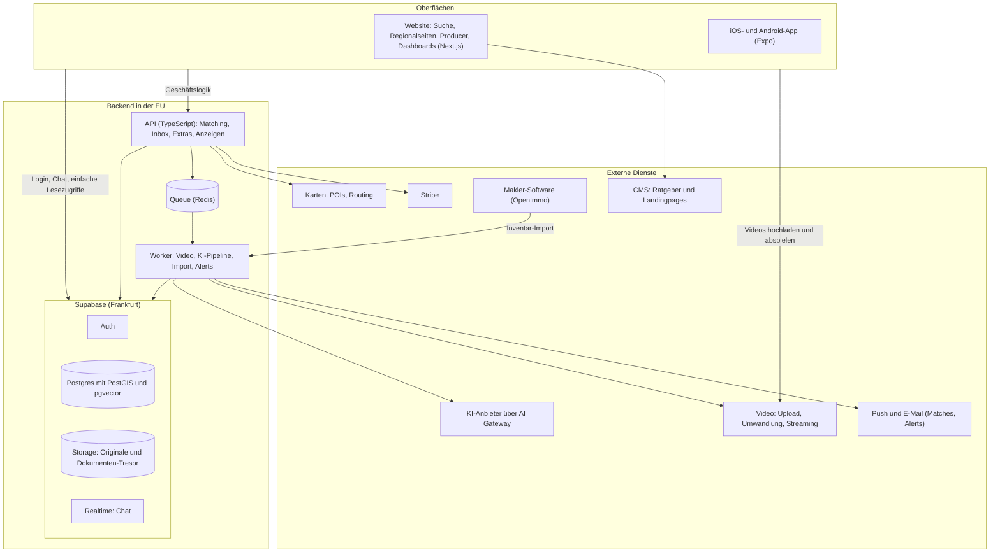
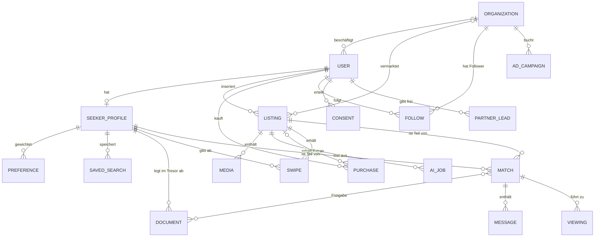
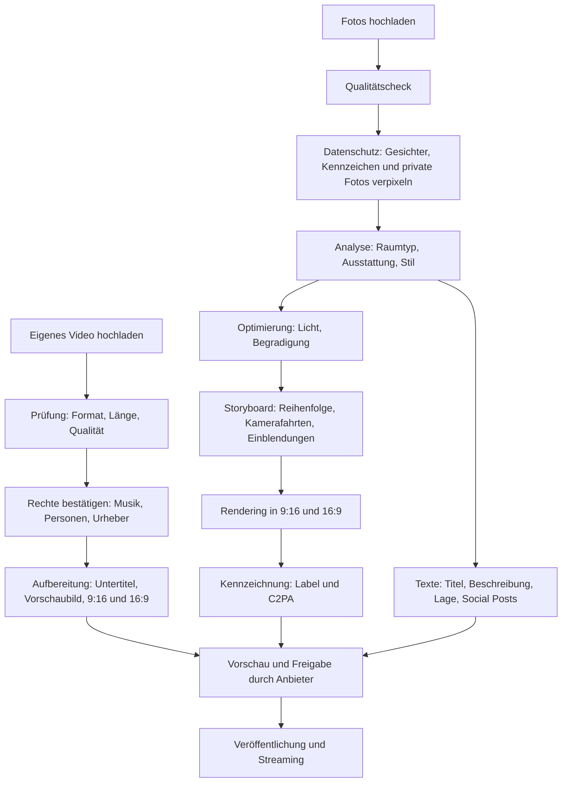
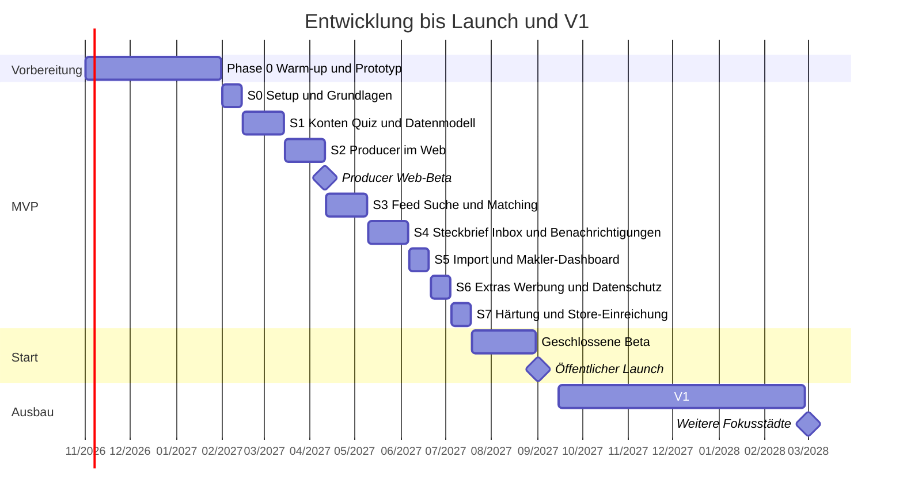

# 08 · Anwendungsentwicklungsplan

> Ziel: eine Website und Apps für iOS und Android, gebaut von einem sehr kleinen, KI-getriebenen Team – zwei erfahrene Entwickler, die Coding-Agenten führen – in rund sechs Monaten bis zur Beta, öffentlicher Start im September 2027. Kauf und Miete von Anfang an, kostenlos für alle, finanziert über Extras und Werbung. Grundsatz: eine Sprache (TypeScript) für alles, bewährte Dienste einkaufen, selbst bauen nur, was uns unterscheidet: Feed und Matching, Producer und Steckbrief.

## 1. Plattformen

| Plattform | Für wen | Umfang im MVP |
|---|---|---|
| **Website** (Next.js) | alle; Anbieter am Rechner; Zuschauer und Suchende aus Google | klassische Suche mit Filtern, Liste und Karte; Regionalseiten für Suchmaschinen; öffentliche Inseratsseiten mit Film; Themen-Feeds zum Anschauen ohne Konto; Web-Quiz und Steckbrief; Producer mit Video-Upload und KI; Inbox und Dashboards für Private, Makler und Hausverwaltungen; Extras buchen; Werbeflächen für Partner; Backoffice |
| **iOS-App** (Expo / React Native) | Suchende und Zuschauer; Anbieter unterwegs | Feed im Vollbild mit Gastmodus, Detailansicht, Liste und Karte, Matches und Chat, Steckbrief mit Stufen bei Miete, Producer (Videos und Fotos vom Handy), Inbox, Push-Nachrichten |
| **Android-App** (dieselbe Codebasis) | wie iOS | identisch |

Auf der Website ist die klassische Suche die Hauptansicht, denn dort kommen die Menschen aus Google an. In der App ist es der Swipe-Feed. Den vollen Feed mit Matching gibt es in V1 auch im Browser.

## 2. Technologie-Stack

| Bereich | Wahl | Warum |
|---|---|---|
| Monorepo | pnpm und Turborepo | gemeinsame Typen, Schemas und Logik für Website, Apps und API |
| Website | Next.js (App Router), TypeScript; serverseitiges Rendering und inkrementelle Aktualisierung für Such- und Regionalseiten | Suchmaschinen-tauglich, schnell, passt zur vorhandenen Erfahrung |
| Apps | Expo (React Native) mit Expo Router; EAS Build, Submit und Update | eine Codebasis für iOS und Android, Updates ohne Store-Review für reine JavaScript-Änderungen |
| API | TypeScript mit Hono oder Fastify, Zod-Schemas, OpenAPI | Geschäftslogik, Matching, Inbox, Extras, Anzeigen, Partner-Schnittstellen |
| Datenbank | Postgres bei Supabase (Region Frankfurt) mit PostGIS und pgvector | Geodaten (Gebiete, Pendelzonen, Umkreise) und Bild-Embeddings für Stil-Ähnlichkeit in einer Datenbank |
| Suche | zuerst Postgres mit PostGIS und Volltextsuche; ab großem Inventar Typesense oder OpenSearch | einfach starten, später für Hunderttausende Inserate skalieren |
| Login, Dateien, Echtzeit | Supabase Auth, Storage, Realtime, Row Level Security | Login per E-Mail-Code, Apple und Google; Chat in Echtzeit; Zugriffsrechte direkt in der Datenbank |
| Hintergrundjobs | Worker mit Queue (BullMQ und Redis oder Trigger.dev) | Video-Aufbereitung, KI-Aufrufe, Import, Benachrichtigungen |
| Video | Mux oder Cloudflare Stream: direkter Upload vom Gerät, Umwandlung, Auslieferung (HLS), automatische Untertitel | große Videodateien laufen nicht über unsere Server; adaptive Qualität, schneller Start |
| Inhalte | Payload oder Storyblok | Ratgeber, Landingpages, Seiten für Anbieter und Werbekunden |
| Suchmaschinen | Sitemaps und Video-Sitemaps, strukturierte Daten (schema.org, z. B. VideoObject und BreadcrumbList), saubere URLs pro Stadt, Stadtteil und Objektart | Sichtbarkeit in Google, auch in den Video-Ergebnissen |
| Hosting | Vercel (Website), Railway in der EU-Region (API, Worker, Redis) | bekannte Werkzeuge, Datenhaltung in der EU |
| Produkt-Analytics | PostHog (EU-Cloud) | Auswertungen, Feature-Flags, A/B-Tests |
| Fehlerüberwachung | Sentry | Website, Apps und API |
| Bezahlung | Stripe mit Stripe Tax und Rechnungen; RevenueCat nur, falls In-App-Käufe nötig werden | Extras, Pakete und Monatspakete für Gewerbliche, korrekte Rechnungen für Firmenkunden |
| Werbung | eigene einfache Auslieferung für Partner-Karten (Kampagnen, Region, Kontext, Kontaktbegrenzung, Berichte); später Google Ad Manager für Werbeflächen auf der Website | volle Kontrolle über Kennzeichnung und Datenschutz; programmatische Werbung erst bei Reichweite |
| Einwilligungen | Consent-Management-Plattform für Website und Apps; bei programmatischer Werbung nach dem IAB-Standard TCF | Einwilligungen für Analyse und personalisierte Werbung nachweisbar einholen |
| Push und E-Mail | Expo Push; Resend oder Postmark für Matches und Alerts; ein Newsletter-Werkzeug mit EU-Hosting | Benachrichtigungen; E-Mails mit SPF, DKIM, DMARC und Abmeldung per Klick, damit sie nicht im Spam landen |
| Karten und Lage | MapLibre oder Mapbox; Points of Interest aus OpenStreetMap; Routing-API (TravelTime, Google Routes oder HERE); ÖPNV-Fahrpläne (GTFS) | Pendelzeiten, Erreichbarkeit, Lage-Profil |
| KI | eigene Abstraktionsschicht („AI Gateway“) über mehrere Anbieter für Text, Bildanalyse, Bildbearbeitung und Video | Anbieterwechsel ohne Umbau, Kosten- und Qualitätskontrolle |
| Herkunftsnachweis | C2PA-Metadaten | maschinenlesbare Kennzeichnung von KI-Inhalten |
| Makler-Schnittstelle | OpenImmo-Import (XML/ZIP per FTP aus der Makler-Software); Weiterleitung von Anfragen per E-Mail im OpenImmo-Feedback-Format | Standard im deutschen Markt |
| Tests | Vitest, Playwright (Website), Maestro (Apps), k6 (Lasttests) | automatisierte Qualitätssicherung, Vorbereitung auf Lastspitzen |

**Aufgabenteilung:** Einfache Lesezugriffe und der Chat laufen direkt über Supabase, abgesichert durch Row Level Security. Alles mit Geschäftslogik – Matching, Inserate veröffentlichen, Stufen und Kontaktfreigabe, Extras, Anzeigen, Partner – läuft über die eigene API.

**Verworfene Alternativen**

| Alternative | Warum nicht |
|---|---|
| Flutter | eigene Sprache (Dart), kein gemeinsamer Code mit Website und API |
| zwei native Apps (Swift und Kotlin) | doppelte Entwicklung und Kosten. Wo native Leistung nötig ist (Kamera, Video), erlaubt Expo eigene native Module. |
| eigene Server oder Kubernetes | Betriebsaufwand ohne Mehrwert in der Startphase |
| Firebase | schwächer bei relationalen Daten und Geo-Abfragen |
| Payload als App-Backend | stark als CMS, aber Matching, Echtzeit und Jobs passen besser in eine eigene API |
| fremdes Werbenetzwerk ab dem ersten Tag | Tracking, Einwilligungs-Dialoge und Werbung, die nicht zur Marke passt; lohnt sich erst bei großer Reichweite |

## 3. Architektur



## 4. Repository-Struktur

```text
immocrush/
├── apps/
│   ├── web/          # Next.js: Website, Suche, Regionalseiten, Producer, Dashboards, Backoffice
│   ├── mobile/       # Expo: iOS- und Android-App
│   ├── api/          # TypeScript-API (Hono oder Fastify)
│   └── worker/       # Hintergrundjobs: Video, KI-Pipeline, OpenImmo-Import, Alerts
├── packages/
│   ├── core/         # Domänenmodell, Zod-Schemas, Matching-Logik, erlaubte Merkmale
│   ├── ui/           # Design-Tokens und gemeinsame Komponenten
│   ├── emails/       # E-Mail-Vorlagen (Matches, Alerts, Absagen)
│   ├── api-client/   # typisierter Client für Website und Apps
│   └── config/       # gemeinsame Konfiguration (TypeScript, Linting)
├── supabase/         # Migrationen, Row-Level-Security-Policies, Testdaten
├── docs/             # Konzeptdokumente und Architekturentscheidungen (ADR)
├── turbo.json
└── pnpm-workspace.yaml
```

Das Repository enthält derzeit nur die Konzeptdokumente. Der Code entsteht ab Sprint 0 in dieser Struktur.

## 5. Datenmodell



| Entität | Zweck | Wichtige Felder | Hinweise |
|---|---|---|---|
| USER | Konto | E-Mail, Telefon, Rollen, Verifizierungen, privat oder gewerblich | vollständige Löschung auf Wunsch |
| ORGANIZATION | Maklerbüro, Bauträger, Hausverwaltung oder Werbekunde | Name, Erlaubnis nach § 34c GewO, Branding, Kanal, Pakete | |
| SEEKER_PROFILE | Suchprofil für Kauf oder Miete | Kauf oder Miete, Nutzung, Budget bzw. Warmmiete, Suchgebiete (PostGIS), Einzugstermin, Level, Wohntyp, Geschmacksvektor (pgvector) | Sichtbarkeit pro Feld und Stufe geregelt |
| PREFERENCE | gewichtetes Kriterium | Kriterium, Gewicht (Muss bis Lieber nicht), Quelle (Quiz, Mikrofrage, gelernt) | |
| SAVED_SEARCH | gespeicherte Suche und Alert | Filter, Kanal (Push, E-Mail), Häufigkeit | Grundlage für „Matches per E-Mail“ |
| LISTING | Inserat | Kauf oder Miete, Objektart, Kaufpreis bzw. Kaltmiete, Nebenkosten, Kaution, Fläche, Lage (PostGIS, genaue Adresse getrennt gespeichert), Energie-Pflichtangaben, Käuferprovision, Anfrage-Bremse, Bewerbungsfenster, Status | |
| MEDIA | Videos und Fotos | Original, bearbeitete Fassung, Herkunft (Upload oder KI), Rechte-Bestätigung, KI-Kennzeichnung, C2PA, Bild-Embedding | Original bleibt immer erhalten |
| AI_JOB | KI-Verarbeitung | Typ, Status, Modell und Version, Kosten, Protokoll | Kostenkontrolle und Nachvollziehbarkeit |
| SWIPE | Crush, Weiter, Super-Crush bzw. Bewerben | Richtung, Grund, Zeitpunkt, Position im Feed | Grundlage für Lernen und Swipe-Insights |
| MATCH | Beziehung zwischen Suchendem und Inserat | Stufe (Interesse, Bewerbung, Zusage), Status (gecrusht, Match, Besichtigung, Angebot, abgeschlossen, abgesagt), Eingang im Bewerbungsfenster | steuert, welche Angaben und Unterlagen freigegeben sind |
| DOCUMENT | Dokumenten-Tresor | Typ (Einkommensnachweis, Bonitätsnachweis, Finanzierungsnachweis), Datei verschlüsselt, Ablaufdatum | Freigabe nur in der erlaubten Stufe; Zugriff wird protokolliert und endet automatisch |
| PURCHASE | gekaufte Extras und Pakete | Produkt, Laufzeit, Preis, Stripe-Referenz | |
| AD_CAMPAIGN | Werbekampagne | Werbekunde, Format, Region, Kontext, Laufzeit, Budget, Kontaktbegrenzung | keine personenbezogene Zielgruppenauswahl ohne Einwilligung |
| FOLLOW | Kanal folgen | Nutzer, Organisation | ab V1 |
| MESSAGE | Chat | Text, Anhänge | Melden und Moderation |
| VIEWING | Besichtigung | Zeitfenster, Status | |
| CONSENT | Einwilligung | Zweck, Textversion, Zeitpunkt, Widerruf | Nachweispflicht nach DSGVO |
| PARTNER_LEAD | Kontaktweitergabe | Partner, Zweck, zugehörige Einwilligung | nur mit Einwilligung im Einzelfall |

**Datenschutz im Datenmodell**

- Felder haben Sichtbarkeitsstufen: nur ich, anonym vor dem Match, Stufe 2 (Bewerbung), nach dem Match, Stufe 3 (Zusage). Umgesetzt mit Datenbank-Views, Row Level Security und klar definierten API-Antworten.
- Was in der Vermietung nie abgefragt werden darf, gibt es im Datenmodell gar nicht (siehe [Produktkonzept](03-produktkonzept.md)).
- Sensible Angaben und der Dokumenten-Tresor liegen getrennt mit strengeren Rechten.
- Hat ein Vermieter einen Mietvertrag geschlossen, verliert er automatisch den Zugriff auf die übrigen Bewerbungen, spätestens nach 6 Monaten.
- Auswertungen für Insights laufen in einem getrennten Bereich und nur über Gruppen mit mindestens 20 Profilen.
- Löschung entfernt alle personenbezogenen Daten. In Auswertungen bleiben nur anonyme Zählwerte.

## 6. Matching-Engine

**Ablauf pro Feed-Anfrage**

1. **Kandidaten** (Postgres, PostGIS): aktives Inserat, Kauf oder Miete passend, im Suchgebiet oder in der Pendelzone, Preis bzw. Warmmiete höchstens 10 % über dem Budget, passende Objektart und Mindestgröße, bei Miete passender Einzugstermin, noch nicht gewischt. „Muss“-Kriterien wirken hier als Ausschluss.
2. **Bewertung** (TypeScript in `packages/core`): weiche Kriterien mit Gewichten, Lagewerte aus POI-Entfernungen und Pendelzeiten, Stil-Ähnlichkeit zwischen Geschmacksvektor und Bild-Embeddings (pgvector).
3. **Feed-Mischung:** etwa 70 % beste Matches, 20 % Entdecken knapp außerhalb der Kriterien, 10 % neue Inserate. Dazu Vielfalt (nicht fünfmal dasselbe Viertel hintereinander). Gesponserte Inserate erscheinen nur, wenn sie grundsätzlich passen, und sind gekennzeichnet und begrenzt. Partner-Karten höchstens jede 8.–12. Karte.
4. **Erklärung:** die drei wichtigsten Übereinstimmungen und Abweichungen werden mit dem Wert gespeichert („Warum passt das?“).

```ts
type Weight = 0 | 1 | 2 | 3;
function matchScore(criteria: { weight: Weight; fulfillment: number }[]): number {
  const total = criteria.reduce((sum, c) => sum + c.weight, 0);
  if (total === 0) return 0;
  const achieved = criteria.reduce((sum, c) => sum + c.weight * c.fulfillment, 0);
  return Math.round((achieved / total) * 100);
}
```

„Egal“ hat das Gewicht 0, „Lieber nicht“ wird als umgekehrte Erfüllung gewertet. Das Beispiel aus dem [Produktkonzept](03-produktkonzept.md) ergibt so 87 %.

**Gastmodus:** Ohne Konto zeigt der Feed beliebte und neue Inserate der ungefähren Region (aus der Suche oder einer groben Standortangabe, nie metergenau) und Themen-Feeds. Mit dem Wohntraum-Quiz wird er persönlich.

**Inbox der Anbieter:**

- sortiert nach einer Kombination aus Passung Suchender → Objekt, Passung zu den sachlichen Wünschen des Anbieters, Vollständigkeit und Super-Crush bzw. Bewerbung
- **Bewerbungsfenster:** Bewerbungen aus den ersten 24, 48 oder 72 Stunden werden gesammelt und erst nach Ablauf gemeinsam angezeigt
- **Faire Reihenfolge:** Innerhalb ähnlicher Match-Werte (z. B. 5-Punkte-Bänder) entscheidet der Zufall, nicht die Uhrzeit
- **Anfrage-Bremse:** Zähler pro Inserat; bei Erreichen der Höchstzahl Status „Bewerbungen pausiert“ und Vormerkliste mit Benachrichtigung
- **kein Geld im Spiel:** Extras haben technisch keinen Einfluss auf die Inbox

**Fairness im Code:** Feed und Inbox dürfen nur Merkmale aus einer festen Liste erlaubter Merkmale nutzen. Geschlecht, Alter, Herkunft, Staatsangehörigkeit, Religion, Familienstand, Fotos und Namen sind technisch ausgeschlossen. Automatische Tests und regelmäßige Prüfungen stellen sicher, dass das so bleibt.

**Alerts und Vorberechnung:** Bei neuen Inseraten berechnet der Worker passende Suchende und verschickt Push-Nachrichten oder E-Mails – nur oberhalb einer Schwelle und in der gewählten Häufigkeit (sofort, täglich, wöchentlich). Dieselbe Berechnung speist den Nachfrage-Check und den Käufer-Radar. Ändert sich ein Profil, wird der Feed-Vorrat neu berechnet. Der Feed lädt in Seiten zu je 20 Karten.

**Ausbaustufen:** Im MVP Regeln, Gewichte und Stil-Ähnlichkeit. In V1 lernt das System Gewichte aus Swipes und Absagegründen (je Nutzer und Region). In V2 folgt ein lernendes Ranking über alle Nutzer – trainiert nur mit erlaubten Merkmalen.

**Lagedaten:** Points of Interest aus OpenStreetMap, monatlich aktualisiert in PostGIS. Schulformen werden mit amtlichen Schulverzeichnissen der Länder ergänzt, weil sie in OpenStreetMap lückenhaft sind. Pendelzeiten kommen aus einer Routing-API und werden zwischengespeichert. Der ÖPNV-Takt wird aus öffentlichen Fahrplandaten (GTFS) berechnet. Religiöse Einrichtungen fließen ohne ausdrückliche Einwilligung nicht ins Matching ein.

## 7. Producer: Video-Upload und KI-Pipeline



**Weg A: eigene Videos**

- Direkter Upload vom Handy oder Rechner zum Video-Dienst, mit Fortsetzung nach Verbindungsabbruch. Basis bis 90 Sekunden, mit dem Extra „Lange Videos“ bis 10 Minuten.
- Automatische Untertitel per Spracherkennung, Vorschaubild, Fakten-Einblendungen, Abspann mit QR-Code.
- **„Musik ersetzen“:** Tonspur entfernen und lizenzfreie Musik aus unserer Bibliothek unterlegen. Die Lizenz muss Plattform und Social Media abdecken.
- **Rechte-Bestätigung** pro Video (Musik, abgebildete Personen, Videograf, bei vermieteten Wohnungen Zustimmung der Mieter) wird mit Zeitstempel gespeichert.
- Hinweis auf Wasserzeichen anderer Plattformen; Erkennung doppelter Videos als Betrugssignal.
- V1: Import per Link (YouTube, Vimeo) und aus Instagram über die offizielle Schnittstelle, soweit möglich.

**Weg B: Film aus Fotos**

- **Standard-Film:** kontrollierte Kamerafahrten über die echten Fotos, mit Tiefen- und Parallax-Effekt, Musik, Einblendungen und Abspann. Das ist günstig, schnell und erfindet keine Architektur.
- **Generative Videoclips** gibt es erst nach einem Benchmark mit 50 echten Inseraten (Qualität, Kosten, Dauer) und nur mit Qualitätsprüfung. Generative Modelle neigen dazu, Räume und Details zu verändern.
- **Texte** entstehen aus strukturierten Fakten und Lagedaten. Ein Prüfschritt vergleicht die Aussagen mit den Daten und markiert Erfundenes, etwa eine Ausstattung, die nicht angegeben wurde.
- **Importierte Inserate:** Aus den Fotos eines OpenImmo-Imports entsteht automatisch ein Film-Vorschlag. Der Makler gibt ihn frei oder erteilt die Freigabe einmal pauschal für alle Objekte. So haben auch importierte Inserate einen Film.
- **Energieausweis-Scan (V1):** Texterkennung und Bildanalyse übertragen die Pflichtangaben in Felder. Der Anbieter bestätigt sie.

**Für beide Wege**

- **Moderation:** automatische Prüfung von Bildern, Videos und Texten; die ersten Inserate eines Kontos werden manuell geprüft.
- **Steuerung:** Modelle und Prompts sind versioniert, Kosten werden pro Job protokolliert. Vertraglich ausgeschlossen ist, dass Anbieter unsere Daten zum Training nutzen. Anbieter mit Verarbeitung in der EU werden bevorzugt.
- **Ziel:** Ein Inserat ist in unter 10 Minuten fertig. Die KI-Kosten der kostenlosen Basis liegen unter 1 € pro Inserat; aufwendige Funktionen (bis 10 €) sind Extras.

## 8. Releases

| Bereich | MVP (Start September 2027) | V1 (bis Februar 2028) | V2 (2028) |
|---|---|---|---|
| Suchende und Zuschauer | Gastmodus, Wohntraum-Quiz (Kauf und Miete), Wohntyp-Test, Feed im Vollbild mit Crush, Weiter und Super-Crush bzw. Bewerben, Themen-Feeds, Teilen, Reaktionen, Liste und Karte, gespeicherte Suchen, Detailansicht mit Lage-Profil und Match-Erklärung, Steckbrief Kauf, Steckbrief Miete in drei Stufen mit Dokumenten-Tresor, Motivationsschreiben, Matches per Push und E-Mail, Chat | „Preis raten“, Duelle, Kanälen folgen, „Haus der Woche“, Gemeinsam suchen, Marktreport und Kompromiss-Assistent, Besichtigungsplaner, Steckbrief als PDF, voller Feed im Browser | Übersetzungen |
| Anbieter | Nachfrage-Check, Producer mit Video-Upload (Musik ersetzen, Rechte-Bestätigung) und Film aus Fotos, Texte, Pflichtangaben-Check, Inserats-Stärke, Inbox mit fairen Filtern, Anfrage-Bremse und Bewerbungsfenster, automatische Absagen, Dashboard mit Swipe-Insights, erste Extras über Stripe (Hervorhebung, Top-Platzierung, Lange Videos, Hochschieben) | Energieausweis-Scan, Social-Media-Paket, Video-Import per Link, Preis-Radar, Verkaufs- und Vermietungsfahrplan, Große Anzeige, KI-Extras (Home Staging, Sprecher, Grundriss, Exposé-PDF), Pakete Plus und Premium | – |
| Gewerbliche | kostenloser OpenImmo-Import, Video-Upload, Producer mit Branding, Dashboard mit Inbox für viele Objekte, Weiterleitung in die Makler-Software | Kanäle mit Followern, Käufer-Radar, Team-Funktionen, Projektseiten für Bauträger, Sichtbarkeits-Pakete und Pro-Werkzeuge | Off-Market-Matching |
| Werbung | Partner-Karten im Feed für Gründungs-Werbepartner, eigene Auslieferung mit Berichten | „Profis in der Nähe“, Werbeflächen auf der Website, Sponsoring von Themen-Feeds und Rechnern, Umzugsplaner mit Partner-Angeboten, Newsletter-Sponsoring | Self-Service für Werbekunden, programmatische Werbung mit Einwilligung |
| Matching | Regeln, Gewichte, Stil-Ähnlichkeit, Bewerbungsfenster, faire Reihenfolge | Gewichte aus Swipes gelernt, Absagegründe | lernendes Ranking, Match-Wahrscheinlichkeit |
| Vertrauen | Telefon- und E-Mail-Verifizierung, Finanzierungsnachweis per Upload (manuell geprüft), ungefähre Lage bei privaten Anbietern, Melden und Blockieren, Moderation von Inseraten und Videos, Erkennung doppelter Medien | Ausweis-Verifizierung, Finanzierungs-Check mit Partner, automatische Betrugserkennung | – |
| Plattform | Website mit Suche und Regionalseiten, iOS, Android, Backoffice, Analytics, Einwilligungs-Management | Partnerportal für Werbekunden | Gewerbeimmobilien, Insights für Kunden |

**Bewusst nicht im MVP:** Gewerbeimmobilien, Live-Videobesichtigungen, Übersetzungen, weitere Länder, programmatische Werbung – und niemals ein Bezahl-Abo für Suchende oder die Übernahme fremder Inserate von anderen Portalen (siehe [Recht](09-recht-datenschutz-compliance.md)).

## 9. Zeitplan



Gearbeitet wird in Zwei-Wochen-Sprints; S1 bis S4 fassen jeweils zwei Sprints zusammen.

| Sprint | Zeitraum | Ergebnis |
|---|---|---|
| S0 | 1.–14. Feb 2027 | Monorepo, CI/CD, Umgebungen (Entwicklung, Test, Produktion), Supabase-Projekt, Login-Grundlagen, Design-System-Basis, Analytics und Fehlerüberwachung; Datenschutz-Folgenabschätzung gestartet |
| S1 | 15. Feb – 14. März | Konten und Rollen (privat und gewerblich), Wohntraum-Quiz Kauf und Miete und Wohntyp-Test (Web und App), Datenmodell für Profile und Inserate, Medien-Upload, Backoffice-Grundgerüst |
| S2 | 15. März – 11. April | Producer im Web: Video-Upload mit Rechte-Bestätigung und „Musik ersetzen“, Film aus Fotos, Optimierung, Raumerkennung, Texte, Kennzeichnung. **Meilenstein: Producer-Web-Beta mit ersten Privaten und Maklern** |
| S3 | 12. April – 9. Mai | Feed in der App mit Gastmodus und Themen-Feeds, Video-Player, Gesten, Matching v1, Lagedaten, Detailansicht mit Match-Erklärung; Suchseiten, Regionalseiten und Inseratsseiten im Web |
| S4 | 10. Mai – 6. Juni | Steckbrief Kauf, Steckbrief Miete in Stufen mit Dokumenten-Tresor, Inbox mit fairen Filtern, Anfrage-Bremse und Bewerbungsfenster, Match-Ablauf, Chat, Push und E-Mail-Alerts |
| S5 | 7.–20. Juni | OpenImmo-Import und Weiterleitung in die Makler-Software, Dashboard für Makler und Hausverwaltungen, Nachfrage-Check, Pflichtangaben-Check |
| S6 | 21. Juni – 4. Juli | Extras mit Stripe, Partner-Karten mit Auslieferung und Berichten, Moderation, Melden und Blockieren, Datenschutz-Cockpit, Einwilligungs-Management, Konto löschen, rechtliche Seiten |
| S7 | 5.–18. Juli | Performance, Lasttests, Barrierefreiheit, Sicherheitstests, End-to-End-Tests, Einreichung bei TestFlight und im Google-Play-Testtrack |
| Beta | 19. Juli – 31. August | geschlossene Beta, wöchentliche Releases, Auswertung der Kohorten |
| Launch | 1. September 2027 | Veröffentlichung in App Store und Google Play |
| V1 | 15. Sep 2027 – 28. Feb 2028 | Funktionen der Spalte V1 aus Abschnitt 8 |

**Puffer:** Der Umfang ist mit Miete, Video-Upload, Suche, Extras und Werbung groß. Zwei Entwickler mit Coding-Agenten schaffen ihn nach den Vergleichswerten aus dem [Geschäftsmodell](05-geschaeftsmodell.md) in diesem Zeitraum. Den Zeitplan bestimmen ohnehin weniger der Code als Inventar, Store-Reviews und Beta-Erkenntnisse. Wir prüfen nach S3 (Anfang Mai): Liegt das Team mehr als zwei Wochen zurück, kommt ein freiberuflicher Entwickler für einzelne Module dazu. Wenn es dann noch eng wird, verschieben wir Funktionen nach V1, nicht den Starttermin der Beta. Kandidaten dafür: Swipe-Insights, Reaktionen, Extras (dann ab Q4 2027), Nachfrage-Check für Miete, weitere Themen-Feeds.

## 10. Team und KI-getriebene Entwicklung

**Leitidee:** Agenten übernehmen die Menge, Menschen das Urteil. Wir stellen keine Leute ein, um schneller zu werden – dafür gibt es Agenten. Wir stellen Leute ein, wo ein verantwortlicher Mensch gebraucht wird: für Architektur und Qualität, für Makler und Werbekunden, für Moderation und Vertrauen.

| Rolle | Phase 0 (Nov – Jan) | Phase 1 bis zum Launch (Feb – Aug 2027) | nach dem Launch (Sep 2027 – Aug 2028) | Phase 2 (ab Herbst 2028) |
|---|---|---|---|---|
| Gründer: Produkt, Branche, Makler-Netzwerk, Gründungs-Werbepartner | ✓ | ✓ | ✓ | ✓ |
| CTO / Lead Engineer, idealerweise Mitgründer | Suche; Landingpage, Web-Quiz und Prototyp mit Agenten | ✓ | ✓ | ✓ |
| Senior-Full-Stack-Entwickler (TypeScript, React, React Native), sicher im Umgang mit Agenten | – | 1 | 1–2 | 2–3 |
| Product Design (UX, UI, Motion) | freiberuflich für den Prototyp | freiberuflich, 1–1,5 Tage pro Woche | freiberuflich | 1 |
| KI und Video | Video-Benchmark durch den CTO, bei Bedarf wenige Tage freiberuflich | im Entwicklerteam | im Entwicklerteam | im Entwicklerteam oder 1 |
| Qualitätssicherung | – | automatisierte Tests und Agenten-Reviews; Beta-Tester | wie Phase 1 | Teilzeit |
| Growth, Content und Social Media | Gründer | 1 ab April 2027, mit KI für Schnitt, Texte und Varianten | 1 | 2–3 |
| Vertrieb für Makler, Hausverwaltungen und Werbekunden | Gründer | Gründer | 1 ab dem Launch | 2–3 |
| Support und Moderation | – | Gründer in der Beta, KI als erste Stufe | KI als erste Stufe, eine Teilzeitkraft oder Werkstudent | 1–2 |
| extern: Datenschutzbeauftragter, Kanzlei, Steuerberatung | Erstberatung | laufend | laufend | laufend |

**So arbeiten wir mit Agenten**

- **Spezifikation zuerst:** Jede Funktion beginnt als kurze Beschreibung im Repository: Ziel, Akzeptanzkriterien, Ereignisse für die Messung. Agenten arbeiten danach, Menschen prüfen das Ergebnis gegen die Beschreibung.
- **Mehrere Agenten parallel:** Jeder Entwickler führt mehrere Agenten gleichzeitig, lokal und in der Cloud, etwa einen für die Website, einen für die App, einen für Tests. Die Menschen schneiden Aufgaben, entscheiden über Architektur und geben frei.
- **Kleine Schritte:** kleine Pull Requests, täglich mehrfach in den Hauptzweig, Feature-Flags. So bleibt das Review schaffbar, und Fehler fallen früh auf.
- **Automatische Qualitätsschranken:** Typprüfung, Unit-, Integrations- und End-to-End-Tests, Tests der Row-Level-Security-Regeln, automatisierte Code-Reviews und Sicherheits-Scans laufen bei jeder Änderung. Agenten schreiben die Tests mit; Menschen legen fest, was getestet werden muss.
- **Menschen bleiben verantwortlich:** Matching und faire Inbox, Stufenmodell und Dokumenten-Tresor, Zahlungen und Datenschutz prüft immer ein Mensch Zeile für Zeile. Hier zählen Korrektheit und Recht mehr als Tempo.
- **Wissen im Repository:** Architekturentscheidungen, Spezifikationen und Regeln für Agenten liegen im Repository. Das macht Agenten besser und senkt das Risiko, wenn jemand ausfällt.
- **Kosten im Blick:** Ausgaben für Agenten und KI-Modelle messen wir pro Woche und Person. Sie sind gewollt, sollen aber nicht unbemerkt wachsen.

Eine Agentur brauchen wir nicht. Feed und Matching, Producer-Pipeline und Steckbrief gehören ins eigene Team – sie sind der Kern des Unternehmens. Für einzelne, klar abgegrenzte Module (etwa den OpenImmo-Import) kann ein Freelancer einspringen.

## 11. Kaufen oder selbst bauen

| Komponente | Entscheidung | Begründung |
|---|---|---|
| Login, Dateien, Echtzeit | kaufen (Supabase) | Standard, kein Wettbewerbsvorteil |
| Video-Upload, Umwandlung und Auslieferung | kaufen (Mux oder Cloudflare Stream) | komplex, günstig einzukaufen |
| Film aus Fotos (Rendering-Pipeline) | selbst bauen, mit eingekauften Modellen | Kern des Producers; Qualität und Kosten in eigener Hand |
| KI-Modelle | per API einkaufen, über das AI Gateway austauschbar | der Markt entwickelt sich monatlich |
| Musikbibliothek | lizenzieren | Rechte für Plattform und Social Media müssen sicher sein |
| Home Staging (V1) | zunächst per API einkaufen (z. B. Pedra bietet eine an) | schneller am Markt |
| Matching und faire Inbox | selbst bauen | Kern des Wettbewerbsvorteils |
| Suche | Postgres selbst, später Typesense oder OpenSearch | einfach starten |
| Anzeigen-Auslieferung | einfach selbst bauen; später Google Ad Manager für die Website | Kontrolle über Kennzeichnung und Datenschutz |
| Einwilligungs-Management | kaufen | rechtssicher, Standard |
| Lagedaten | OpenStreetMap und GTFS selbst aufbereiten, Routing einkaufen | Kosten und Kontrolle |
| OpenImmo-Import | selbst bauen | offener Standard, überschaubar |
| Ausweis-Verifizierung (V1) | kaufen (spezialisierte Anbieter) | Regulierung, Betrugsschutz |
| Finanzierungs-Check | Partner | erlaubnispflichtig (§ 34i GewO) |
| Zahlungen und Rechnungen | Stripe | Standard |
| Inhalte | Payload oder Storyblok | vorhandene Erfahrung |

## 12. Laufende Kosten

| Posten | pro Monat bis zum Launch | pro Monat nach dem Launch | Bemerkung |
|---|---|---|---|
| Team | 20–35 Tsd. € | 30–60 Tsd. € | bis zum Launch zwei Entwickler, Design freiberuflich, Growth ab April, Gründer; danach 5–8 Personen inklusive Gründer und Teilzeit; jeweils inklusive Arbeitgeberkosten (Aufschlüsselung im [Geschäftsmodell](05-geschaeftsmodell.md)) |
| KI-Werkzeuge für das Team (Coding-Agenten, Design- und Content-KI) | 1–2,5 Tsd. € | 1,5–3 Tsd. € | 300–1.000 € pro Entwickler, weil mehrere Agenten parallel laufen; Spitzentarife kosten rund 200 $ pro Person |
| Infrastruktur (Supabase, Railway, Vercel, Video, Karten und Routing, E-Mail) | 0,5–2 Tsd. € | 4–15 Tsd. € | vor dem Launch weitgehend Einstiegstarife; danach größter Posten: Video-Auslieferung; Ziel unter 0,10 € pro aktivem Nutzer |
| KI-Nutzung im Produkt (Text, Bild, Video) | 0,5–1,5 Tsd. € | 1–4 Tsd. € | Basis unter 1 € pro Inserat, aufwendige Funktionen als Extras |
| Werkzeuge (Analytics, Fehlerüberwachung, Projektmanagement, Einwilligungs-Management) | 0,5–1,5 Tsd. € | 1–2 Tsd. € | |
| Datenschutzbeauftragter und Rechtsberatung | 1–2 Tsd. € | 1–2 Tsd. € | in der Startphase höher |
| Apple Developer Program | 99 $ pro Jahr | | |
| Google Play Console | 25 $ einmalig | | |
| einmalig vor dem Launch | 20–40 Tsd. € | | rechtliche Prüfung (10–20 Tsd. €), Penetrationstest, Markenanmeldung, Musiklizenzen; das Design-System entsteht KI-gestützt im Team |

Das Marketing ist hier nicht enthalten; Budget-Szenarien stehen in der [Go-to-Market-Strategie](07-go-to-market-strategie.md) und im [Geschäftsmodell](05-geschaeftsmodell.md).

## 13. Qualität, Sicherheit, Performance

- **Tests:** Unit-Tests für die Kernlogik (vor allem Matching, Stufen und faire Filter), Integrationstests für die API, Tests der Row-Level-Security-Regeln, End-to-End-Tests mit Playwright (Website) und Maestro (Apps).
- **CI/CD:** Lint, Typprüfung, Tests und Build für jeden Pull Request; Vorschau-Umgebungen für die Website; interne App-Builds über EAS.
- **Sicherheit:**
  - Ausrichtung an OWASP ASVS (Web und API) und OWASP MASVS (Apps), Penetrationstest vor dem Launch
  - Row Level Security auf allen Tabellen, signierte URLs für Medien, Rate-Limits
  - Dokumenten-Tresor verschlüsselt, jeder Zugriff protokolliert
  - Zwei-Faktor-Login und Zugriffsprotokoll im Backoffice
  - Backups mit Wiederherstellung auf einen beliebigen Zeitpunkt
  - Meldeprozess für Datenpannen (innerhalb von 72 Stunden an die Aufsichtsbehörde)
- **Lastspitzen:** Lasttests vor dem Launch und vor großen Kampagnen (TV, Creator, Presse). Website-Seiten werden aus dem Cache ausgeliefert, Videos über das Netz des Video-Dienstes. Notfalls schützt eine Warteliste für neue Konten das System.
- **Performance-Ziele:**
  - erster Videoframe in unter 1 Sekunde im Mobilfunknetz
  - flüssiges Wischen
  - App-Start in unter 2 Sekunden
  - Feed-Antwort der API in unter 300 ms (95. Perzentil)
  - die nächsten 2–3 Videos werden vorgeladen
  - gute Core Web Vitals auf Such-, Regional- und Inseratsseiten, weil Google sie bewertet
- **E-Mail-Zustellbarkeit:** eigene Absender-Domain mit SPF, DKIM und DMARC, Abmeldung per Klick, getrennte Absender für Benachrichtigungen und Newsletter.
- **Barrierefreiheit:** WCAG 2.1 AA in Website und Apps, Screenreader-Beschriftungen, ausreichende Kontraste, Untertitel für alle Videos. Jede Wischgeste hat eine Alternative per Button.
- **Überwachung:** Sentry, Verfügbarkeitsprüfungen, PostHog-Dashboards, KI- und Video-Kosten pro Tag.

## 14. Besonderheiten der App-Stores

- **Gastmodus:** Apple verlangt, dass Apps ohne wesentliche kontobasierte Funktionen auch ohne Login nutzbar sind. Unser Gastmodus erfüllt das für das Anschauen; für Matches, Steckbrief und Inserate braucht es ein Konto.
- **Konto löschen in der App** ist Pflicht bei Apple. Google verlangt zusätzlich einen Lösch-Weg im Web.
- **Sign in with Apple:** Wer Login mit Google anbietet, muss bei Apple eine gleichwertige, datensparsame Alternative anbieten. Sign in with Apple erfüllt das.
- **Nutzerinhalte** (Inserate, Videos, Chat) verlangen Melden, Blockieren, Filter und erreichbare Kontaktdaten.
- **Datenschutzangaben** in beiden Stores („Privacy Nutrition Label“ bei Apple, „Datensicherheit“ bei Google). Solange wir nur kontextbezogene Werbung ohne Tracking zeigen, entfällt der Tracking-Dialog von Apple (App Tracking Transparency).
- **Bezahlung:** Extras kaufen Anbieter im MVP auf der Website. Werden digitale Extras in der App verkauft, verlangen Apple und Google in der Regel ihre eigenen Bezahlsysteme mit Provision. Was die App über den Kauf im Web sagen darf, regeln die Store-Richtlinien, in der EU mit Sonderregeln durch den Digital Markets Act. Das prüfen wir vor dem Launch.
- **Entwicklerkonten als Organisation anlegen** – dafür braucht es eine D-U-N-S-Nummer, die einige Tage bis Wochen dauern kann. Neue private Google-Konten müssen vor der Veröffentlichung 14 Tage mit mindestens 12 Testern testen; Organisationskonten nicht.
- **Deep Links** (Universal Links bzw. App Links): Inserats-, Steckbrief- und E-Mail-Links öffnen die App, wenn sie installiert ist, sonst die Website.
- **Push-Erlaubnis** fragen wir im passenden Moment ab (nach dem ersten Crush), nicht beim ersten Start.
- **Updates ohne Store-Review** (EAS Update) nur für Fehlerbehebungen und kleine Änderungen; neue Funktionen gehen regulär durch das Review.
- **Review-Zeiten einplanen:** Die erste Einreichung wird oft abgelehnt. Deshalb reichen wir schon in S7 ein, nicht erst kurz vor dem Launch.

## 15. Engineering-Prinzipien

1. **Eine Sprache, gemeinsame Schemas.** TypeScript überall; Zod-Schemas aus `packages/core` gelten in Website, Apps und API.
2. **Kaufen statt bauen – außer beim Kern.** Feed und Matching, Producer-Pipeline und Steckbrief sind unser Produkt, der Rest ist Infrastruktur.
3. **Datenschutz und Fairness ab dem ersten Commit.** Sichtbarkeitsstufen im Datenmodell, erlaubte Merkmale als Liste im Code, kein Einfluss von Geld auf die Inbox.
4. **Kleine, häufige Releases.** Trunk-based Development mit Feature-Flags, Vorschau-Umgebungen, in der Beta wöchentliche App-Releases.
5. **Jede Funktion wird gemessen.** Ereignisse und Erfolgskriterium werden vor dem Bau festgelegt.
6. **KI bleibt austauschbar.** AI Gateway, versionierte Prompts, Kosten pro Job.
7. **Entscheidungen werden dokumentiert.** Architecture Decision Records in `docs/adr`.
8. **Bewährte Technik vor Experimenten.** Ein verbreiteter, typisierter Stack hilft auch den Agenten: Sie kennen ihn gut und machen weniger Fehler.
9. **Agenten schreiben, Menschen entscheiden.** Mehr Tempo braucht stärkere Tests, nicht mehr Personal. Kern-Logik, Datenschutz und Zahlungen prüft immer ein Mensch.
